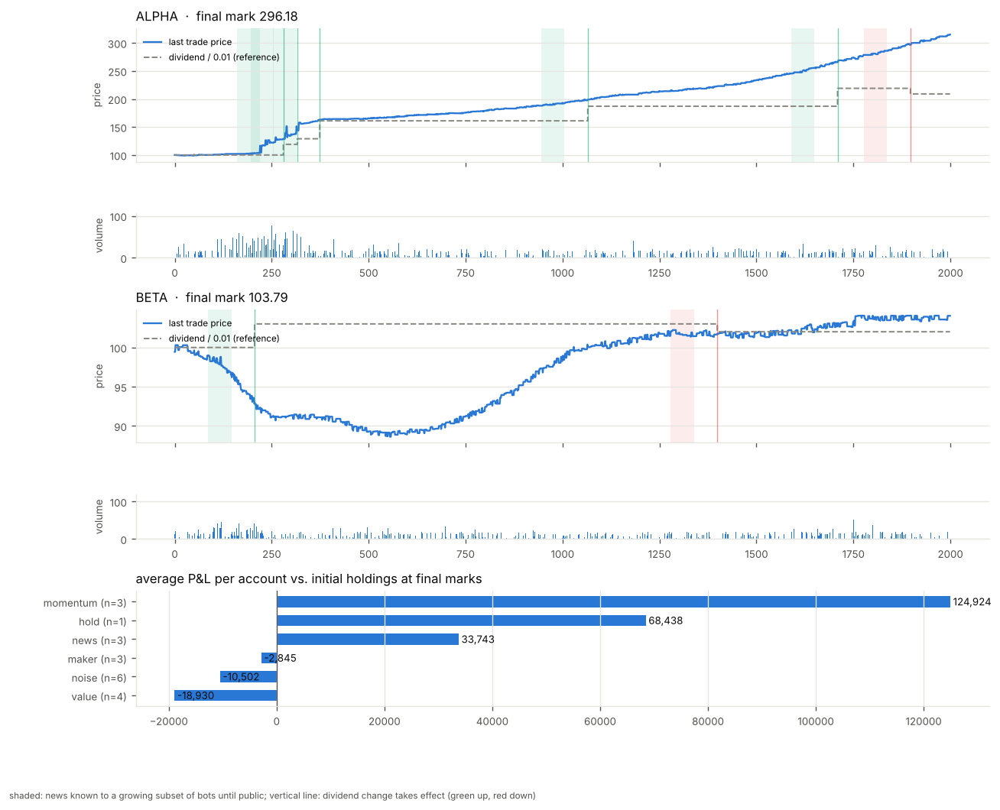

# LLM Bot Market

一个用 CPU 运行的股票市场模拟器，用来让多个 LLM 各自编写交易 bot，投放到同一个市场里互相对抗。bot 的目标只有一个：给自己赚钱。我们不按真实行情去设计 bot，而是看策略之间的博弈能长出什么样的行情。

## 市场规则

- **普通限价盘口**：价格优先、时间优先的连续撮合，支持限价单（GTC / IOC）、市价单和撤单。没有指定做市商，提供流动性的只是普通 bot。
- **禁止自成交**：默认同一个 owner（同一个作者写的所有 bot）之间不会成交，撮合时撤掉自己挂着的旧单（cancel-resting）。可以改成只按账户判断。
- **不能借钱、不能卖空**：买单冻结现金，卖单冻结股票，现金永远不会为负。
- **股息**：每个分红周期按持股（包括挂单冻结的股票）派息，由国库支付。
- **信息窗口**：股息只因新闻事件改变。每条新闻先告诉随机的一小部分账户，再逐步扩大，然后公开，最后才真正改变股息。
- **现金持有费**：每个费用周期按平均现金余额扣费；本周期的成交额按比例抵扣这笔费用，最多抵到零。全部持股不扣费，但要承担价格波动。
- **交易费**：每笔成交双方各付一个很小的比例，用来提高对敲的成本。所有费用进入国库，等于销毁。
- **整数结算**：金额都是整数分，股数都是整数，每 100 tick 检查一次现金和股票守恒。

设计考虑和每个参数的含义见 [docs/DESIGN.md](docs/DESIGN.md)。

## 运行

只需要 Python 3.11+。画图需要 matplotlib（没有也能跑，只是不出图）。

```text
python3 -m market run scenarios/baseline.toml --out runs/demo
python3 -m market run scenarios/baseline.toml --out runs/no-fee --seed 3 --set fees.carry_rate=0
python3 -m unittest discover -s tests
```

输出目录必须不存在。里面有：

| 文件 | 内容 |
|---|---|
| summary.json | 每个账户和每种策略的结果：权益、相对初始持仓的盈亏、成交额、各项费用、股息、超时和报错 |
| bars.csv | 每 tick 每只股票的 OHLC、成交量、最优买卖价、当前股息 |
| trades.csv | 公开成交记录（不含身份） |
| news.csv | 所有新闻事件的真实内容和时间表（赛后公开） |
| report.png | 价格、参考价、新闻窗口、成交量和各策略盈亏 |
| logs/ | 每个 bot 的 stderr 输出 |

基线场景 2000 tick、20 个 bot、2 只股票，在 4 核机器上约 4 秒跑完。



## 写一个 bot

bot 是一个 Python 文件，里面有一个 `Bot` 类，只能用标准库：

```python
class Bot:
    def __init__(self, start):          # 规则、账户名、随机种子、参数
        self.rules = start["rules"]

    def on_tick(self, obs):             # 每 tick 调用，返回动作列表
        return [{"type": "limit", "stock": "ALPHA", "side": "buy", "price": 9950, "qty": 10}]
```

每个 bot 运行在独立进程里，每 tick 有固定的答复时间（默认 250ms），超时就错过这一 tick；崩溃只影响它自己。完整接口见 [docs/BOT_API.md](docs/BOT_API.md)，模板是 [bots/template.py](bots/template.py)。

把 bot 加进场景文件的 `[[bots]]` 段即可上场，`owner` 用来区分作者（也决定自成交的范围）。

## 基线 bot

| 文件 | 策略 |
|---|---|
| maker.py | 双边报价赚价差，按库存偏移报价 |
| value.py | 用已知股息（包括已听说但未生效的新闻）估值，低买高卖 |
| momentum.py | 快慢均线趋势跟随 |
| news.py | 在新闻公开前按方向交易，公开后部分止盈 |
| noise.py | 在当前价附近随机挂小单 |
| hold.py | 一次性买入后持有 |

这些只是对照组，不是好策略。

## 现状和下一步

已实现：撮合引擎和规则、进程隔离的 bot 接口、新闻分批披露、持有费和成交额抵扣、六个基线 bot、报告和测试。

还没有做：多轮比赛（每轮结束后把成绩和公开数据交给 LLM 改策略再投放）、比赛之间的排行榜、更严格的安全沙盒（现在只是进程隔离加资源限制，跑不可信代码请放在容器里）。
