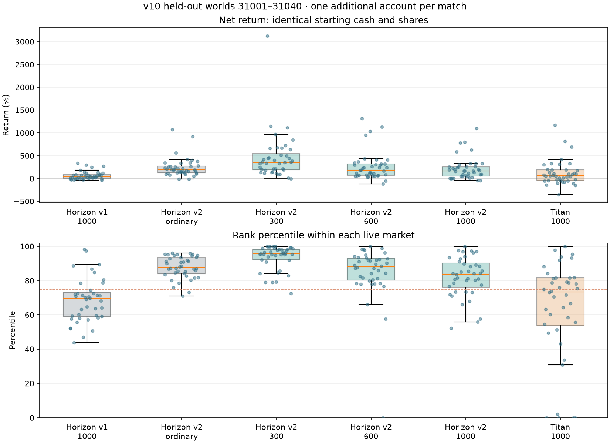

# v10：随对局时长缩放的期末兑现与 Horizon v2

此页为历史冻结记录；当前背景为 [v12](baseline-v12.md)，最新研究策略见 [Horizon v3](horizon-v3.md)。本文的新版 `horizon` 指 v10 冻结程序中的 v2；当前程序使用 `horizon_v2` 调用同一份旧代码。原始结果、冻结源码和录制没有改写。

本轮修正 3000 ticks 延长至 10000 ticks 时，期末兑现仍停留在平均 1500 ticks 的设定。新增按整局时长配置的随机期限与私人提示，同时保留旧场景的绝对单位兼容行为。没有改变新闻、股息路径、撮合优先级、决策频率、融资强平或费用。

## 期末兑现

```toml
terminal_payment_ticks = 50
terminal_ratio_range = [0.16666666666666666, 0.8333333333333334]
terminal_hint_fractions = [[0.0, 0.5], [0.3333333333333333, 0.26666666666666666], [0.6666666666666666, 0.1]]
```

随机期限相当于整局的 1/6–5/6，均值为半局，先四舍五入成 50-tick 单位，再沿用原有整数抽签。10000 ticks 时为 33–167 单位，即 1650–8350 ticks，均值 5000；5000 ticks 为 17–83，3000 ticks 恢复 10–50。不是末段剩余 ticks 的比例。

提示的两个数字分别是“发布时间占整局的比例”和“区间宽度对应的期限占整局的比例”。10000 ticks 解析为 tick 0/3333/6666，宽度 100/53/20 单位；3000 ticks 恢复原 0/1000/2000、30/16/6。所有账户仍有各自包含真值的随机区间，世界共用同一隐藏兑现单位数。

公开 Rules 提供解析后的整数范围与提示；开局估值、bot 估值和实际结算均使用这一范围，不能只提高终值而保留旧开价。当前 T1 中心开价为 `0.02 × (9999 + 5000) = 299.98 元`，再施加种子决定的 ±15%。因此相同现金、持股在 v9/v10 的初始权益会不同。

`terminal_ratio_range` 与旧 `terminal_payments` 同时配置会报错，分数提示与绝对提示也不能同时出现；避免再发生参数被静默覆盖。旧 v9 及以前的 TOML 不改动，仍使用各自绝对范围。

这会增强末段股息的价值，但不保证股价十倍。忽略取整、费用和未来再变动：初始每 tick 0.02 元的股票，按平均期限估值约 `0.02 × (10000 + 5000) = 300 元`；到 tick 9000 升至 0.30 元，约为 `0.30 × (1000 + 5000) = 1800 元`，是六倍现金流价值。旧期限下两者约为 230/750 元。新开价也同步上升，不能仅把旧开价与新终值相除。本轮没有再次提高大龙成长参数。

## Horizon v2 与实验边界

旧实现原样保留为 `horizon_v1`。新版 `horizon` 保存全部已收到消息，默认只让距生效不超过 300 ticks 的私有消息进入估值，公开消息照常使用；同一生效时刻的变化先合并。使用区间中点，不再每条扣掉 20% 宽度。区间的敏感度平方和开方仅用于缩小仓位，不改变涨跌方向，也不声称是经过校准的概率后验。部分消息缺失时，估计路径可以短暂为负；计算某段派息时取非负，但不能把内部累计差额抹掉，否则后面的恢复会被错误计算成额外增长。

现金和股票都承担闲置费，新版取消股票独有的等待闲置费折价；仅对实际融资部分估计短期利息。近期负消息已进入完整现金流路径，不再额外将仓位机械降至 30%。价格足够低、且远期恢复仍有价值时可以买入。

执行与市场适应借鉴 Titan：150-tick 的估值/价格比例平滑、20-tick 的主动成交方向辅助、分批下单、末期 400 ticks 收敛现金流价值。新消息先产生重估，随后根据市场实际反应调整，不盲目长期坚持一个理论价。开局的私人消息不会被初始价格校准抵消。风险控制与 Titan 默认一致：杠杆上限 2、单股上限 45%、单次切片 2.5% 权益。目标外库存按合理卖价分批退出；仅因目标缩小不能直接砸掉仍认为便宜的库存。估值下降到买盘可成交时正常退出，实际杠杆超过目标的 1.15 倍或权益非正时优先主动减仓。

这是一组明确的策略改造，不是单一缺陷修复，不能把收益变化全部归因于某一行公式。另设杠杆 1.2 对照，以及同样收到 1000-tick 消息、立即使用所有待生效消息的对照。普通闲置费、交易费和融资利息全部照收。默认 300-tick 激活是先导阶段选择，尚未利用更远消息提前建仓的全部潜力；不能宣称已把 1000-tick 优势用尽。

所有挑战者现金与初始持股从同场 `titan-value` 配置复制，并在每场结果中断言现金、股数、初始权益完全相等：20 万元现金、每股 200 股。Titan 背景账户仍为普通消息权限。额外账户保持普通披露倍率 1，研究组覆盖率 50%、宽度 3，仅改变最大提前量。另加同权限 Titan 对照，区分“信息优势有效”与“新算法超过成熟算法”。

新 bot 已检查不使用 seed、账户身份、文件、网络或隐藏状态；原有策略审查结论继承。实验由 `tools/research_v10.py` 保存配置、完整源码、二进制哈希和逐局结果，使用冻结后的 31001–31040 世界作正式对照；先导 7/11/23 不计入结果。

## 开发先导与冻结

先导只使用 7/11/23，没有在 31001–31040 上选参数。第一稿的全远期版本分别约 −82.8%/−62.4%/−49.1%。修正减仓择价后仍为 −75.8%/−31.6%/−38.1%，说明不能把失败全归因于成交执行。修正部分路径下限的估值问题后，全远期仍为 −77.6%/−56.8%/−67.0%；同程序、同权限，仅设置 300-tick 激活窗口的版本为 +26.7%/+125.1%/+144.7%。多线程路径不同，这些不是逐笔固定价格带上的归因实验。

因此在正式留出测试前固定默认窗口为 300 ticks，随后不再根据留出收益调整代码。初稿源码分别保存在 `runs/v10-research/horizon-pilot1.rs`、`horizon-pilot2.rs`，先导配置打包为 `pilot-configs.zip`，逐局记录没有覆盖。正式结果另列，先导收益不能并入验收。

新旧远期权限全局消息数量相同，区别是到达时间。1000-tick 账户保存更早收到的区间，在进入激活窗口时再使用；如果消息此前已公开，则优先使用收敛后的区间。不是由引擎少发消息，也没有降低决策频率。

## 40 个留出世界的结果

世界种子 31001–31040，每个世界六场，各额外加入一个挑战者，共 240 场；研究覆盖率 50%、区间宽度 3。以下为扣除全部实际费用后的净收益，分母是初始现金加初始股票市值，不是仅用 20 万元现金。每行是独立的实时竞争市场，不是同一固定价格带上的回测。

| 策略 / 最大提前 ticks | 平均收益 | 中位数 | 最差一局 | 平均百分位 | 前 25% | 胜过同场普通 Titan |
|---|---:|---:|---:|---:|---:|---:|
| Horizon v1 / 1000 | +66.95% | +39.66% | -35.71% | 68.36 | 9/40 | 2/40 |
| Horizon v2 / 普通 | +242.95% | +192.40% | -12.73% | 87.73 | 38/40 | 1/40 |
| Horizon v2 / 300 | +462.68% | +356.99% | -4.69% | 93.59 | 39/40 | 18/40 |
| Horizon v2 / 600 | +268.72% | +181.99% | -120.33% | 84.67 | 37/40 | 7/40 |
| Horizon v2 / 1000 | +219.28% | +167.59% | -48.25% | 82.12 | 30/40 | 5/40 |
| Titan / 1000 | +124.18% | +64.13% | -353.11% | 63.37 | 18/40 | 2/40 |

300 组盈利 39/40 局，达到既有的数值门槛（平均百分位至少 90、至少 80% 进入前 25%）。前 20 / 后 20 个世界的平均百分位分别为 95.29 / 91.89，进入前四分之一的局数分别为 20/20 / 19/20。这是本轮新世界的成绩，没有另跑默认 1001–1020 验收，也不改写 v6/v9 的历史记录。

同样最大提前 1000 ticks，新版平均 +219.28%，旧版 +66.95%；逐世界收益改善 31/40。新版优于同权限 Titan 的组均值，也不能由此推导所有权限下都优于 Titan。

300 组同场普通 Titan 平均 +427.82%、中位数 +403.94%；Horizon 只在 18/40 局获胜，少数大收益世界抬高了 Horizon 的均值。普通权限的新版 Horizon 只在 1/40 局胜过普通 Titan。因此不能称已经稳定压制 Titan。300 组同场标准 Swift 平均 +192.94%，小资金单次入场 Swift 平均 +678.62%；资金规模不同，不能直接将收益率差解释为纯算法差。



### 有无指定大龙

这是按世界隐藏设定进行的赛后分组，策略未读取该标签。无指定大龙仍有普通强弱趋势，并不意味着平盘。

| 策略 | 无大龙：局数 / 平均 / 中位数 | 有大龙：局数 / 平均 / 中位数 |
|---|---|---|
| Horizon v1 / 1000 | 25 / +55.86% / +34.78% | 15 / +85.45% / +80.73% |
| Horizon v2 / 普通 | 25 / +242.39% / +153.33% | 15 / +243.88% / +228.59% |
| Horizon v2 / 300 | 25 / +467.75% / +330.62% | 15 / +454.22% / +443.70% |
| Horizon v2 / 1000 | 25 / +200.50% / +119.53% | 15 / +250.58% / +221.03% |

### 使用时机与杠杆对照

均用 31001–31020、1000-tick 权限和相同资金。不同撮合路径会产生噪声，但没有为对照另选世界或调参。

| 新版设置 | 平均收益 | 中位数 | 平均百分位 | 前 25% |
|---|---:|---:|---:|---:|
| 默认：临近 300 才使用，杠杆 2 | +239.44% | +170.33% | 81.73 | 15/20 |
| 临近 300 才使用，杠杆 1.2 | +230.66% | +176.25% | 85.29 | 18/20 |
| 收到远期消息立即使用，杠杆 2 | +35.51% | +0.87% | 57.24 | 2/20 |

旧版同样 20 个世界、杠杆 1.2 的平均收益为 +70.90%。新版降回 1.2 仍为 +230.66%，因此改进并非只来自加杠杆；与新版杠杆 2 比较，均值略低但排名和亏损尾部更好。这个消融结果支持继续验证较低杠杆，没有在看过留出结果后重新修改默认参数。

结果支持当前估值/执行方式更适合较近的消息，不支持“远期信息本身无用”。完整远期版本仍未形成有效的长期建仓方式。更多信息改变重估发生的时间、同时估计的待生效路径以及价格校准；区间也不是完整未来。现有对照没有将不完整路径、校准吸收信号和等待期间风险各自的贡献完全拆开。

### 风险与解释边界

主对照最终负权益次数：旧版 1000 为 0，新版普通/300/600/1000 为 0/0/1/0，Titan 1000 为 4。这些与盘中强平和已核销坏账分开统计。

600 组 seed 31005 最终亏损 120.33%，期间没有强平。Titan 1000 的 seed 31015 最终亏损 353.11%，也没有强平：临近结束的标记市值远高于现金流兑现，借款超过最终可兑现资产。现有评分允许负权益，未将收益截断在 -100%。具体账本见 [风险记录](liquidation-audit.md#v10-补充没有盘中强平也可能期末资不抵债)。

Horizon v2 仍存在终值与市价错位、估计不完整、仓位无法按理想价退出等风险。RSS 仓位折扣不是经校准的风险模型，本轮收益不能推广为所有未来世界保证获利。

## 性能与正确性

Windows 20 逻辑核心，共享 10 核亲和性预算，release、4 个市场线程。性能比赛串行运行，种子 7/27006/28012，每种场景每个种子重复 3 次。两组使用相同冻结程序、相同背景阵容；对比的是不同终值设定下的整局成本，包含普通报告输出，不含逐 tick 录制/浏览器。

| 场景 | 场数 | 进程墙钟中位数 | 范围 | 引擎中位数 |
|---|---:|---:|---:|---:|
| v9 | 9 | 5.229 秒 | 4.959–5.701 | 4.641 秒 |
| v10 | 9 | 5.093 秒 | 4.732–5.675 | 4.556 秒 |

进程墙钟中位数变化 -2.60%。终值和提示比例只在初始化解析；市场价格、持仓和成交数量会因经济设定变化，不能将整局时差全部当作新字段的计算开销。没有降低决策频率、调整观察频率或扩大 tick 时间差。

121 项 Rust 测试全部通过，覆盖旧版兼容、随机范围/提示缩放、新闻不变、实际兑现公式、撮合价格/时间优先级、消息与现金股份守恒，以及策略信息边界和减仓/路径回归。322 场实验（24 场开发先导、240 场主对照、40 场消融、18 场计时）共 6440 次守恒审计；跳过决策 0、bot 错误 0、禁用账户 0。1013 次强平事件另逐项核对 fills、金额、股份、手续费和现金等式，差异 0。先导只用于开发，不并入正式收益表。

源码、二进制与配置已冻结保存，最终源码与冻结哈希一致；v9/v10 九对计时的 news.csv 逐字节一致，期末股息相同，只有终值设定及其交易后果不同。

九项市场质量全项通过局数（各 40）：Horizon v1 / 1000 38/40；Horizon v2 / 普通 37/40；Horizon v2 / 300 30/40；Horizon v2 / 600 33/40；Horizon v2 / 1000 32/40；Titan / 1000 34/40。没有放宽门槛；价格偏离诊断与程序正确性审计分别看待。

完整机器可读数据见 [结果 JSON](baseline-v10-results.json)；逐局原始文件、执行命令和冻结源码在 `runs/v10-research/`。

## 独立研究场景

[`scenarios/horizon-v10.toml`](../scenarios/horizon-v10.toml) 保存“v10 背景 + 一个同 Titan 资金、1000-tick 最大提前量的 Horizon v2”，与正式 `new1000` 配置逐字节一致。默认 `baseline.toml` 仍是纯背景基准。普通权限、300 和 600 组的配置及旧版对照保存在 `runs/v10-research/configs/`。

```text
python tools/swift_debugger.py run --scenario scenarios/horizon-v10.toml --out runs/horizon-v10-example --seed 31001 --threads 4 --record horizon,titan,swift,news_v2#0
python tools/swift_debugger.py serve --run runs/horizon-v10-example --port 8770
```

研究脚本为 `tools/research_v10.py`，统计为 `tools/analyze_v10.py`。现有输出目录禁止覆盖；再次运行应使用新目录或另存整轮实验。多线程市场允许不同成交顺序，录制本身也会改变时序，因此复跑不承诺逐笔及收益完全相同。

## 已生成的复盘

`runs/v10-replay/` 保存 seed 31001、同 Titan 资金、1000-tick 权限的新版 Horizon。全体背景参与，只录制 `researcher`（Horizon）、`titan-value`、两个 Swift 和 `news_v2#0` 五个账户；每个 10001 帧。现金、成交数、手续费、股息、组合收益核对均零差异，Swift 信号重算无不一致。录制源码哈希与当前一致。录制会改变异步撮合时序，收益不并入上面的 40 世界结果。

已启动本机 [复盘页面](http://127.0.0.1:8770/)。重启命令：`python tools/swift_debugger.py serve --run runs/v10-replay --port 8770`。选择 `researcher` 查看 Horizon，在“消息与交易关联”中检查本人收报、公开、生效与附近成交；这些时间关联本身不证明每一笔交易的因果。打包耗时约 80.95 秒；录制命令的墙钟字段包含等待性能测试锁，不能把它当成单局引擎耗时。
