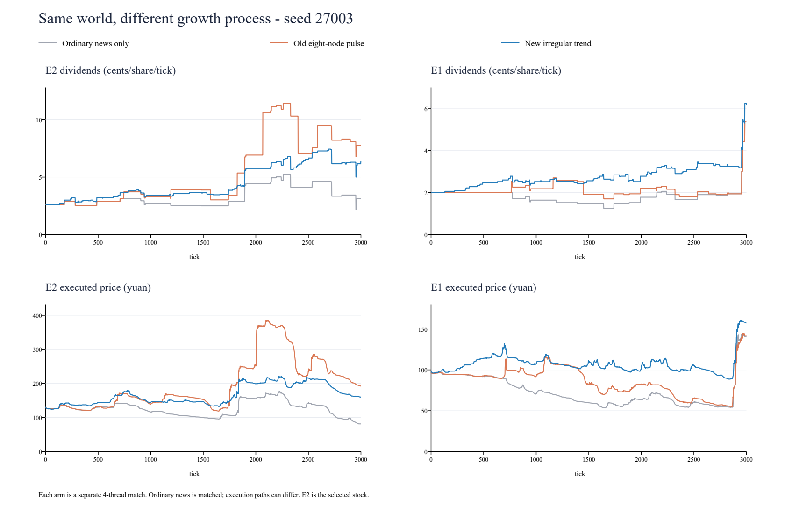

# v7：普通权限 Titan 与渐进的大龙趋势

本页保留 3000 ticks 趋势版及其固定实验，历史配置为 `baseline-v7.toml`。当前默认已升级为 [v8：1 万 ticks 长局](baseline-v8.md)；下文“当前”指本次 v7 历史实验。

当前 `baseline.toml` 与 `baseline-v7.toml` 相同。在最后一版 v6 上增加一个十倍资金的 `titan-value`：现金 200,000 元、每只股票 200 股，新闻倍率 1，正常缴纳闲置费。共 99–223 个账户、12 种策略、13 个账户组；seed 7 为 147 人。保留两个 Swift、6–16 个 NewsV2 和其余背景，不加入 Astra/Falcon，也不要求新 bot 打穿。

本次将大龙由八个大幅跳变节点改成持续的小幅经营变化。策略代码、3000 ticks、原有重大新闻、消息权限、费用、撮合和终值规则不变。**指定大龙获得持续增长倾向，不承诺一定长成或股价必涨。** 本批 16 个指定大龙有 14 个期末股息高于初始，另两个没有走出来。

旧八节点模型和此前 240 局实验完整保存在 [旧版报告](baseline-v7-pulses.md)与 [旧版结果](baseline-v7-pulses-results.json)，不能当作本版成绩。当前机器可读结果为 [baseline-v7-results.json](baseline-v7-results.json)。

## 场景边界

| 文件 | 用途 |
|---|---|
| `baseline.toml` / `baseline-v7.toml` | 当前趋势版，50% 概率指定一只潜在大龙 |
| `baseline-v7-no-dragon.toml` | 相同十倍 Titan，完全关闭附加经营过程 |
| `baseline-v7-pulses.toml` | 归档八节点模型，复现用户看到的旧图 |
| `baseline-v6.toml` / `baseline-per-tick.toml` | 原样保留的最后一版 v6，没有 Titan 或大龙机制 |

Titan 是新闻估值、市场定价适应与订单流辅助的分批调仓策略，见 [Titan 研究](titan-v6.md)。所有账户消息倍率均为 1，无费用特权。过去的一倍/十倍 Titan 容量实验属于旧模型，未在本轮重做。

## 新大龙怎样形成

系统不直接设置价格，也不命令账户买入。先生成原有三层新闻与普通股息路径 `B(t)`，再独立生成非负的额外经营股息 `G(t)`；实际派息率是 `B(t)+G(t)`。两者都通过新闻披露，等生效时间才改变派息。额外股息参与现有逐 tick 派息与期末兑现。

所有十只股票都使用同一种附加经营过程，具有阶段性强势和弱势。每只股票的局部经营强弱每隔随机 105–300 ticks 左右切换；正负扰动、回落、偶发急挫均可能发生。平静期每股每 tick 有 2% 的更新机会，动荡期为 6%；取整后股息没有改变的机会不生成新闻。

每局随机选择三个隐藏候选，三者在前 55% 的时间都有温和的正增长偏置。每局独立抽签，50% 概率从三者中指定一个后期持续性更强的候选；其余世界没有指定者。tick 1650 之后，指定者保留较强的正增长偏置，其他股票仍随局部经营阶段变化，不再按预定节点强制衰退到零。普通股票也可能持续走强，指定者也可能遭遇利空。

这不是八次固定幅度调整，也没有预定峰值或期末目标。内部潜在经营趋势逐 tick 积累，披露时小步追上：通常一次对数变化上限随机取 0.018–0.04，正向相当于“初始股息＋此前额外股息”的约 1.8%–4.1%，另有整数取整误差；每次更新有 2.5% 概率遇到额外的 6%–13% 对数负扰动，允许更急的回落。

**这个幅度约束只针对附加经营更新，不是总股息涨幅上限，更不是股价涨跌停。** 原有市场、行业、个股新闻仍可带来较大的跳变。非负的 `G(t)` 可以下降，但不会抵扣成负值；普通路径 `B(t)` 仍可跌到零。

默认参数：

```toml
[world.dragon]
model = "trend"
enabled = true
probability = 0.5
candidates = 3

[world.dragon.trend]
events_per_1000_ticks = 20.0
growth_log_bias = [1.0, 1.5]
step_sd = 0.018
max_step = 0.04
```

`growth_log_bias` 是每只股票抽取的隐藏增长强度，不是最终倍数。代码按每局时长归一化：早期候选偏置为该值的 0.65 倍，后期指定者为 1.35 倍，再叠加每阶段 −2 到 +2 的局部强弱及随机扰动。该内部尺度不等于直接增加多少股息。省略 `model` 继续使用归档 `pulses`，兼容旧场景；旧 `peak_extra` 参数仅用于 `pulses`。

## 信息边界

三个候选、指定者和未来路径不传给 bot。`Rules.dragon` 只包含公开机制参数。tick 1650 是增长倾向开始分化的时点，不是派息跳高时点；其影响先通过后续不定时更新出现，再遵守新闻披露与生效延迟。

同一种子切换有/无指定者，前 1650 ticks 的全部账户消息和股息完全相同，测试已覆盖。这保证此前不能凭已交付消息确定谁被指定；不等于无法看出某只股票已经强势，也不等于 1650 之后无法逐步判断持续性。候选之间没有一个固定加股息金额可直接识别赢家。

附加事件与普通个股新闻使用相同格式和时间规则。私人区间尺度使用普通个股新闻公式：普通基础股息（保底初始值一半）×个股冲击标准差×状态倍率；不再用旧模型的 `abs(delta)/2` 产生额外幅度线索。公开后给出精确 delta。

插入附加新闻只重排公开事件编号，不改变原有新闻的数值、私人获得者、区间内容、开价、动荡状态和终值抽签。稳定的内部抽样键与公开编号分开，不对 bot 暴露。审查继续禁止策略根据 `Start.seed` 重建隐藏世界。

赛后 `summary.json.dragon` 保存模型、候选、指定者、分化时点及逐次额外股息。`episodes` 还包含取整后未形成新闻的更新机会；分析新闻数量时只计算非零变化。`news.csv` 保存披露/公开/生效时点，`bars.csv` 保存实际总股息。赛后真相不能作为比赛中的输入。

## E2 旧图的问题与 E1 急涨原因

用户此前看到的样例是种子 27003：候选 E2、C2、E1，指定大龙为 **E2**。旧版把增长压在少数节点，确实偏离了渐进成长的要求。

同世界的 E2：旧版附加股息只调整 8 次，最大一次增加 186 内部单位，即每股每 tick **3.72 分**；新版调整 62 次，最大一次增加 11 单位，即 **0.22 分**。新版总股息初始 2.60 分、峰值 7.44 分、期末 6.38 分，中途有回落。普通新闻仍贡献过一次 1.40 分的总股息增加。



灰线关闭附加过程，橙线是八节点旧版，蓝线是新版。上排为股息（分/股/tick），下排为成交价（元）。三组普通新闻一致；四线程执行不要求成交路径逐笔一致。

**E1 并非指定大龙。** 此前链接的旧录制里，它从末段低位约 55.38 元升到约 144 元，是低点的约 2.6 倍，不是该录制中的四倍。主要原因是三条普通利好集中到来：

| 事件 | 首次私人披露 | 全面公开 | 股息生效 | E1 每股每 tick 增量 |
|---|---:|---:|---:|---:|
| 能源行业利好 | 2835 | 2895 | 2955 | +1.08 分 |
| E1 个股利好 | 2844 | 2904 | 2964 | +1.42 分 |
| E1 个股利好 | 2865 | 2925 | 2985 | +0.94 分 |

该段普通股息从 1.94 分依次升到 3.02、4.44、5.38 分，达到原来的约 2.77 倍。此世界真实期末倍数 N=47，即最后股息还要兑现 2350 ticks：对应单股普通终值从 45.59 元变为 126.43 元。消息先披露，账户会提前交易这个未来变化；所以价格在股息真正增加前就能急拉。N 是赛后真相，不代表所有 bot 当时都知道精确值。

本次保留这些普通新闻，因此新版 E1 仍有末段急涨。若要减少全市场这类行情，需要另研究普通冲击幅度、消息聚集和期末兑现权重，不能只修改大龙后便宣布问题全部消失。

旧录制：[八节点 E2/E1 样例](../runs/v7-dragon-study/dragon_titan10/seed-27003/report.html)。本轮：[趋势版](../runs/v7-trend-study/trend/seed-27003/report.html)、[八节点重跑](../runs/v7-trend-study/pulses/seed-27003/report.html)、[无附加过程](../runs/v7-trend-study/off/seed-27003/report.html)。

## 新闻频率与 3000 ticks

普通三层新闻仍按概率生成，没有固定间隔。平静时全市场合计约每 36 ticks 一条，动荡时约每 12 ticks 一条；落到某一只股票（包含市场/行业影响），理论上分别约每 182/61 ticks 一次。实际会因抽签、零变化、状态比例和比赛截断不同。

本轮 40 个固定世界的实测：

| 模型 | 每局全市场新闻平均数 | 全市场平均间隔 | 每股平均涉及新闻数 | 单股平均间隔 |
|---|---:|---:|---:|---:|
| 只有普通新闻 | 106.63 | 28.1 ticks | 20.89 | 143.6 ticks |
| 旧八节点版 | 130.63 | 23.0 ticks | 23.29 | 128.8 ticks |
| 当前趋势版 | 459.50 | 6.5 ticks | 56.18 | 53.4 ticks |

间隔为 3000/平均事件数，不是固定新闻日历。同一个市场/行业事件影响多只股票，因此“全市场新闻数/10”不等于每股新闻数。新版增加的主要是小幅经营更新，普通重大新闻数量不变。每股局内实际生效的事件平均 55.36 次；靠近结束的少量普通新闻在游戏内来不及生效。

所有事件仍在 t 首次向约 5% 账户披露，t+30 扩至累计约 25%，t+60 全面公开精确变化，t+120 才改变股息。新闻更频繁不代表传播链变短。

3000 ticks 对几十 tick 的短线操作已有很多轮机会；对完整经营周期和趋势跟踪偏短，且临近结束时终值重估影响突出。本轮保持 3000，便于只判断趋势改造。后续若扩到 6000 或更长，应同时研究费用累计、初始定价、终值占比和私人终值提示的相对时点：仅把长度翻倍会增加股息与费用、改变开价，当前固定在 1000/2000 的终值提示也会相对提前，并非纯粹增加观察时间。

## 40 世界、120 局固定对照

固定种子 27001–27040，三组为 off、pulses、trend，每世界每组一次。复用旧世界是为了比较形态，不是新的独立留出验收；参数没有按收益结果调优。release、4 个市场线程，Windows 共享 10 核预算，经 `arena_gate.py` 串行运行。

收益按每世界每组账户先平均、再跨世界平均，避免人数较多的世界权重更高。包含股息、组合、交易/库存估值并扣除全部费用。三组都保留同一个普通权限十倍 Titan。

| 策略 | 关闭附加过程 | 八节点旧版重跑 | 当前趋势版 |
|---|---:|---:|---:|
| swift-early-single | +125.19% | +164.19% | +171.94% |
| swift-standard | +105.18% | +145.63% | +131.97% |
| titan-value | +47.35% | +64.01% | +90.42% |
| hunter | +59.35% | +87.61% | +85.66% |
| coral | +30.26% | +43.76% | +67.47% |
| news_v2 | +30.78% | +56.59% | +48.61% |
| tracker | +9.75% | +18.76% | +42.79% |
| shark | +7.11% | +15.07% | +37.32% |
| value | +14.81% | +32.26% | +25.42% |
| momentum | +7.53% | +20.31% | +22.65% |
| hold | −22.95% | −18.41% | −14.07% |
| noise | −33.54% | −32.48% | −29.11% |
| grid | −47.44% | −51.83% | −45.84% |

两个 Swift 在趋势版 40 局均盈利并进入前 25%，平均百分位分别为 98.50 和 94.60。十倍 Titan 为 88.40，38/40 进入前 25%，2/40 亏损。这里是基准成员表现，不是另加挑战者后的“打穿”认证，也不能推出小资金在其他市场一定适合短线。

相对八节点旧版，Titan 平均收益增加 26.41 个百分点，33/40 世界改善；标准 Swift 减少 13.66，NewsV2 减少 7.98。小资金 Swift 增加 7.75，但仅 19/40 世界改善、配对近似 95% 区间为 −6.59 到 +22.09，不宜称其收益稳定提升。逐策略配对值及近似区间保存在 JSON；这是同世界、非逐笔固定行情的比较。

不能把增加的收益全部解释成交易能力更强：本版为所有股票提供额外经营机会，增加了现金流，也增加了消息和交易。全市场按初始权益加权的平均收益从关闭时 −17.94%、旧版 −13.38% 改为 −7.51%，仍为负。小资金 Swift 的股息贡献约初始权益的 +47.05%，交易及库存估值约 +156.32%，再加组合、扣费用；普通 Swift 的相应贡献为 +104.14% 和 +54.59%。

### 趋势形态的边界

40 世界中有 16 个抽中指定者，与旧版身份相同。新版指定者期末总股息平均为初始的 2.31 倍，14/16 高于初始；27012 的 C2 只有 0.12 倍，27033 的 E2 为 0.91 倍。前者经营噪声与普通利空压住了增长，后者曾到 1.52 倍后回落。**50% 是获得持续性偏置的概率，不是“50% 的局保底出现一只翻倍大龙”。** 当前实现保留这个风险，不能隐去两局失败后声称必然趋势向上。

40 世界×10 股中，在任意相隔 100 ticks 的收盘价之间曾翻倍的股票×局数，关闭/旧版/新版分别为 27/23/16；20 ticks 指标为 14/11/7。无成交 tick 延续最近成交价，首笔前为空；每只股票每局只计一次。新版减少了急涨案例，没有消除。单次比较同时改变经营现金流及交易行为，不能把差值全部归因为“平滑”本身。

### 正确性、市场质量与性能

104 项 Rust 测试、严格 Clippy、release 构建通过。新增/扩展测试覆盖前中期身份隔离、原有新闻及私人披露不变、非负叠加、小步增长、随机回落、公开规则字段与旧 JSON 兼容。原有价格/时间优先、消息投递、待入账成交、现金/股份守恒测试继续通过。

120 局共 720 次账务审计通过，零跳过决策、零 bot 错误、零停用。趋势版和旧版重跑均无强平/坏账；关闭附加过程组发生 4 次强平、合计 8633.74 元坏账，保留在原始结果，没有删除这些世界。

市场质量全项通过率：关闭 27/40、旧版 30/40、当前 26/40。当前失败项为双边报价不足 1 局、估值偏离 4 局、价值穿越不足 10 局，项目可重叠；没有放宽门槛。更平滑不等于所有流动性和估值指标都改善，单向趋势也可能减少价值穿越。

性能另行串行测量：release、4 线程、10 核预算；种子 27003/27006/27007，每组每种子 3 次，预热后交替执行。进程墙钟中位数：关闭 1.316 秒，旧版 1.349 秒，趋势版 1.432 秒；趋势版较旧版约慢 **6.2%**，较关闭约慢 **8.8%**。引擎内计时为 1.189/1.216/1.290 秒。没有降低 bot 决策频率；成本包含更多新闻、交付和交易，不能当作纯世界生成开销。

另用旧/新二进制分别在种子 7/11/19、单线程运行关闭与旧八节点场景，成交 CSV、新闻 CSV、全部账户现金/股份/期末权益/消息计数完全一致。性能预热 3 局、计时 27 局、兼容性 12 局，共 42 局，和 120 局策略实验分开，不算新增独立世界。

## 复现与研究记录

```text
python tools/build_release.py
target/release/llm-market run scenarios/baseline-v7.toml --seed 27003 --out runs/v7-example
python tools/research_trend.py prepare --out runs/v7-trend-repeat
python tools/arena_gate.py --cwd . -- python tools/research_trend.py run --out runs/v7-trend-repeat
python tools/arena_gate.py --cwd . -- python tools/research_trend.py performance --out runs/v7-trend-repeat
python tools/research_trend.py report --out runs/v7-trend-repeat
```

旧模型兼容性对照需在新实验目录中另保存旧版 `before.exe`；没有该文件时 performance 只做性能测量。原实验的冻结配置、Rust 源码、二进制和哈希保存在 `runs/v7-trend-study/`，`frozen-sources.zip` 是运行前快照。后续仅补充统计字段、图表、API 注释和文档；JSON 另记录最终分析脚本哈希，运行逻辑与策略不因结果改变。

绘图脚本为 `tools/plot_trend.py`，读取三个原始场景的 bars.csv，输出独立 SVG/PNG。完整市场设定见 [当前规则](market-settings-current.md)；旧八节点模型研究脚本已绑定归档场景，避免默认配置变化污染历史实验。
