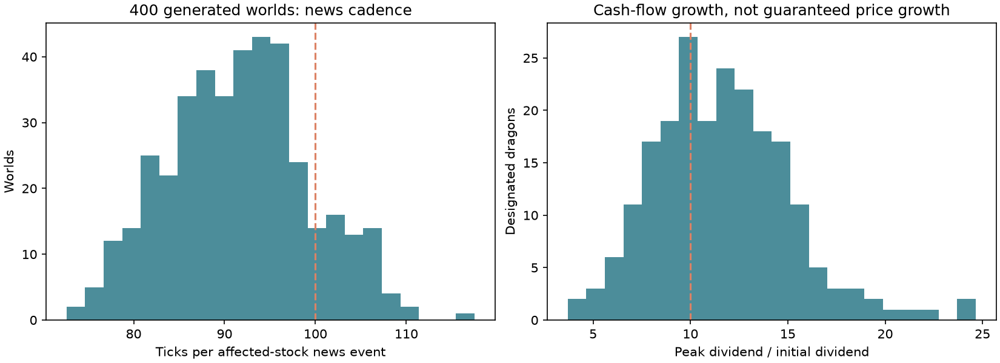
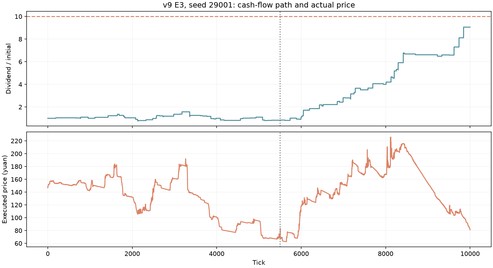
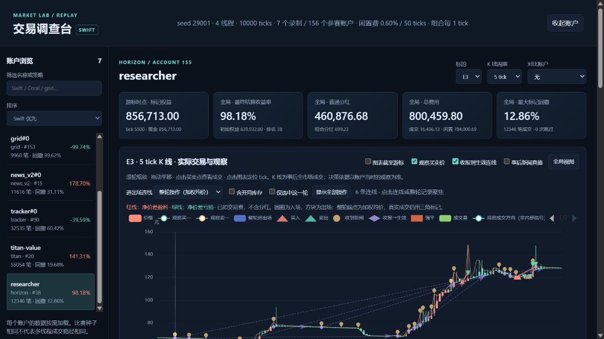

# v9：远期消息、分阶段成长与风险复盘

本页为历史 v9 研究。当前默认已更新为 [v10](baseline-v10.md)，本页原始配置、程序和结果保持归档；历史 `horizon` 在当前程序中注册为 `horizon_v1`。v9 发布时 `scenarios/baseline.toml` 与 `baseline-v9.toml` 一致。仍为 10000 ticks、99–223 个背景账户，保留普通 Swift、小资金单次入场 Swift、NewsV2、普通消息权限的十倍资金 Titan。Horizon 作为单独实验账户参加对照，不自动加入背景，也不要求有新 bot 打穿。历史 v8/v7/v6 配置保留。

## 本轮实现

1. **独立远期权限**：最大提前量、覆盖率、区间精度分别配置。普通披露仍为最早提前 120 ticks，远期研究可提前到 300/600/1000 ticks；更早只改变消息到达，不提前改变派息。当前背景所有账户关闭额外权限。
2. **新 `growth` 路径**：所有股票都有经营阶段变化，三个候选前中局共同温和成长，50% 世界指定其中一个在 55% 后继续发展。随机阶段、回落和急挫打断上升；没有指定股价轨迹。
3. **Horizon 策略**：使用合法收到的未来现金流区间、按生效时间积分、等待成本、近期利空后的分批建仓和风险限制。资金、初始股数均为普通 bot 十倍。策略与测试口径见 [独立文档](horizon-bot.md)。
4. **独立风险证据**：每次强平保存真实成交、前后现金和股份、坏账核销。复盘可联动消息收报、生效、进出场与强平。案例见 [强平与坏账](liquidation-audit.md)，操作见 [交易调查台](swift-debugger.md)。

大龙身份保护不是仅隐藏一个名称：原首次披露晚于 tick 5500 的所有未来事件，在此之前都不得通过远期权限投递。即使事件编号因后续增长路径发生变化，也不能通过提前看到这些编号泄漏身份。普通消息、世界随机路径和其他账户的投递抽签不受某一账户权限影响。

## 世界形态

先做世界生成实验，不运行 bot、不依据策略收益挑参数。固定 400 个种子 30001–30400，额外经营更新机会从 5/1000 调整为 3.5/1000，以接近单股约 100 ticks 一次消息；正向单步对数上限为 0.16，实际限制独立随机为其 60%–100%。保留初版 5/1000 世界结果供比较。

- 400 个世界中 214 个被指定大龙，符合 50% 随机概率的抽样波动。
- 单股消息平均间隔：各世界均值 **91.63 ticks**。包含市场、行业、个股和经营更新；同一事件的重复披露不重复计数，排除局内尚未生效事件。
- 指定者的最高股息 / 初始股息：中位数 **11.35 倍**；185/214 达到 8 倍，139/214 达到 10 倍，范围 **3.70–24.66 倍**。
- 214 个指定者都存在至少 10% 的股息回撤。成长目标会受更新等待、经营波动和独立普通新闻影响，并不是每局保底兑现十倍。

**这些是分红倍数，不是股价承诺。** 价格由 bot 撮合决定，期末越来越近也会缩短剩余现金流期限。“最低点到后来最高点”另存为 `dividend_trough_to_later_peak`；同时记录零股息持续时间，避免用除零或极小分母包装十倍。成交价需结合实际 bars/trades 单独看。

图例为 seed 29001、额外 300-tick 研究账户参加的真实比赛，指定 E3：股息最高为初始的 9.06 倍、先前正数低点到后续峰值为 11.74 倍，包含 38 次实际向下更新。实际成交全局最低 62.62 元、最高 231.67 元，高低比约 **3.70 倍**。图中价格与股息走势分别显示，不将股息直接当作成交价；十倍成交行情尚未作为稳定达成的结果。

## 对照设计与可复现资料

冻结策略、场景和可执行文件后，使用 29001–29040 共 40 个世界，分别运行普通权限、300/600/1000 ticks 最大提前量四组，共 160 场。三档远期权限覆盖率均为 50%，宽度均为 3 个事件标准差；原普通消息倍率都是 1。每场仅追加一个 Horizon，现金 20 万元、每股 200 股，费用不减免。

普通与远期组同时改变了信息覆盖和时间，不能把二者差异全部解释为“多出多少 ticks”的纯时间收益；三档远期组则保持覆盖、精度与策略代码相同。异步撮合不要求逐笔复现，增加消息会改变交易和其他 bot 的反应。这是可交易世界的对照，不是在完全相同的价格带上回放。

原始数据：`runs/v9-research/` 中的 `manifest.json`、`sources.zip`、冻结二进制、`configs/`、`pilot.json`、`bench.json`、`batch.json`、逐局 CSV/HTML/summary。汇总为 [结果 JSON](baseline-v9-results.json)。脚本为 `tools/research_horizon_news.py` 和 `tools/analyze_v9.py`。

## 160 场固定策略结果

收益均为相对于初始权益的净收益，已经承担闲置费、交易费和利息，包含派息及期末兑现。

| Horizon 权限 | 平均收益 | 中位收益 | 盈利局数 | 平均排名百分位 | 进入前 25% |
|---|---:|---:|---:|---:|---:|
| 普通 | −19.57% | −22.50% | 9/40 | 52.54 | 0/40 |
| 最多提前 300 ticks | +134.55% | +120.44% | 40/40 | 82.53 | 26/40 |
| 最多提前 600 ticks | +79.24% | +74.15% | 38/40 | 75.00 | 17/40 |
| 最多提前 1000 ticks | +28.80% | +33.97% | 30/40 | 64.52 | 7/40 |

**四组都没有达到原有打穿门槛：平均排名百分位至少 90，且至少 80% 的局进入前四分之一。** Horizon 全部无强平、无坏账。三档远期权限每局平均收到 379.35 条额外研究；相对相同世界的普通组，收益改善分别为 40/40、39/40、37/40。

这支持“额外研究对当前策略有价值”，不支持“看得越远越强”。同一策略会同时纳入更多尚未生效且区间较宽的变化，保守折价会累积，进场时机和持有等待也随之改变。300/600/1000 组每局平均成交数分别约 21564、16179、11558。**目前没有做逐项消融，不能确定保守估计、等待成本和执行时机各解释多少差异。** 更好的策略可以选择忽略信息或晚些交易，不能推导出信息本身有害。

平均每局普通组支付闲置费 57.15 万元；三个研究组分别 91.89、79.90、71.06 万元。300 组分红约 35.99 万元、交易及库存/期末估值残差约 144.11 万元，承担闲置费等支出后剩余为净收益；不是免除费用或单靠领分红获利。

### 对背景 bot 的影响

下表每个世界先对同策略背景账户求平均，再对 40 个世界等权平均；两种 Swift 分开列。普通组也是“v9 + 一个普通 Horizon”，不是无挑战者的纯基准，更不是 v8 对 v9 的纯机制消融。

| 背景策略平均收益 | 普通组 | 300 组 | 600 组 | 1000 组 |
|---|---:|---:|---:|---:|
| Swift 小资金单次入场 | +373.31% | +395.30% | +396.05% | +384.37% |
| Swift 标准 | +289.52% | +285.72% | +300.61% | +288.41% |
| Titan 普通权限十倍资金 | +338.05% | +313.76% | +325.88% | +334.97% |
| NewsV2 | +132.57% | +137.71% | +142.47% | +134.85% |
| Coral | +167.35% | +131.72% | +140.92% | +158.88% |
| Tracker | +18.66% | −25.36% | −24.78% | −13.32% |
| Grid | −98.28% | −98.26% | −98.26% | −98.25% |

强策略并未被 Horizon 普遍超过，资金规模也不同，不据此断言百分比收益差都来自策略优劣。Grid 等旧策略在长局和高闲置费下严重失血，是下一轮策略维护对象；本轮没有为改善排名而替换或调弱它们。

## 性能与验证

Windows 20 逻辑核心，统一亲和性预算 10 核，市场 4 线程，release 构建，所有比赛通过 arena gate 串行。没有降低 bot 决策频率或更改最大 tick 偏差。计时种子 7、27006、28012，各重复三次，每种配置九场。

| 场景 | 完整进程墙钟中位数 | 范围 | 引擎墙钟中位数 |
|---|---:|---:|---:|
| v8 对照，同一新版程序 | 4.891 秒 | 4.190–5.407 秒 | 4.473 秒 |
| v9 | 5.014 秒 | 4.453–5.301 秒 | 4.501 秒 |

完整墙钟中位数增加约 2.5%。计时包含普通报告写出，不包含逐 tick 调试录制和浏览器渲染；这也不是改变引擎之前的旧二进制对新二进制纯开销比较。两组都使用新增风险记录的程序，主要比较世界设定改变后的运行成本。

110 项 Rust 测试通过，涵盖既有撮合价格/时间优先级、消息、结算、现金股份守恒，以及新增权限兼容性、其他账户投递隔离、远期区间真值、前中局身份保护、Horizon 只依赖观察及强平成交核对。前端关联函数另验证按游标截断、重复消息合并和成交/强平窗口。新代码运行前经过信息边界审查。

同种子的旧 v8 `news.csv` 与本轮 v8 对照逐字节一致，期末股息与隐藏终值也一致；撮合结果允许不同。旧录制已在新界面验证可打开，缺少风险字段时不会虚构记录。

合计 184 场非逐 tick 录制比赛（6 场先导、18 场计时、160 场正式对照），**3680 次守恒审计全部通过，跳过决策、bot 错误和禁用账户均为零**。602 次强平事件逐项核对真实成交数量、现金、股份、手续费及核销，差异为零。九项市场质量检查在四组分别通过 40/40、38/40、40/40、40/40，原门槛未放宽。

累计坏账约 749.78 万元，其中 v8 的九场计时对照贡献 748.43 万元，v9 九场为 35.01 元。这是小样本尾部事件，不能据此认定 v9 消除了信用风险。巨额坏账的具体流动性链条和已发生利息的延后结算，见 [风险案例](liquidation-audit.md)。

## 可直接检查的录制

`runs/v9-replay/` 保存 seed 29001、1000-tick 研究权限的一局完整记录，共 156 个参赛账户，只为 7 个账户保存逐 tick 决策以控制数据量。两种 Swift、Horizon、Titan、NewsV2、Grid、Tracker 均可选择，其他账户完整参与撮合。

7 个账户各有 10001 帧，现金、成交数、手续费、股息、组合收益核对全部为零差异，Swift 信号重算没有不一致。这一局没有发生强平，风险页会如实显示空记录；强平调查使用上面的真实风险案例，不将另一局事件混进当前回放。调试录制会改变异步时序，因此不要求与批量实验逐笔相同。

启动：`python tools/swift_debugger.py serve --run runs/v9-replay --port 8769`。在“消息与交易关联”页查看本人收报→公开→生效以及附近真实成交；勾选“图表截至游标”可限制关联记录为当时已收到的消息与成交回报。时间接近只表示关联，不证明交易因果。

浏览器实测：Horizon 的 E3 在 tick 0 只列出当时已投递的 3 条远期研究；推进至 5500 列出 49 条，消息 #449 此时区间仍是 −32..49、关联成交为零。关闭游标限制后可看到该消息后续收敛至 8..8、关联窗口内买卖各 318 股；点击记录会定位图表并展示逐次区间及真实成交。风险页正确显示本局没有记录，旧录制兼容检查亦通过。

## 诊断分层

- **程序正确性**：守恒审计、消息投递、撮合优先级和账户流水核对，失败必须调查。
- **世界形态**：单股消息计数/间隔/最大空窗、股息倍数、零股息时间、回撤、峰值时刻。单局均值 60–150 ticks 暂作为“接近 100”的宽松诊断带；指定者达到 8 倍、存在回撤另列，不与程序正确性混用。
- **原有市场质量**：原九项阈值保留；估值偏离和穿越不足不是引擎错误或盈利策略无效的证明。
- **风险现象**：强平、卖不出的剩余持仓、坏账核销和真实成交单独记录。允许出现，不为通过“质量”而消除。

强平案例复现的巨额损失与账本守恒可以同时成立。那体现的是标记权益与可变现收入的区别，以及当前 treasury 兜底规则；不能因为守恒通过就声称风险很小。

## 补查：15 倍以上股息是否已经出现

没有进行“专门把成长目标提高到 15 倍”的配对干预实验。另从既有 40 场普通 Horizon 对照中检索指定者，发现两局股息峰值已经超过初始的 15 倍：

| 世界 / 指定者 | 股息峰值 / 初始 | 股息峰值 tick | 成交价先低后高倍数 |
|---|---:|---:|---:|
| 29003 / T1 | 19.50 | 9960 | 4.44 |
| 29037 / C3 | 18.22 | 9944 | 5.84 |

成交统计读取各局 `bars.csv` 的实际 low/high，低点分别在 tick 223、851，后续高点在 2554、9681；两局的有序涨幅也等于全局高低比。因此，“股息超过 15 倍并不保证十倍成交行情”已有样本支持，但两局不能替代改变目标的实验，也不能据此认定资金不足是原因。末段峰值对应的剩余派息期限已很短，期末兑现又只按有限单位计数，这会削弱股息倍率对剩余现金流价值的放大。

资金与流动性要分开测：成交不会消灭付给卖方的现金，当前还存在融资和 treasury 派息，因此初始现金不是市值的硬上限；但愿意在高价接盘者的可用购买力和盘口深度仍有限。若要检验现金约束，应固定世界与股数，改变初始现金/授信，再观察成交价、深度和强平，而非仅根据未涨十倍倒推原因。
