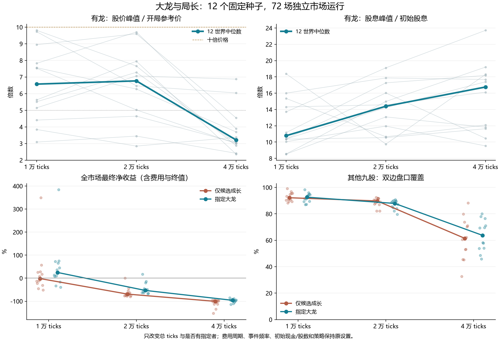

# 大龙价格、局长与市场影响调查

2026-10-20。沿用 v15 的 16 种策略和资金、费用设定，未修改默认场景、bot 或引擎。种子固定 81001–81012，局长 10,000 / 20,000 / 40,000，各做“指定大龙持续成长 on”与“仅候选成长 off”，共 72 场。每个格子 12 个世界，各重复一次，4 工作线程，Windows 共用半机 10 核预算，release 串行运行。

实测大龙股价峰值中位数随三种局长依次为 **6.57 倍 → 6.77 倍 → 3.22 倍**。在 10,000 ticks 中，有龙相对仅候选成长的全市场净收益配对差中位数为 **+26.33 个百分点**，12/12 个世界为正。加长局、增加持续成长、市场健康是三个不同问题，以下分别核对。



## 为什么股息十多倍，价格常只有四五倍

此前 4.80 倍是 11 个世界的**股价峰值中位数**，不是所有大龙都低于五倍，更不是价格上限。本轮倍数仍以真实开局参考价为分母，五倍指价格达到开局的五倍，不是上涨 500%。

开局参考价约为 `初始股息 × (全局剩余派息 + 期末兑现期限的公开中点) × 开价扰动`。在当前 10,000-tick 场景，平均兑现 5,000 ticks，开价约对应 15,000 ticks 的现金流。大龙成长目标高点仍在全局 87%–97%，提前至 1/3 的是成长起点。到 90% 时，即使股息变成 12 倍，剩余 1,000 ticks 加平均 5,000 ticks 兑现，平价估值比例只有 `12 × 6,000 / 15,000 = 4.8`。

这是一把“此后股息保持当前水平”的估值尺，不是强制成交价格，也没有把未来成长当作已知事实。终值真实期限可能高于或低于平均值；消息、私人终值提示、库存、供需和策略报价都会改变成交价。已经派出去的分红进入持有者现金，股价只对应未来机会，不能拿股价倍数代表含分红的总收益。

同样假设股息 12 倍、时点 90%，终值期限若取公开范围两端的约 0.167T / 0.833T，这把尺分别约为开局价的 **2.1 / 7.5 倍**（忽略开价扰动）。所以不同世界即使股息峰值接近，价格峰值仍可明显不同。

成长目标来自 `growth_log_bias=[2.3,2.65]`，对应约 10–14 倍量级的“初始＋额外股息”目标，叠加普通路径、经营阶段及波动。它不承诺十倍成交价；普通新闻路径没有同样的上限，其他股票也能大涨。

专门复核上轮“4.80 倍”的同一批 11 个世界：股息峰值中位数 13.00 倍，出现在全局 93.8% 附近；价格高点时点中位数为 88.9%，当时股息倍数中位数 10.64。价格高点当时的平价估值/开价中位数 3.84，成交高价/平价估值中位数 1.31。高点前累计已派股息/开价中位数 1.88，把已派现金加回价格后的财富倍数中位数为 6.69（未扣费用）。这批数据与下面的新种子实验分别列出，不混合计算。

## 加长局能否解决

在股息路径的相对形状不变时，设当前位于全局比例 f、股息为初始 g 倍、终值期限为 αT，则价格比例的简化尺为：

`g × (1 − f + α) / (1 + 0.5)`（暂忽略开价 ±15% 扰动）。

T 在分子分母中抵消。当前代码会让开局价格、成长阶段和终值期限一起随 T 增长，因此单纯增加 ticks 不会机械地把四五倍变成十倍。若仍在 90% 才到高点、终值取平均值，同一估值尺达到十倍需要约 **25 倍股息**；更早达到高股息也能提高剩余现金流权重。

实际模拟并非纯粹拉伸时间：每 tick 的新闻概率不变，所以长局经历更多普通冲击；经营更新次数更多；每 50 ticks 的收费和融资周期不变；bot 的固定 tick 观察窗口也没同比放大。初始每户现金与股数固定，但开价升高，初始现金/库存价值比例改变。这些都会影响实测，不能把差异全部归因于“成长时间更够”。

| 总 ticks | 有龙价格峰值中位数 | 均值 | 至少五倍 | 至少十倍 | 股息峰值中位数 | 全局收盘价最大回撤中位数 |
|---|---:|---:|---:|---:|---:|---:|
| 10,000 | 6.57 | 6.59 | 9/12 | 0/12 | 10.79 | 47.8% |
| 20,000 | 6.77 | 6.50 | 9/12 | 0/12 | 14.40 | 64.9% |
| 40,000 | 3.22 | 3.76 | 2/12 | 0/12 | 16.76 | 73.4% |

- 20,000 相对 10,000 ticks：价格峰值倍数提高 7/12；配对相对变化中位数 +6.3%。
- 40,000 相对 10,000 ticks：价格峰值倍数提高 1/12；配对相对变化中位数 -47.2%。

同一 seed 在不同局长下不是相同现金流路径的逐点复现；上表是固定种子集合的配置实验，不是单一世界的时间轴缩放证明。全局回撤包含尾段，后验最高价也不表示 bot 能以该价卖出大量持仓。

本轮使用纯 v15 背景并强制每个实验世界都有指定者；上轮 Osprey 研究使用另一批种子，且多一个普通研究账户。不能把两批价格倍数的差异全部归因于某一个因素。

| ticks | 股息高点时点中位数 | 股价高点时点中位数 | 股价高点时的平价估值/开价中位数 | 成交高价/该平价估值中位数 | 股价高点前已派股息/开价中位数 |
|---|---:|---:|---:|---:|---:|
| 10,000 | 97.4% | 82.1% | 4.92 | 1.33 | 1.82 |
| 20,000 | 92.9% | 90.0% | 5.89 | 1.12 | 1.99 |
| 40,000 | 96.8% | 42.9% | 3.33 | 1.02 | 0.50 |

平价估值使用当前股息与赛后真实终值期限，未来股息不变；真实期限仅用于离线解释，没有传给 bot。每列各取中位数，不能把中位数相乘来重建另一列。已派股息是未逐 tick 取整、未扣费用的每股现金流机会，不是账户实得净收益。

## 大龙对市场的影响

on/off 两组均启用经营成长，保留同一批候选，只切换是否有指定者持续成长。每对的账户人数、初始现金/股份/权益、期末期限完全一致；另外九只股票的完整股息路径一致，指定者在分化点前也一致。所有 bot 代码经审查，现有策略不读取 `Rules.dragon`。因此本比较估计的是“增加这一条持续成长路径”的市场效果，不能理解为删除所有强势股。

| ticks | 全市场净收益中位数 off → on | 配对净收益差中位数（百分点） | 全市场净收益增加 | 指定股后段成交额占比中位数 off → on | 每 tick 成交笔数中位数 off → on |
|---|---:|---:|---:|---:|---:|
| 10,000 | -1.5% → +25.0% | +26.3 | 12/12 | 12.5% → 16.6% | 78.3 → 77.4 |
| 20,000 | -69.2% → -53.0% | +15.8 | 12/12 | 9.8% → 15.2% | 54.9 → 56.2 |
| 40,000 | -100.5% → -96.2% | +9.1 | 11/12 | 11.0% → 10.4% | 24.5 → 22.9 |

“全市场净收益”是所有账户最终权益之和 / 初始权益之和 − 1，已扣费用并按实际终值结算，不是策略平均排名。表内两组中位数之差不等于配对差中位数。成交额占比会随股价升高而提高，股数成交占比另存结果 JSON，不能据成交额占比单独断言资金从其他股票撤出。

大龙会带来系统支付的额外分红和更高的期末兑现机会，因此不是纯零和：持有者赚钱未必完全对应其他 bot 的损失。同时，持仓、融资、费用和流动性竞争会重新分配收益，排名也可能变化。下面直接检查其他九只股票，而不是从大龙涨价推断“必然抽干其他股票”。

| ticks | 其他九股成交额/tick 的配对相对变化中位数 | 其他九股平均期末价/开价的配对差中位数 | 双边盘口覆盖配对差中位数（百分点） | 相对价差配对差中位数（百分点） |
|---|---:|---:|---:|---:|
| 10,000 | +0.8% | +0.040 | -0.93 | +0.016 |
| 20,000 | +4.1% | +0.017 | -2.03 | -0.020 |
| 40,000 | -0.1% | -0.003 | +3.88 | +0.015 |

先在每个世界内对另外九股取均值，再做 on/off 配对。其他股票的股息一致，价格、成交和盘口仍可能受到财富、仓位和订单变化影响。它们是整个交易系统的反应，没有单独识别每条传导链的因果份额。

10,000 ticks 下各策略的排名变化（按世界等权，表按平均百分位变化排序；不用于调参）：

| 策略 | on−off 平均百分位差 | 账户平均收益的配对差中位数（百分点） |
|---|---:|---:|
| shark | +5.61 | +13.43 |
| tracker | +3.66 | +16.59 |
| hold | +2.22 | +13.35 |
| hunter | +0.82 | +29.20 |
| coral | +0.58 | +57.64 |
| horizon | +0.49 | +262.67 |
| grid | +0.09 | +0.35 |
| tide | -0.04 | +65.47 |
| swift | -0.15 | +82.85 |
| noise | -0.19 | +4.45 |
| kestrel | -0.23 | +142.85 |
| momentum | -0.63 | +31.48 |
| titan | -0.83 | +36.37 |
| news_v2 | -0.83 | +26.23 |
| value | -1.44 | +27.05 |
| profit_effect | -2.54 | +1.40 |

## 长局成本和质量

闲置费仍是每 50 ticks 平均权益的 0.6%，成交可抵扣。只作一个隔离示例：完全没有收入、价格变化和抵扣时，按每期扣 0.6% 近似，10,000 / 20,000 / 40,000 ticks 后剩余比例约为 **30.0% / 9.0% / 0.8%**。这不是实际账户预测，但说明加长会显著增加收费轮数。融资利息每 50 ticks 0.3% 也不随局长缩小。

| ticks | 组 | 亏损账户占比的世界中位数 | 曾触发强平账户占比中位数 | 强平触发总次数 | 原有市场质量全项通过 | 单场模拟墙钟中位数，秒 |
|---|---|---:|---:|---:|---:|---:|
| 10,000 | off | 64.4% | 0.0% | 29 | 8/12 | 4.46 |
| 10,000 | on | 58.5% | 0.0% | 15 | 8/12 | 4.51 |
| 20,000 | off | 95.8% | 2.5% | 82 | 1/12 | 8.54 |
| 20,000 | on | 85.4% | 5.0% | 126 | 0/12 | 8.74 |
| 40,000 | off | 99.4% | 41.2% | 4945921 | 0/12 | 15.88 |
| 40,000 | on | 99.4% | 35.9% | 3651279 | 0/12 | 15.34 |

“强平触发次数”可能包含同一账户反复触发，不能当作爆仓账户数。代码在没有对手盘时无法继续出售；仍持有股票的账户不满足“股份清零后核销现金债务”的条件，因此还可能反复尝试。期末按实际股息兑现后，剩余负债也可能超过资产，净收益可以低于 −100%。这属于本模型的风险结算结果，不能将所有亏损都简单归因于手续费。

闲置费的一部分还以销毁股份收取，所以不仅现金受损，可交易的股份数量也会改变。下表各项均取世界中位数，“后 1/3 双边盘口覆盖”是在最后三分之一时间里，对全部股票盘口采样是否同时有买卖报价计数。

| ticks | 组 | 初始现金/总权益 | 期末剩余股数/初始股数 | 后 1/3 双边盘口覆盖 | 期末负权益账户占比 |
|---|---|---:|---:|---:|---:|
| 10,000 | off | 17.9% | 74.4% | 84.8% | 0.0% |
| 10,000 | on | 17.9% | 73.2% | 85.5% | 0.0% |
| 20,000 | off | 9.8% | 37.1% | 80.4% | 0.0% |
| 20,000 | on | 9.8% | 37.3% | 76.0% | 0.0% |
| 40,000 | off | 5.2% | 14.1% | 26.9% | 9.4% |
| 40,000 | on | 5.2% | 14.7% | 27.3% | 3.1% |

原有质量失败项及场数（可重叠，未放宽门槛）：

- 10,000 / on：max_gap_ticks=3, two_sided_share=4
- 10,000 / off：max_gap_ticks=3, two_sided_share=4
- 20,000 / on：max_gap_ticks=12, two_sided_share=10, trade_coverage=6, median_abs_log_dev=2, share_beyond_2x=3
- 20,000 / off：max_gap_ticks=11, two_sided_share=9, trade_coverage=6, share_beyond_2x=2
- 40,000 / on：trade_coverage=12, max_gap_ticks=12, two_sided_share=12, share_beyond_2x=9, median_abs_log_dev=1
- 40,000 / off：trade_coverage=12, max_gap_ticks=12, two_sided_share=12, median_abs_log_dev=1, share_beyond_2x=11

全市场收益可以因为股息增加而改善，同时仍有大量账户亏损或某些流动性检查失败；这两者不冲突。要研究“更长的交易时间”而不改变经济负担，需要另做费用、事件率和策略窗口的时间尺度实验，本轮没有混入这些调整。

## 证据与复现

本轮没有修改 Rust、策略或引擎，沿用上一轮已通过 165 项 release 测试的程序。离线开价重建与此前 200 个真实 Start 股价逐项一致，并与每场所有账户初始权益核对。全部 3360 次现金/股份守恒审计通过，全部账户零 bot 错误、停用、跳过；有龙/无龙配对逐 tick 核对上述股息一致性。

72 场模拟核心累计 693.69 秒，含程序输出写盘的子进程累计 776.68 秒，整批 939.24 秒。每配置每 seed 一次，无性能预热；这些是调查成本，不是严格速度基准或引擎优化结论。局长越大处理的 ticks 越多，但账户活跃度也会变，不能仅按耗时比例推断单位工作效率。

冻结配置、源码 ZIP、二进制与哈希、计划和逐场输出位于 `runs/dragon-duration-v15/`。汇总及逐世界数据见 [dragon-duration-results.json](dragon-duration-results.json)。默认仍为 v15 的 10,000 ticks；此调查未修改默认设置。

```sh
python tools/arena_gate.py --cwd . -- python tools/research_dragon_duration.py dragon-duration-replay
python tools/report_dragon_duration.py
uv run --with matplotlib --python 3.12 python tools/plot_dragon_duration.py
```

复跑使用新的目录名。汇总脚本默认核验本次固定归档，并不自动把重跑成绩覆盖进本次结果；多线程交易路径不保证逐笔复现。
