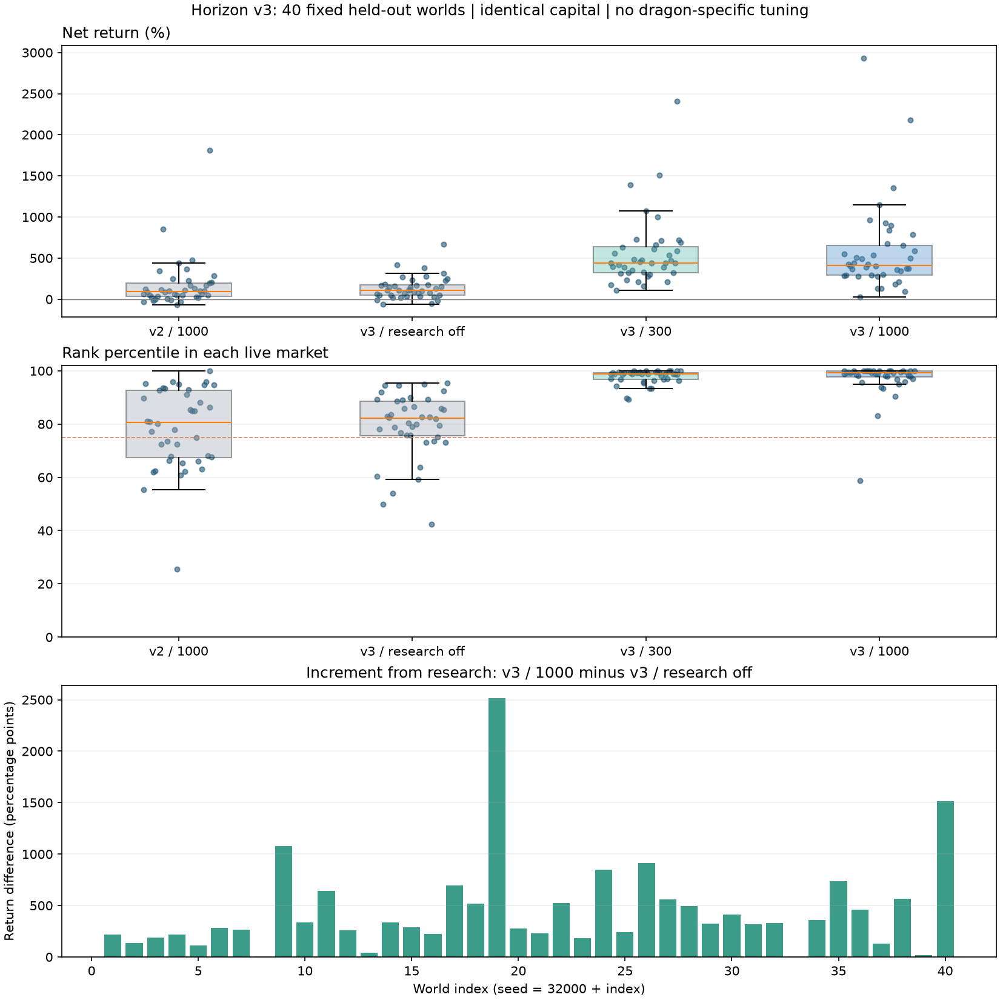

# Horizon v3：持续研究、暂时利空与分批建仓

本页记录在固定 v11 背景中另加候选账户的研究。之后用户已要求将新版加入基准，当前默认为 [v12](baseline-v12.md)：v3/1000 接替旧 Horizon 位置。这里的冻结数据、独立研究场景和 8771 录制仍保留原阵容，不作为 v12 的重新验收成绩。

本轮目标是改进一般新闻交易，不根据大龙身份、生成阶段或特定股票调参。`horizon` 为 v3；旧代码逐字节保存为 `horizon_v2`，原始版本为 `horizon_v1`。世界、股息、收费、融资、强平与调度规则没有在本轮改动。

## 改了什么

旧 v2 收到远期消息后，默认到距生效 300 ticks 才纳入交易估值。更远的消息虽被保存，但没有直接支持早期建仓；同时，用含私人研究的价值追随市场价校准，可能逐渐把私人信息产生的估值差消掉。

v3 保留 Titan 风格的普通交易核心：普通消息现金流估值、150-tick 市场溢价校准、20-tick 主动成交方向，以及限价拆单。额外研究不会进入这个快速校准。所有已经收到、尚未生效的研究消息则构成另一条现金流路径，不设 300-tick 启用门槛。同一时点的变化先合并；未掌握完整路径时允许内部累计股息暂时为负，仅实际支付估计取非负，避免把下跌后恢复错误算成额外增长。

当研究路径相对普通消息路径的价值增加超过 2%，且存在未来正变化，就建立持续计划。计划保存建立时的市场溢价基准，此后不会因价格横盘而自动抹掉私人信息差；新消息仍会更新现金流、临时低谷与计划期限。只使用本人收到的区间中点，宽度的 RSS 敏感度用来缩小仓位，不声称是经过校准的概率预测。

研究仓位分阶段进入：

1. 已知更近的坏消息尚未生效、当前价格仍高于估计低谷价格的 103% 时，研究目标只放出 20%。
2. 价格已提前跌入该区间，或坏消息已经生效，放到 65%；因此不必死等固定日期才抄底。
3. 接近计划期末 120 ticks 时，放到 100%。通常计划到最后一条已知正变化生效后 100 ticks，后续消息可延长。

这些比例针对**研究目标**，不是全账户的硬持仓比例：普通交易核心可以独立建立仓位，已有且仍合理的研究库存也不会仅因阶段比例变小而被机械卖掉。未放出的研究额度形成全账户建仓预留，上限为权益的 30%。每次下单通常不超过权益的 2.5%；拆单是执行控制，分阶段目标与预留才是分批建仓逻辑。

公开消息会提高信息精度，不是自动卖点。价格已反映收益会降低目标；如果后续消息使计划价值低于现价 5%，且研究路径不再优于普通路径，就取消研究计划。普通核心仍可根据自己的估值交易，所以“取消计划”不等于强制全平。

等待期间按实际融资比例估计借款成本；现金持有也缴闲置费，因而不再单方面把全部闲置费扣在买入方案上。默认目标杠杆上限 2、单股权益权重上限 45%。最后一成对局时间（至少 400 ticks），以终值提示下界、当前股息和已知不利变化估算兑现资产；借款超过其 70% 时停止加仓并尝试小片减仓。它不能保证低流动性时顺利退出，也不修改引擎强平线。

## 可以检查的行为

新增 10 项自动测试，覆盖：收到 700 ticks 后的恢复消息即建立计划；先小仓、下跌后加大；价格提前到位可以加仓；公开消息不清除计划；重复市场校准不抹掉研究基准；坏消息可取消原判断；缺失路径不制造虚假增长；关闭研究时普通核心与 Titan 相符；关闭研究时终值风控也不使用额外消息；标记杠杆健康但终值资产不足时减仓；不同 seed、身份和权限元数据不改变相同观察下的动作，负权益不加仓。部分断言合并在同一项测试中。

全工作区 release 测试 **131 项通过**。代码已检查：不读隐藏世界、未来真值、种子反推、账户身份、文件或网络；不使用大龙规则字段或固定股票身份。观察频率与每 tick 决策保持不变。

## 实验设计

固定背景为 [v11](baseline-v11.md)：v10 原有阵容加一个冻结的 Horizon v2，最大提前量 300 ticks。研究账户、固定 Horizon 与 Titan 的初始现金都是 20 万元、每股 200 股，初始权益逐局核对相等；均正常缴费，普通新闻倍率为 1。

先导种子 7、11、23 不计入验收。正式种子预先写入 `runs/horizon-v3-research/plan.json`，为 **32001–32040**；代码和参数在正式运行前冻结，之后不按结果调整：

| 组 | 策略与额外研究 |
|---|---|
| `v2_long` | 旧 v2，最大提前 1000 ticks |
| `v3_control` | 新普通交易核心与风控，收到但完全不用额外研究 |
| `v3_short` | v3，最大提前 300 ticks |
| `v3_long` | v3，最大提前 1000 ticks |

各组额外覆盖率都为 0.5、区间宽度 3 倍标准差。1000 是最大提前量，不代表每条消息提前 1000 ticks，也不代表知道全部未来。前 20 个世界另跑“取消分阶段/资金预留”和“取消终值债务风控”两个消融。性能另用纯 v10/v11、种子 7/27006/28012，各重复三次。所有比赛串行，release、4 个工作线程、Windows 10 核共享亲和性预算。

先导 v3/1000 三局收益为 +14.4%、+201.6%、+412.7%，旧 v2/1000 为 −48.0%、−29.7%、+3.9%；v3/300 三局仍都更高。先导发现关闭研究的对照仍在终值风控里读取不利研究消息，正式冻结前隔离并补测试；先导原始结果与源码保留，没有覆盖，不冒充与正式版本完全相同的对照。

## 固定参数结果

每组 40 个世界，均为最终权益相对初始权益的净收益，**包含普通/组合分红及期末兑现，已扣成交费、闲置费和融资利息**。不是只统计买卖价差，也未免除任何费用。

| 组 | 平均收益 | 收益中位数 | 最差收益 | 平均排名百分位 | 前 25% | 胜同场 Titan |
|---|---:|---:|---:|---:|---:|---:|
| 旧 v2 / 1000 | +176.58% | +91.07% | −69.19% | 78.44 | 23/40 | 6/40 |
| v3 / 不用额外研究 | +138.51% | +108.52% | −58.60% | 79.45 | 31/40 | 1/40 |
| v3 / 300 | +559.42% | +441.88% | +111.26% | 97.79 | 40/40 | 34/40 |
| v3 / 1000 | +583.42% | +413.32% | +29.87% | 97.00 | 39/40 | 33/40 |

新版远期组在 **38/40** 个世界胜过旧版远期组，在 **40/40** 个世界胜过关闭额外研究的对照，平均增加 444.91 个收益百分点；最小增量 7.69 个百分点。因此本轮收益改善不能只归因于借用了 Titan 的普通交易核心。新版远期组也在 32/40 局胜过同场固定 Horizon v2/300 对手。

但 v3/1000 只在 **19/40** 个世界胜过 v3/300，逐世界收益差的中位数为 **−17.44 个百分点**，最差一成世界的平均收益也更低（+97.50% 对 +163.51%）。它的组均值略高，主要受部分大收益世界影响；不能说越早知道消息越好。seed 32008 是保留的失手例子：v3/1000 仅 +29.87%，旧 v2/1000 +343.18%；新版也不是每种行情都更强。

两档新版都达到原排名门槛（平均百分位至少 90、至少 80% 世界前 25%），但它们有十倍资金及明确的研究权限，不能移植成普通账户或 Swift 的新成绩。40 局也不代表未来世界盈利保证。



前 20 / 后 20 个世界的远期组平均收益分别为 +568.49% / +598.35%，排名百分位 96.49 / 97.51，两半均达到上述排名门槛。按世界事后分层，无指定大龙的 21 局平均 +394.38%、中位数 +365.05%，有指定大龙的 19 局为 +792.36%、+507.20%。这是结果分层，没有用于调参；无指定大龙仍有普通冲击与候选经营波动，不能解释为无新闻市场。

## 分批与期末风控的消融

均为相同的前 20 个世界、1000-tick 权限；只改变指定开关。正式结果之后没有据此改默认参数。

| 版本 | 平均收益 | 中位数 | 最差 | 盈利局 | 前 25% |
|---|---:|---:|---:|---:|---:|
| 完整 v3 | +568.49% | +392.69% | +29.87% | 20/20 | 19/20 |
| 不分阶段、不预留后续额度 | +657.51% | +483.57% | −21.33% | 19/20 | 19/20 |
| 不启用终值债务风控 | +532.62% | +393.01% | +71.37% | 20/20 | 19/20 |

**分批并非本轮平均收益最优。** 不分阶段版在 15/20 个世界胜过完整版本，平均多 89.01 个百分点，但出现亏损局，最差一成均值 +52.07%，低于完整版 +63.52%。分批机制确实工作，却付出了等待成本；不能把新版全部进步都说成分批的功劳，也不能用两个尾部样本证明普遍降低风险。当前保留预先固定的分批版本，不按这批结果追涨改参。

关闭终值风控后，均值下降，但中位数和最差局略好；两个版本都没有期末负权益或盘中强平。自动测试证明风险条件成立时会减仓，这批市场样本还没有证明它消除了期末破产风险。

## 利润与市场影响

v3/1000 每局平均金额拆分（万元）：

| 项目 | 金额 |
|---|---:|
| 交易及库存价值变化，含期末兑现 | +341.79 |
| 普通分红 | +479.25 |
| 组合分红 | +9.11 |
| 闲置费 | −301.89 |
| 融资利息 | −63.19 |
| 成交费 | −12.90 |
| 最终净利润 | **+452.16** |

此处交易及库存项是权益恒等式的剩余部分，不等于只统计已实现价差；不能把分红和期末兑现再重复计入利润。该组没有坏账豁免。远期仓位的股息、费用与融资规模都很大，盈利不是单纯靠公开消息前后快进快出。

需要记录的市场副作用是**成交连续性变差**。旧 v2/1000、关闭研究对照、新 v3/300、新 v3/1000 的原市场质量全项通过率分别为 13/40、31/40、11/40、5/40。远期组的长成交空窗检查 35/40 未过，成交覆盖率 21/40 未过，双边报价 11/40 未过；估值偏离和两倍偏离各 8/40，项目可重叠。价差、深度、价值穿越和波动聚集检查全部通过。没有放宽门槛，也没有把账户高收益当作市场整体改善；成交变稀的机制尚未单独消融拆清楚。

## 验证与性能

总计 **230 局**：12 局先导、160 局正式对照、40 局消融、18 局纯背景计时；不是 230 个独立世界。4600 次引擎守恒审计通过，bot 错误、禁用与跳过决策均为零；611 次全市场强平事件逐笔核对成交金额、手续费、现金、股份与坏账，差异为零。131 项 Rust release 测试通过。

冻结源码、二进制与配置哈希核对通过；旧 Horizon v2 与改造前源码逐字节相同。40 组正式世界的外生新闻一致，纯 v10/v11 九对计时的外生新闻、最终股息和终值抽签一致。原始报告及 [机器汇总](horizon-v3-results.json) 保留。

| 纯背景场景 | 次数 | 进程墙钟中位数 | 范围 | 引擎中位数 |
|---|---:|---:|---:|---:|
| v10 | 9 | 4.928 秒 | 4.285–5.198 秒 | 4.473 秒 |
| v11，增加固定 Horizon v2 | 9 | 4.832 秒 | 4.329–5.091 秒 | 4.429 秒 |

两者接近，不能把约 2% 差异宣称为加速；这比较的是增加固定对手的整体影响。策略本身在正式组中的平均单次决策耗时，旧 v2/1000 为 8.17 微秒，新 v3/1000 为 12.89 微秒，v3/300 为 9.20 微秒。新版远期计算更贵，但仍远低于 2000 微秒门槛；每 tick 决策，没有靠降频换性能。

## 复现与解释边界

已录制固定首个测试世界 seed 32001，数据在 `runs/horizon-v3-replay/`，本机服务为 [8771 复盘](http://127.0.0.1:8771/)。选择 `researcher` 是新版 Horizon，`horizon-incumbent` 是旧版固定对手；同页还录有 Titan、两个 Swift 和 NewsV2。六个账户各 10001 帧，现金、成交数、成交费、股息、组合收益和库存核对均零差异，Swift 重建无不一致。录制二进制和源码与实验冻结哈希一致，打包耗时 68.09 秒。

```text
python tools/swift_debugger.py run --scenario scenarios/horizon-v11.toml --out runs/horizon-v3-example --seed 32001 --threads 4 --record horizon,horizon_v2,titan,swift,news_v2#0
python tools/swift_debugger.py serve --run runs/horizon-v3-example --port 8771
```

既有 8770 的 v10 录制保留。录制会改变异步交易时序，收益不并入主测试；同一 seed 的页面结果不必等于正式样本。启动器记录的录制墙钟包含等待性能测试锁，不能拿它衡量单局引擎速度。

运行入口为 `scenarios/horizon-v11.toml`，额外账户名为 `researcher`；固定对手名为 `horizon-incumbent`。完整研究脚本 `tools/research_horizon_v3.py` 保留逐局命令、结果、源码压缩包及二进制/配置哈希；既有目录拒绝覆盖。再次整轮运行须另存输出目录。

额外信息是否有收益，主要看同一世界中新 v3/1000 与关闭研究对照的差异。相对旧版改善，还同时包含普通核心、估值、建仓和终值风控的变化，不能全算作“远期消息收益”。不同权限的真实收报时间、持仓和市场反馈也不同，多线程成交允许波动，同 seed 并非逐笔重放。

这仍不是识别真实长期趋势的通用模型。收到的消息只有部分覆盖，临时坏消息之后未必真的恢复；被冻结的市场溢价基准也可能过时。行为测试能证明分批机制存在，不能替代跨世界收益与消融。无论平均收益多高，都不能承诺每次下跌买入有效。
