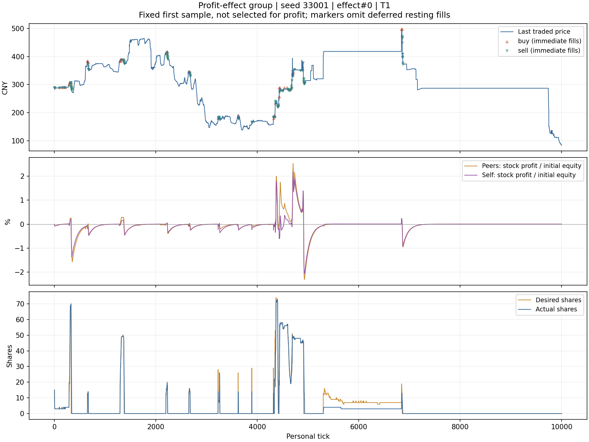

# 赚钱效应／亏钱效应群体：ProfitEffect

这是行为模拟策略，目标是让一组有限资金账户因彼此的实际赚钱、亏钱经历改变仓位。不是为了打穿收益排名，也不强制制造泡沫。已按用户选择纳入 [v13 正式基准](baseline-v13.md)，独立研究场景继续保留。

后续更新：[少数成员追市场领涨股](profit-effect-leaders.md)。当前 `scenarios/profit-effect-v12.toml` 已启用该权重；原场景保存在 `scenarios/profit-effect-v12-original.toml`。本文下方的 33001–33020、80 局结果属于更新前版本，保留作历史对照。

## 信息和行为

- 仅同一个 `social_group` 中的账户分享近期、逐股票的盈亏贡献。接收者看到其他成员的等权平均，不含自己的重复计数，不含组外账户信息。
- 不增加传播延迟、社交网络或新闻故事。看到已发布的最新观察就能反应。现有异步调度仍允许少量个人 tick 差异，没有新增全市场同步。
- 不使用理论估值、新闻、远期研究、期末兑现提示、盘口买卖方向或 K 线形态。盘口仅用于下单和数量约束；市价标记仅用于记账和换算股数。
- 组内赚钱、自己赚钱、可选的简单价格变化加权决定目标仓位。敏感度、同伴权重、自己权重、价格权重、入场阈值、亏损敏感度按账户有所不同。`Start.seed` 仅用于参数差异，不反推隐藏世界。
- 盈利刺激越强，愿意配置的资金越多；亏损刺激压低仓位，强信号可清仓。清仓后不会因为亏损记忆淡去就自动买回；需要新的正向信号。
- 无故意套牢装死逻辑。缺少买盘或卖价太远时，可以出现“想卖但未成交”。未成交不能记作已退出。

每个账户沿用自己的初始持仓比例作为中性起点，不先统一抛空再强行买回。没有初始股票的账户也能因同伴盈利而加入；如果全组从现金开始、价格也不变，则不会凭空出现赚钱故事。

## 盈亏口径

对每只股票，先计算两个已结算观察之间的实际经济盈亏，单位为分：

```text
本次持仓市值 − 上次持仓市值
+ 卖出实收金额 − 买入实付金额 − 实际交易费用
+ 实际到账股息
− 非交易股份变动 × 本次标记价
```

最后一项排除闲置费销毁股份等转移。它们仍然降低账户总收益，但不会冒充“这只股票跌了”。组合收益、闲置费和利息只进入自己的账户整体净收益；不硬分摊给某只股票。坏账豁免不算赚钱。

盈亏采用 100 ticks 的指数记忆：旧贡献经过 100 ticks 剩约 36.8%，不是固定延迟，也不是只保留最近 100 ticks。信号除以该账户初始权益，成为“这只股票近期赚亏了初始资金的百分之多少”。它不是买入价收益率，避免极小持仓的一次暴涨压过整个群体。

其他成员各自归一化后等权平均，包括暂未持仓者的零贡献。退出后已赚到或亏掉的钱继续在记忆中衰减，不因卖完即消失。浮盈允许传播，因此同伴盈利也可能来自本群体买入推动的价格；这里没有假定这部分浮盈都能兑现。

分享只在成员实际收到观察时更新，未行动账户保留最后发布的快照；因此慢账户或被禁用账户的陈旧快照是当前简化的边界。正常组员每 tick 都决策。整个接口不提供未来数据。

## 默认参数和执行

| 参数 | 默认及账户差异 | 作用 |
|---|---|---|
| `sensitivity` | 1.0，±60% | 总体反应强度 |
| `peer_weight` | 1.0，±50% | 其他组员的盈亏 |
| `own_weight` | 0.6，±50% | 自己在该股的盈亏 |
| `price_weight` | 0.15，±80% | 简单近期价格变化，设 0 可关闭 |
| `leader_weight` | 策略默认 0；当前研究场景约三分之一成员取 0.5/0.8/1.1 | 额外追近期上涨领先的股票，详情见更新文档 |
| `leader_min_return` | 0.005 | 领涨候选的近期价格变化记忆须超过 0.5% |
| `loss_weight` | 1.5，±30% | 对负贡献的放大 |
| `threshold` | 0.15，±70% | 信号需要达到的强度 |
| `confidence` | 0.25 | 自己账户净收益对总投入意愿的影响 |
| `cap` | 30% | 单股目标上限 |
| `clip` | 2% | 单次订单约占权益的上限 |
| `chase` | 3% | 相对最近成交价愿意追价的边界 |

参数在场景中显式指定时，不再对该参数加个体差异。股票盈亏贡献以初始权益的 0.3% 作信号尺度；价格变化以 3% 作尺度。这只是固定的行为标尺，并非训练得到的最优参数。

总目标股票仓位最多 95%，只使用实际可用现金，不借款、不做空。正常有对手价时用带价格限制的 IOC，部分成交照实记账；没有可接受对手价时挂限价单。不同股票轮换处理，保留现有动作数和自成交约束。股数差小于约 0.5% 权益时不做微量再平衡，但清仓不受该门槛阻挡。

## 独立对照设计

`tools/research_profit_effect.py` 先按照 v12 的原始规则为每个种子抽出所有组的人数，再固定人数，把 Noise 组的一半（向下取整）替换成研究账户。账户顺序、初始现金、股份、普通新闻权限、Horizon 权限和总人数保持一致。这样新增配置组不会改变人口抽样，也不是加钱造成的市场差异。

预先固定种子 33001–33020，每种情况一局，共 80 局；每局 10000 ticks、4 个市场工作线程，Windows 进程及其子进程共用 10 个逻辑核。四组为：

1. `noise`：相同位置仍为原 Noise。
2. `full`：完整收益效应。
3. `peer_off`：同一策略，但同伴权重设为零，仍有自身盈亏和价格权重。
4. `price_off`：同一策略，但价格权重设为零，靠组内和自身实际盈亏。

正式统计前冻结源码、配置、二进制及哈希，没有按这 20 个世界选择参数。对照组交易会改变其他人的交易，因此同种子并不保证相同行情；核对的是相同的外生新闻、期末兑现和初始资产。

另用原 v12 场景比较改动前后 release 二进制：种子 7、27006、28012，各重复 3 次，交替顺序、串行运行；单线程另外核对逐笔成交、新闻和最终资产完全一致。

## 调试证据与复现

原始观察新增 `social`；`debug-run` 记录 `profit_effect` 信号、目标仓位，并用独立实例重放同一次观察，核对生成订单是否一致。此核对检查记录准确性，不替代独立行为测试。

复盘界面已显示同伴／自身盈亏贡献、总信号、目标股数与实际持股；逐 tick 快照还显示自己的账户净收益记忆、简单价格变化记忆和同伴数。图中的盈亏百分比以初始权益为分母，不能解读成这一笔买卖的回报。

```powershell
python tools/arena_gate.py --cwd . -- python tools/research_profit_effect.py all
python tools/arena_gate.py --cwd . -- python tools/analyze_profit_effect.py
```

脚本拒绝覆盖已有比赛目录。既有结果位于 `runs/profit-effect-study/`，冻结文件位于其中 `frozen/`；重跑整套实验应先为新研究指定新的输出目录，不删除旧证据。

可直接运行的 `scenarios/profit-effect-v12.toml` 固定了种子 7 抽到的人数，用于交互调试；变更它的世界种子不会重新抽人数。研究脚本为每个种子单独生成对应人口的场景。

检查包括实际部分成交与费用、退出后的利润记忆、股息与闲置费分离、坏账排除、组外隔离、复用观察不串账户、固定价格下盈利买入/亏损卖出、关闭同伴权重、现金不足、敏感度差异和残余小仓位退出。完整 Rust release 测试共 141 项通过。

## 本轮结果：20 个世界、80 局

每个世界替换 9–21 个 Noise 账户，研究组平均只占全市场初始权益的 **4.93%**。以下先在每个世界对组内账户取平均，再对 20 个世界等权平均；不是挑选表现最好的成员。

| 情况 | 群体平均净收益 | 每账户平均成交次数 | 全市场平均成交笔数 | 市场质量全项通过 |
|---|---:|---:|---:|---:|
| 原 Noise | −69.84% | 2,912 | 704,247 | 11/20 |
| 完整收益效应 | **−56.97%** | 5,874 | 757,832 | 9/20 |
| 关闭同伴权重 | −59.58% | 8,223 | 789,964 | 7/20 |
| 关闭价格权重 | −64.63% | 511 | 693,975 | 13/20 |

完整策略相对 Noise 平均少亏 12.87 个百分点，在 17/20 个世界改善。相对关闭同伴权重，平均改善 2.61 个百分点、12/20 个世界改善；这个样本只支持小幅、并不稳定的帮助。四组的**世界内群体平均收益**在所有 20 个世界都为负，不等于每个成员都亏损。

前半批曾呈现关闭同伴权重更好的情况，完整样本反转了这个比较。这里保留全量结果，不沿用阶段性印象。11 个有指定大龙的世界中，完整组平均收益 −52.51%；另外 9 个世界为 −62.42%，两类均未获得群体正收益。

### 亏钱从哪里来

完整组按初始权益归一化后的平均贡献：

| 项目 | 对净收益的贡献 |
|---|---:|
| 交易、库存与期末兑现残差 | −18.75 个百分点 |
| 普通股息 | +18.73 个百分点 |
| 组合收益 | +0.19 个百分点 |
| 闲置费 | −54.00 个百分点 |
| 交易手续费 | −3.14 个百分点 |
| 利息 | 0 |

残差包含库存价格与期末兑现，不能叫作纯已实现交易亏损。闲置费影响很大，但价格交易与库存本身也没有赚钱。群体没有获得费用豁免或额外资金。

### 重要发现：全组退场后，内部赚钱故事会枯竭

逐笔核对全部 20 个世界的完整组及关闭价格权重组，见 [成交时段统计](profit-effect-activity.json)：

- 完整组每账户平均 5,874 次成交；每个世界中都没有成员在后 5000 ticks 完全不交易，期末完全空仓的成员比例平均 33.34%。
- 关闭价格权重后，每账户平均只成交 511 次；**92.25% 的成员在后 5000 ticks 完全不交易**，期末 97.38% 完全空仓。比例先在世界内计算，再对世界等权平均。
- 关闭价格权重组的成交主要集中在前 1000 ticks：每账户平均 447 次；最后 1000 ticks 仅 2.77 次。完整组对应为 1,137 次和 323 次。

这与当前规则相符：全组退出某只股票后，没有持仓就不会再产生该股浮盈或股息；旧的已实现盈亏又会衰减。没有正向新经历时，组内平均值本身很难重新点燃购买。少量简单价格变化权重提供了一个外部触发。这是当前“仅组内分享＋清仓后等待正信号”设计的反馈边界，不证明任何真实社会中的传播过程都如此，也不是说必须增加复杂技术分析。

### 市场副作用

完整组使全市场平均成交笔数增加 **7.61%**，但连续性没有因此改善。每局先取各股最大无成交间隔的中位数，再对世界取中位数，该指标从 122.25 ticks 升至 216.5 ticks；最长间隔检查失败从 9/20 局增至 11/20 局。双边报价不足从 3/20 局增至 5/20 局。总成交增加可以与部分股票长时间没人交易同时发生。

现有质量检查未修改。群体仅占约 5% 初始权益，这轮也没有证明能稳定形成全市场泡沫或改善所有股票流动性。

### 性能和核对

- 80 局共 **1600 次守恒审计通过**，0 bot 错误、0 禁用、0 跳过决策；研究群体无强平。
- 原 v12 不开启分享的前后对照：release、10 核进程预算、4 工作线程、3 种子各 3 次。整局墙钟中位数 **4.838 → 4.864 秒（+0.55%）**；范围分别 4.530–5.208 秒、4.581–5.134 秒；引擎中位数 4.4665 → 4.4679 秒。
- 活跃研究场景中，完整组整局墙钟中位数 4.587 秒、Noise 4.656 秒；这是不同交易行为的端到端耗时，不能用于断言分享计算本身“加速”。完整组单次 bot 决策平均约 1.16 微秒，不含引擎构造观察和分享的时间。
- 两个单线程兼容世界：逐笔成交、新闻、最终现金、股份和排名完全相同。既有撮合、消息投递和结算没有被修改。
- 额外录制的种子 33001 中，两个成员共 **20000 次决策的订单复核一致**；每人 10001 帧，现金、成交数、手续费、股息、组合和库存核对差异均为零。

复盘在 `runs/profit-effect-study/trace`，本次本地服务为 `http://127.0.0.1:8772/`。这是额外录制的一局，异步执行下不宣称等同于同种子批量实验的逐笔路径。`decisions-effect-0.csv` 和 `decisions-effect-1.csv` 位于研究输出目录，包含逐 tick 信号、目标、持股、订单数量和即时成交均价。复盘界面的完整成交记录还包含延后回报的挂单成交。

下图固定展示第一个世界、第一名录制成员、第一只股票，没有按收益挑图。上下两条仓位曲线分开显示想持有多少和实际持有多少；成交标记仅画即时回报的部分。



全部数值见 [结构化报告](profit-effect-results.json)。上述研究完成时正式 v12 阵容未变更；随后已将带少数领涨成员的版本纳入 [v13](baseline-v13.md)。这些历史结果不改称 v13 成绩。
