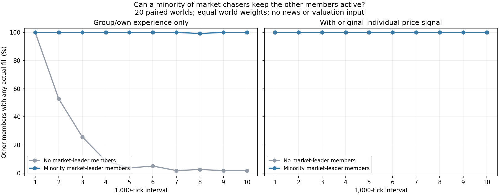

# ProfitEffect：少数成员追市场领涨股

这次增加一个外部入场来源：即使组内没人持股、没有新的盈利故事，部分成员也会因为“市场上这只股票最近涨得好”而入场。其后实际产生的浮盈、亏损、费用和到账股息进入原有组内分享。目标是补充行为动机，不是保证群体盈利。现已纳入 [v13 正式基准](baseline-v13.md)；下面的 80 局仍为晋级前的固定人口对照。

## 规则

原有 `price_weight` 对每只股票自身的简单价格变化加权；新 `leader_weight` 比较同一账户此刻看到的所有股票，偏好其中的上涨领先者。

- 复用 100 ticks 指数衰减的价格变化记忆。每次观察累计本次可见成交价相对上次价格的变化；它不是严格的 100 ticks 区间涨幅，更不是从开局累计涨幅。
- 只有记忆值 **超过 +0.5%** 的股票才是候选，按该值从高到低取前两名。相同值按股票索引打破平局。全市场下跌或平淡时，不能把“跌得最少”当作领涨入场。
- 第一名获得完整加分，第二名获得一半；加分随正涨幅增加，上限对应记忆值 +6%。权重越高、个人敏感度越高，倾向投入越多。
- 组内和自身亏损仍能压过这项加分。沿用单股 30%、总股票目标 95%、单次订单约 2% 权益的限制，只用可用现金，不借款或凭空增加资金。
- 成员清仓后可被新正向行情重新触发。跌出前两名会失去本项加分，但**不是一条独立的强制卖出指令**；退出仍由原有盈亏、价格信号、仓位和执行规则决定。信号归零也不会自动恢复中性初始持仓。
- 不读新闻、估值、隐藏大龙身份或未来价格；盘口只用于确定能否成交及数量。

令 `r` 为该股价格变化记忆、`rank` 为入选名次，加入原始信号的量为：

```text
leader = leader_weight × min(r / 0.03, 2) / rank
总信号 = sensitivity × (原有同伴、自身、价格信号之和 + leader)
```

复盘字段 `leader_contribution` 已乘个人敏感度，因此可与总信号直接比较。默认权重为零，旧场景不自动启用。当前独立研究场景中，`effect#0、#3、#6……` 启用，权重依次循环为 0.5、0.8、1.1；其他人仍只使用原先的信息权重。比例约三分之一，成员数量取整造成少量差别。

## 对照设计

新固定种子 34001–34020，每局 10000 ticks、4 个工作线程，Windows 共用 10 个逻辑核，所有比赛串行，每个世界每种配置一次。参数在统计前冻结，没有按收益挑参数或种子。

| 配置 | 全体原价格权重 | 约三分之一成员的领涨权重 |
|---|---|---|
| `group` | 关闭 | 关闭 |
| `group_leaders` | 关闭 | 开启 |
| `full` | 原有默认值 | 关闭 |
| `full_leaders` | 原有默认值 | 开启（当前场景） |

每个世界按 v12 的原规则抽取人数，再替换一半 Noise。四组账户位置、初始现金、初始股份、新闻权限与外生新闻相同；它们的交易可以改变后续市场价格和其他 bot 行为。另把每组拆成拟启用领涨的成员和其余成员，避免只看全组成交增加就误称带动了同伴。

这轮研究执行时，正式默认仍为 v12，实验账户尚未加入。随后按用户要求晋级 v13；正式版保留跨种子随机人数，参数与机制沿用本文，具体阵容和晋级核验见 [v13](baseline-v13.md)。

## 结果：能带动同伴，但不保证赚钱

20 个世界共 80 局，每组 9–21 人，研究组平均占全市场初始权益 **4.71%**；启用领涨权重者平均占组员的 **35.26%**。所有均值先在每个世界内对成员平均，再对世界等权平均。

| 配置 | 全组平均净收益 | 每成员平均成交次数 | 其余成员后 5000 ticks 完全不交易 | 全市场平均成交笔数 |
|---|---:|---:|---:|---:|
| 仅组内／自身经历 | −66.53% | 368 | **94.29%** | 687,486 |
| 仅组内／自身经历＋少数领涨成员 | −61.61% | 4,619 | **0%** | 745,790 |
| 原完整版本 | −60.39% | 5,793 | 0% | 757,943 |
| 原完整版本＋少数领涨成员（当前场景） | −63.10% | 6,774 | 0% | 775,803 |

关闭原价格权重后，少数领涨成员确实让其余成员重新活跃，而不只是自己交易：其余成员平均成交次数 **369 → 3,086**，最后 1000 ticks 平均成交 **0.20 → 141.69** 次。20 个世界中没有成员在后 5000 ticks 完全无成交；这不等于所有成员每 tick 都交易。

原完整版本本来已靠每人的价格信号维持活跃，新权重主要增加了追涨成员自身的交易。它不是所有成员活跃度都改善的证据。



**重要副作用：跟随者可能更活跃、却亏得更多。** 按固定成员身份拆开看：

| 配对 | 拟启用／已启用领涨成员的平均收益 | 其余成员的平均收益 |
|---|---:|---:|
| 仅经历 → 加少数领涨成员 | −66.48% → −44.13% | **−66.56% → −71.08%** |
| 原完整版本 → 加少数领涨成员 | −60.25% → −57.06% | **−60.43% → −66.40%** |

第一组全组平均改善 4.93 个百分点，在 11/20 个世界改善；第二组全组平均恶化 2.71 个百分点，仅 8/20 改善。四种配置的世界内全组平均收益在 20 个世界中均为负，不等于每名成员都亏损。这个实验支持“外部上涨能使组内经历继续产生、继续驱动交易”，没有证明跟随是好投资，也没有证明某个成员的亏损直接转移给了哪个追涨成员。

### 市场和性能

成交总量增加，但部分股票更不连续。当前场景对比原完整版本：市场质量全项通过 **9/20 → 8/20**；每局各股最大无成交间隔中位数，再跨世界取中位数，**232.5 → 302.25 ticks**。最长间隔检查失败 **11 → 12 局**，双边报价不足 **7 → 9 局**。这些现象与交易集中于热门股相容，但本轮没有进一步拆分因果。

同一 release 构建，20 个种子各一次、4 工作线程、10 核预算、交替配置顺序、串行运行：原完整版本墙钟中位数 **4.852 秒**，当前版本 **4.720 秒**；范围分别 **4.112–5.582**、**3.938–5.811 秒**。这是行为及成交路径一起改变的端到端耗时，样本没有显现明显整局变慢，不能把略快解释为排序加速。全组单次决策平均耗时 **1.115 → 1.267 微秒**；新增排名计算只在启用的成员中进行。没有降低任何 bot 的决策频率。

144 项 Rust release 测试通过；80 局 **1600 次守恒审计通过**，0 bot 错误、0 禁用、0 跳过决策；研究组无强平。两个单线程完整世界（7、27006）关闭新权重后，与上一版本的逐笔成交、新闻、最终现金、股份和排名完全一致。此次没有改撮合、消息投递或结算。

### 可以直接检查的入场

新回放：<http://127.0.0.1:8773/>，选 `effect#0 → T2 → tick 147`。

当时该成员 **0 股**，自己与同伴在 T2 的近期盈亏贡献均为负，但 T2 的价格变化记忆为 **+4.04%**、领涨排名第一，提供 **+0.7767** 的信号加分，总信号变为 **+0.1935**。目标 15 股，实际提交限价 IOC 买入 6 股，立即成交 **3 股，价格 242.95 元**。目标和成交明确不同。

这局仍保留原价格权重；这条记录用于说明具体动作，不能把整局变化全部归于领涨权重。控制原价格权重的证据来自上面的 `group` 与 `group_leaders` 对照。两个录制成员合计 **20000 次决策与真实订单逐项一致**；每人 10001 帧，现金、库存、成交数、交易费用、普通分红和组合收益核对误差全为零。

完整结构化结果见 [profit-effect-leaders-results.json](profit-effect-leaders-results.json)。此次额外录制不宣称与批量实验同种子逐笔相同；多线程成交路径允许差异。

## 复现和复盘

入口 `tools/research_profit_leaders.py` 支持 `check / prepare / compatibility / batch / trace`；分析入口为 `tools/analyze_profit_leaders.py`。运行时经过 `python tools/arena_gate.py --cwd . -- python …`。`prepare` 冻结二进制、源码及每个世界的配置和哈希；脚本拒绝覆盖本研究已有输出。结果放在 `runs/profit-effect-leaders/`，不要删除旧研究证据来重跑。

当前交互场景 `scenarios/profit-effect-v12.toml` 固定种子 7 的人口；仅修改运行种子不会重新抽人口。原场景保存在 `scenarios/profit-effect-v12-original.toml`。独立录制固定选第一个世界 34001 的 `effect#0`（领涨权重 0.5）和 `effect#1`（领涨权重 0），没有按收益挑选。

复盘新增“市场领涨权重”“正涨幅领先名次”“市场领涨加分”，信号图也显示领涨加分。与其他信号、目标股数、实际持仓和进出场连线一起查看，区分想买、发单和实际成交。
