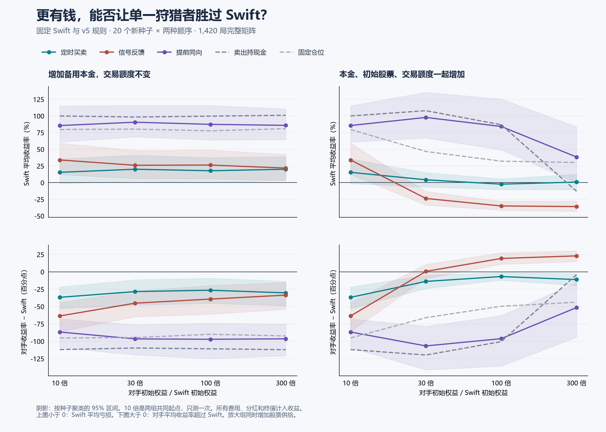

# Swift 狩猎者资金优势实验结果

矩阵完成 1,420 局、20 个新种子；所有配置和两种注册顺序完整报告。

以下首先是矩阵内筛选，不能替代独立确认；最终判断请同时阅读文末的追加确认，以及[新增现金机制核验](swift-capital-cash-results.md)。多目标问题另见[多 Swift 实验](swift-crowding-hunt-results.md)。

达到批次内相对胜出门槛：relay-scaled-100、relay-scaled-300。
达到使 Swift 平均收益稳定为负的门槛：relay-scaled-30、relay-scaled-100、relay-scaled-300。

这里的门槛和追加确认规则见[冻结方案](swift-capital-protocol.md)。两种注册顺序按种子聚类；不能把同一个种子的两局当作两个独立市场。

## 本金、仓位和费用

Swift 不变。对手初始权益恰好为 Swift 的 10、30、100 或 300 倍。备用组保持每只股票 200 股和 10 倍权益的固定交易额度，新增部分全为现金；放大组按倍率增加初始股票、交易额度与 clock / relay 的每次股数。10 倍为共同起点，仅运行一次。

所有本金在同一个账户内，从开局承担费用并计入收益率分母。有效仓位额度为固定初始分配与当时实际权益的较小值；不随盈利增加。收益包含分红、终值及全部费用，不是纯价差利润或年化。

clock 定时交易，relay 推测 Swift 开关，pursuit 用更早的阈值同向进出；cash 尝试卖出开局股票后持现金，blind 保持固定仓位目标。后两项是对照，不包装成识别目标的策略。

## 全部配置

| 结构 | 倍率 | 策略 | Swift 平均收益 | 对手平均收益 | 收益率差 | 对手胜局 | Swift 亏损局 | 双亏时对手少亏 |
|---|---:|---|---:|---:|---:|---:|---:|---:|
| 无新增对手 | — | alone | +97.12% | — | — | — | 0/20 | — |
| 共同起点 | 10 | 定时买卖 | +15.40% | -21.35% | -36.75 | 7/40 | 19/40 | 2/16 |
| 共同起点 | 10 | 信号反馈 | +33.92% | -29.66% | -63.57 | 3/40 | 12/40 | 2/12 |
| 共同起点 | 10 | 提前同向 | +85.59% | -1.11% | -86.69 | 0/40 | 1/40 | 0/1 |
| 共同起点 | 10 | 卖出持现金 | +99.95% | -12.03% | -111.98 | 0/40 | 0/40 | 0/0 |
| 共同起点 | 10 | 固定仓位 | +79.64% | -15.63% | -95.26 | 0/40 | 1/40 | 0/1 |
| 仅增加备用本金 | 30 | 定时买卖 | +20.05% | -8.39% | -28.44 | 11/40 | 16/40 | 9/15 |
| 仅增加备用本金 | 30 | 信号反馈 | +26.00% | -19.18% | -45.18 | 6/40 | 14/40 | 6/14 |
| 仅增加备用本金 | 30 | 提前同向 | +90.57% | -6.03% | -96.60 | 0/40 | 0/40 | 0/0 |
| 仅增加备用本金 | 30 | 卖出持现金 | +98.33% | -11.37% | -109.70 | 0/40 | 0/40 | 0/0 |
| 仅增加备用本金 | 30 | 固定仓位 | +80.16% | -14.56% | -94.72 | 0/40 | 1/40 | 0/1 |
| 同时放大交易 | 30 | 定时买卖 | +4.20% | -9.66% | -13.85 | 12/40 | 18/40 | 9/17 |
| 同时放大交易 | 30 | 信号反馈 | -23.80% | -23.21% | +0.59 | 21/40 | 31/40 | 11/25 |
| 同时放大交易 | 30 | 提前同向 | +97.73% | -8.99% | -106.72 | 0/40 | 1/40 | 0/1 |
| 同时放大交易 | 30 | 卖出持现金 | +107.86% | -11.97% | -119.83 | 0/40 | 0/40 | 0/0 |
| 同时放大交易 | 30 | 固定仓位 | +46.66% | -19.35% | -66.01 | 1/40 | 4/40 | 0/3 |
| 仅增加备用本金 | 100 | 定时买卖 | +17.75% | -8.79% | -26.54 | 15/40 | 17/40 | 15/17 |
| 仅增加备用本金 | 100 | 信号反馈 | +26.31% | -12.97% | -39.29 | 10/40 | 16/40 | 10/16 |
| 仅增加备用本金 | 100 | 提前同向 | +87.36% | -9.76% | -97.12 | 0/40 | 0/40 | 0/0 |
| 仅增加备用本金 | 100 | 卖出持现金 | +99.65% | -11.21% | -110.86 | 0/40 | 1/40 | 0/1 |
| 仅增加备用本金 | 100 | 固定仓位 | +77.64% | -12.27% | -89.91 | 0/40 | 1/40 | 0/1 |
| 同时放大交易 | 100 | 定时买卖 | -2.34% | -9.19% | -6.84 | 16/40 | 19/40 | 11/18 |
| 同时放大交易 | 100 | 信号反馈 | -35.04% | -15.85% | +19.19 | 32/40 | 39/40 | 20/27 |
| 同时放大交易 | 100 | 提前同向 | +84.16% | -12.10% | -96.27 | 2/40 | 6/40 | 2/6 |
| 同时放大交易 | 100 | 卖出持现金 | +86.80% | -13.70% | -100.50 | 7/40 | 11/40 | 7/11 |
| 同时放大交易 | 100 | 固定仓位 | +32.13% | -17.51% | -49.64 | 0/40 | 0/40 | 0/0 |
| 仅增加备用本金 | 300 | 定时买卖 | +20.06% | -10.27% | -30.33 | 13/40 | 17/40 | 13/17 |
| 仅增加备用本金 | 300 | 信号反馈 | +21.75% | -11.84% | -33.59 | 13/40 | 17/40 | 13/17 |
| 仅增加备用本金 | 300 | 提前同向 | +85.83% | -10.66% | -96.49 | 0/40 | 1/40 | 0/1 |
| 仅增加备用本金 | 300 | 卖出持现金 | +100.97% | -11.16% | -112.13 | 0/40 | 0/40 | 0/0 |
| 仅增加备用本金 | 300 | 固定仓位 | +80.90% | -11.43% | -92.33 | 0/40 | 0/40 | 0/0 |
| 同时放大交易 | 300 | 定时买卖 | +0.76% | -10.43% | -11.19 | 14/40 | 20/40 | 12/20 |
| 同时放大交易 | 300 | 信号反馈 | -35.96% | -13.05% | +22.91 | 37/40 | 38/40 | 27/28 |
| 同时放大交易 | 300 | 提前同向 | +38.36% | -13.14% | -51.50 | 13/40 | 18/40 | 13/18 |
| 同时放大交易 | 300 | 卖出持现金 | -13.00% | -17.22% | -4.22 | 23/40 | 25/40 | 23/25 |
| 同时放大交易 | 300 | 固定仓位 | +30.14% | -13.62% | -43.77 | 0/40 | 0/40 | 0/0 |

收益率差为对手减 Swift，单位为百分点；最后一列是事后双亏子集，不是总体胜率。

## 相对于整个市场的规模

| 结构 | 倍率 | 每只股票初始股数 | 占全市场初始股票数量 | 对手权益 / 原背景权益 |
|---|---:|---:|---:|---:|
| 共同起点 | 10 | 200 | 9.5% | 12.9% |
| 仅增加备用本金 | 30 | 200 | 9.5% | 38.8% |
| 同时放大交易 | 30 | 600 | 24.0% | 38.8% |
| 仅增加备用本金 | 100 | 200 | 9.5% | 129.4% |
| 同时放大交易 | 100 | 2000 | 51.2% | 129.4% |
| 仅增加备用本金 | 300 | 200 | 9.5% | 388.2% |
| 同时放大交易 | 300 | 6000 | 75.9% | 388.2% |

放大股票端会改变流通供给；若卖出持现金对照也使 Swift 亏损，便不能把全部效果解释为利用 Swift 参数的优势。备用组保持股票数量不变，回答的是新增现金的作用。

## 批次与不确定性

| 配置 | 收益率差95%区间 | Swift 收益95%区间 | 各批差值 / 胜局 |
|---|---:|---:|---|
| clock-base-10 | [-52.94, -21.89] | [-1.54, +35.33] | matrix-a: -24.80 / 3/20; matrix-b: -48.70 / 4/20 |
| relay-base-10 | [-86.31, -44.14] | [+12.01, +59.13] | matrix-a: -41.57 / 3/20; matrix-b: -85.57 / 0/20 |
| pursuit-base-10 | [-108.99, -67.72] | [+60.66, +115.01] | matrix-a: -64.79 / 0/20; matrix-b: -108.59 / 0/20 |
| clock-reserve-30 | [-47.90, -11.58] | [+2.14, +41.22] | matrix-a: -7.20 / 9/20; matrix-b: -49.69 / 2/20 |
| relay-reserve-30 | [-64.84, -27.81] | [+6.02, +48.11] | matrix-a: -24.91 / 6/20; matrix-b: -65.44 / 0/20 |
| pursuit-reserve-30 | [-119.74, -76.24] | [+68.51, +115.78] | matrix-a: -75.84 / 0/20; matrix-b: -117.35 / 0/20 |
| clock-scaled-30 | [-24.04, -5.06] | [-6.67, +14.97] | matrix-a: -9.65 / 9/20; matrix-b: -18.06 / 3/20 |
| relay-scaled-30 | [-9.69, +10.66] | [-33.59, -13.28] | matrix-a: +0.58 / 10/20; matrix-b: +0.60 / 11/20 |
| pursuit-scaled-30 | [-141.21, -78.49] | [+66.82, +135.34] | matrix-a: -78.23 / 0/20; matrix-b: -135.20 / 0/20 |
| clock-reserve-100 | [-45.42, -9.38] | [+0.04, +37.43] | matrix-a: -4.34 / 14/20; matrix-b: -48.73 / 1/20 |
| relay-reserve-100 | [-61.03, -19.71] | [+5.65, +48.80] | matrix-a: -17.67 / 8/20; matrix-b: -60.90 / 2/20 |
| pursuit-reserve-100 | [-124.99, -74.15] | [+63.86, +115.70] | matrix-a: -74.46 / 0/20; matrix-b: -119.78 / 0/20 |
| clock-scaled-100 | [-12.14, -1.34] | [-10.46, +5.72] | matrix-a: -4.42 / 10/20; matrix-b: -9.26 / 6/20 |
| relay-scaled-100 | [+10.83, +27.29] | [-41.46, -28.10] | matrix-a: +18.91 / 16/20; matrix-b: +19.46 / 16/20 |
| pursuit-scaled-100 | [-135.77, -63.06] | [+49.15, +125.34] | matrix-a: -66.44 / 1/20; matrix-b: -126.10 / 1/20 |
| clock-reserve-300 | [-48.96, -13.73] | [+3.11, +38.91] | matrix-a: -13.69 / 11/20; matrix-b: -46.98 / 2/20 |
| relay-reserve-300 | [-53.93, -15.47] | [+3.35, +42.26] | matrix-a: -8.80 / 11/20; matrix-b: -58.39 / 2/20 |
| pursuit-reserve-300 | [-120.83, -75.20] | [+64.34, +110.40] | matrix-a: -77.60 / 0/20; matrix-b: -115.37 / 0/20 |
| clock-scaled-300 | [-19.82, -2.96] | [-10.46, +12.51] | matrix-a: -4.19 / 9/20; matrix-b: -18.19 / 5/20 |
| relay-scaled-300 | [+14.75, +30.17] | [-43.23, -27.52] | matrix-a: +23.53 / 19/20; matrix-b: +22.28 / 18/20 |
| pursuit-scaled-300 | [-94.24, -15.43] | [-0.20, +83.71] | matrix-a: -9.74 / 10/20; matrix-b: -93.26 / 3/20 |

区间为按种子聚类的 3,000 次 bootstrap，先在种子内平均两种顺序。未对全部配置作多重比较校正；若有候选进入独立确认，确认结果另报，不能用矩阵内择优结果替代。

## 相对于同资金对照

| 配置 | 对照 | Swift 收益变化 / 95%区间 | 对手收益变化 | 对手绝对损益变化（元） |
|---|---|---:|---:|---:|
| clock-base-10 | cash-base-10 | -84.55 / [-105.69, -68.82] | -9.32 | -34,606 |
| clock-base-10 | blind-base-10 | -64.24 / [-73.27, -55.98] | -5.73 | -20,862 |
| relay-base-10 | cash-base-10 | -66.03 / [-86.13, -48.50] | -17.63 | -65,725 |
| relay-base-10 | blind-base-10 | -45.72 / [-58.10, -34.80] | -14.03 | -51,981 |
| pursuit-base-10 | cash-base-10 | -14.36 / [-26.65, -2.50] | +10.92 | +40,565 |
| pursuit-base-10 | blind-base-10 | +5.95 / [-3.79, +15.41] | +14.52 | +54,310 |
| clock-reserve-30 | cash-reserve-30 | -78.27 / [-100.60, -60.77] | +2.98 | +33,262 |
| clock-reserve-30 | blind-reserve-30 | -60.11 / [-73.24, -47.36] | +6.17 | +69,214 |
| relay-reserve-30 | cash-reserve-30 | -72.33 / [-92.07, -55.40] | -7.81 | -87,040 |
| relay-reserve-30 | blind-reserve-30 | -54.17 / [-66.65, -43.10] | -4.62 | -51,088 |
| pursuit-reserve-30 | cash-reserve-30 | -7.76 / [-25.19, +7.42] | +5.34 | +59,553 |
| pursuit-reserve-30 | blind-reserve-30 | +10.40 / [-2.22, +22.86] | +8.53 | +95,505 |
| clock-scaled-30 | cash-scaled-30 | -103.66 / [-137.03, -74.90] | +2.31 | +25,441 |
| clock-scaled-30 | blind-scaled-30 | -42.46 / [-54.51, -28.79] | +9.69 | +108,725 |
| relay-scaled-30 | cash-scaled-30 | -131.66 / [-164.12, -104.18] | -11.25 | -126,030 |
| relay-scaled-30 | blind-scaled-30 | -70.46 / [-83.19, -58.35] | -3.87 | -42,746 |
| pursuit-scaled-30 | cash-scaled-30 | -10.13 / [-28.20, +8.01] | +2.98 | +33,403 |
| pursuit-scaled-30 | blind-scaled-30 | +51.07 / [+26.66, +80.74] | +10.36 | +116,687 |
| clock-reserve-100 | cash-reserve-100 | -81.89 / [-102.40, -63.59] | +2.42 | +89,856 |
| clock-reserve-100 | blind-reserve-100 | -59.89 / [-73.95, -46.28] | +3.48 | +129,399 |
| relay-reserve-100 | cash-reserve-100 | -73.33 / [-92.27, -56.64] | -1.76 | -65,637 |
| relay-reserve-100 | blind-reserve-100 | -51.33 / [-65.05, -38.73] | -0.71 | -26,094 |
| pursuit-reserve-100 | cash-reserve-100 | -12.29 / [-24.85, -0.01] | +1.45 | +53,704 |
| pursuit-reserve-100 | blind-reserve-100 | +9.71 / [-1.26, +20.22] | +2.50 | +93,247 |
| clock-scaled-100 | cash-scaled-100 | -89.14 / [-142.34, -46.52] | +4.52 | +167,447 |
| clock-scaled-100 | blind-scaled-100 | -34.47 / [-41.74, -26.57] | +8.32 | +309,693 |
| relay-scaled-100 | cash-scaled-100 | -121.84 / [-177.20, -76.63] | -2.15 | -81,198 |
| relay-scaled-100 | blind-scaled-100 | -67.17 / [-74.12, -60.16] | +1.66 | +61,048 |
| pursuit-scaled-100 | cash-scaled-100 | -2.64 / [-23.34, +16.10] | +1.60 | +59,232 |
| pursuit-scaled-100 | blind-scaled-100 | +52.04 / [+18.63, +89.62] | +5.40 | +201,479 |
| clock-reserve-300 | cash-reserve-300 | -80.91 / [-101.26, -63.61] | +0.89 | +99,195 |
| clock-reserve-300 | blind-reserve-300 | -60.84 / [-72.83, -49.84] | +1.15 | +129,064 |
| relay-reserve-300 | cash-reserve-300 | -79.22 / [-98.83, -62.08] | -0.68 | -75,951 |
| relay-reserve-300 | blind-reserve-300 | -59.15 / [-69.47, -48.95] | -0.42 | -46,083 |
| pursuit-reserve-300 | cash-reserve-300 | -15.14 / [-29.08, -1.58] | +0.51 | +56,334 |
| pursuit-reserve-300 | blind-reserve-300 | +4.93 / [-4.47, +14.88] | +0.77 | +86,202 |
| clock-scaled-300 | cash-scaled-300 | +13.76 / [-8.31, +33.40] | +6.79 | +753,340 |
| clock-scaled-300 | blind-scaled-300 | -29.39 / [-41.81, -18.15] | +3.19 | +355,985 |
| relay-scaled-300 | cash-scaled-300 | -22.95 / [-47.84, -0.50] | +4.18 | +461,088 |
| relay-scaled-300 | blind-scaled-300 | -66.10 / [-75.22, -57.83] | +0.58 | +63,733 |
| pursuit-scaled-300 | cash-scaled-300 | +51.36 / [+32.32, +74.69] | +4.09 | +453,570 |
| pursuit-scaled-300 | blind-scaled-300 | +8.22 / [-32.34, +55.47] | +0.49 | +56,215 |

配对使用相同种子与注册顺序，但交易会改变市场路径。现金对照会卖初始库存；放大组增加股票供给和分红权，因此目标亏损可能并非信号识别的效果。损益差是对照结果，不是能单独结算的攻击费用。

## 绝对损益、交易量和费用

| 配置 | 对手初始权益（元） | 占背景总权益 | Swift 损益（元） | 对手损益（元） | 对手总成交额（元） | 交易费% / 闲置费% / 利息% |
|---|---:|---:|---:|---:|---:|---:|
| clock-base-10 | 370,921 | 12.9% | +5,716 | -79,294 | 17,814,202 | 2.43 / 0.15 / 0.00 |
| relay-base-10 | 370,921 | 12.9% | +12,573 | -110,413 | 5,282,227 | 0.72 / 4.58 / 0.00 |
| pursuit-base-10 | 370,921 | 12.9% | +31,732 | -4,122 | 4,962,459 | 0.68 / 4.81 / 0.00 |
| cash-base-10 | 370,921 | 12.9% | +37,053 | -44,688 | 166,484 | 0.02 / 10.83 / 0.00 |
| blind-base-10 | 370,921 | 12.9% | +29,529 | -58,432 | 729,734 | 0.10 / 10.55 / 0.00 |
| clock-reserve-30 | 1,112,764 | 38.8% | +7,444 | -93,350 | 17,883,990 | 0.81 / 1.19 / 0.00 |
| relay-reserve-30 | 1,112,764 | 38.8% | +9,619 | -213,652 | 5,684,119 | 0.26 / 6.98 / 0.00 |
| pursuit-reserve-30 | 1,112,764 | 38.8% | +33,596 | -67,059 | 4,965,596 | 0.23 / 7.25 / 0.00 |
| cash-reserve-30 | 1,112,764 | 38.8% | +36,435 | -126,612 | 166,366 | 0.01 / 10.96 / 0.00 |
| blind-reserve-30 | 1,112,764 | 38.8% | +29,732 | -162,564 | 826,670 | 0.04 / 10.85 / 0.00 |
| clock-scaled-30 | 1,112,764 | 38.8% | +1,514 | -107,949 | 18,472,370 | 0.84 / 1.42 / 0.00 |
| relay-scaled-30 | 1,112,764 | 38.8% | -8,830 | -259,420 | 9,722,768 | 0.44 / 6.57 / 0.00 |
| pursuit-scaled-30 | 1,112,764 | 38.8% | +36,255 | -99,987 | 7,067,056 | 0.32 / 5.91 / 0.00 |
| cash-scaled-30 | 1,112,764 | 38.8% | +40,004 | -133,390 | 499,192 | 0.02 / 10.80 / 0.00 |
| blind-scaled-30 | 1,112,764 | 38.8% | +17,344 | -216,674 | 1,402,228 | 0.06 / 11.32 / 0.00 |
| clock-reserve-100 | 3,709,212 | 129.4% | +6,557 | -326,030 | 17,780,135 | 0.24 / 6.57 / 0.00 |
| relay-reserve-100 | 3,709,212 | 129.4% | +9,724 | -481,523 | 5,677,372 | 0.08 / 9.67 / 0.00 |
| pursuit-reserve-100 | 3,709,212 | 129.4% | +32,390 | -362,182 | 4,967,744 | 0.07 / 9.92 / 0.00 |
| cash-reserve-100 | 3,709,212 | 129.4% | +36,940 | -415,886 | 166,360 | 0.00 / 11.09 / 0.00 |
| blind-reserve-100 | 3,709,212 | 129.4% | +28,810 | -455,429 | 826,447 | 0.01 / 11.05 / 0.00 |
| clock-scaled-100 | 3,709,212 | 129.4% | -895 | -341,416 | 18,074,587 | 0.25 / 7.17 / 0.00 |
| relay-scaled-100 | 3,709,212 | 129.4% | -12,982 | -590,061 | 10,986,747 | 0.15 / 9.62 / 0.00 |
| pursuit-scaled-100 | 3,709,212 | 129.4% | +31,179 | -449,630 | 11,065,359 | 0.15 / 8.12 / 0.00 |
| cash-scaled-100 | 3,709,212 | 129.4% | +32,132 | -508,862 | 1,540,419 | 0.02 / 10.40 / 0.00 |
| blind-scaled-100 | 3,709,212 | 129.4% | +11,914 | -651,109 | 1,708,790 | 0.02 / 12.85 / 0.00 |
| clock-reserve-300 | 11,127,636 | 388.2% | +7,403 | -1,143,173 | 17,811,740 | 0.08 / 9.62 / 0.00 |
| relay-reserve-300 | 11,127,636 | 388.2% | +8,052 | -1,318,319 | 5,886,820 | 0.03 / 10.63 / 0.00 |
| pursuit-reserve-300 | 11,127,636 | 388.2% | +31,812 | -1,186,034 | 4,933,961 | 0.02 / 10.74 / 0.00 |
| cash-reserve-300 | 11,127,636 | 388.2% | +37,394 | -1,242,368 | 166,355 | 0.00 / 11.12 / 0.00 |
| blind-reserve-300 | 11,127,636 | 388.2% | +29,994 | -1,272,237 | 829,606 | 0.00 / 11.11 / 0.00 |
| clock-scaled-300 | 11,127,636 | 388.2% | +253 | -1,164,015 | 18,709,754 | 0.08 / 10.14 / 0.00 |
| relay-scaled-300 | 11,127,636 | 388.2% | -13,298 | -1,456,267 | 11,026,793 | 0.05 / 11.33 / 0.00 |
| pursuit-scaled-300 | 11,127,636 | 388.2% | +14,147 | -1,463,784 | 14,472,202 | 0.07 / 9.71 / 0.00 |
| cash-scaled-300 | 11,127,636 | 388.2% | -4,856 | -1,917,355 | 3,062,899 | 0.01 / 10.15 / 0.00 |
| blind-scaled-300 | 11,127,636 | 388.2% | +11,166 | -1,520,000 | 1,754,630 | 0.01 / 12.87 / 0.00 |

百分比少亏可以伴随金额多亏。把本金放大但限制投入，也会稀释损益百分比；这符合本次规则，但不能据此说策略更善于交易。全部费用已包含于收益率。

## 回撤、执行与质量

| 配置 | Swift 平均 / 最差回撤% | 对手平均 / 最差回撤% | 拒单 Swift / 对手 | 强平 Swift / 对手 | 市场质量通过局数 |
|---|---:|---:|---:|---:|---:|
| clock-base-10 | 26.2 / 54.6 | 33.7 / 70.5 | 0 / 0 | 0 / 0 | 21/40 |
| relay-base-10 | 18.8 / 43.7 | 44.9 / 86.0 | 0 / 0 | 0 / 0 | 7/40 |
| pursuit-base-10 | 15.5 / 29.3 | 16.8 / 29.8 | 0 / 0 | 0 / 0 | 29/40 |
| cash-base-10 | 13.8 / 25.2 | 12.8 / 19.5 | 0 / 0 | 0 / 0 | 31/40 |
| blind-base-10 | 13.5 / 37.1 | 39.9 / 75.3 | 0 / 0 | 0 / 0 | 6/40 |
| clock-reserve-30 | 24.5 / 46.8 | 14.1 / 53.0 | 0 / 0 | 0 / 0 | 18/40 |
| relay-reserve-30 | 22.1 / 44.4 | 24.3 / 84.1 | 0 / 0 | 0 / 0 | 7/40 |
| pursuit-reserve-30 | 13.7 / 21.8 | 10.1 / 18.1 | 0 / 0 | 0 / 0 | 29/40 |
| cash-reserve-30 | 14.8 / 26.1 | 11.6 / 13.8 | 0 / 0 | 0 / 0 | 29/40 |
| blind-reserve-30 | 15.5 / 39.3 | 22.2 / 54.9 | 0 / 0 | 0 / 0 | 7/40 |
| clock-scaled-30 | 26.8 / 50.6 | 25.6 / 59.4 | 0 / 0 | 0 / 0 | 10/40 |
| relay-scaled-30 | 37.5 / 60.6 | 40.4 / 87.4 | 0 / 0 | 0 / 0 | 0/40 |
| pursuit-scaled-30 | 19.6 / 44.7 | 16.9 / 26.3 | 0 / 0 | 0 / 0 | 33/40 |
| cash-scaled-30 | 17.6 / 34.9 | 12.9 / 18.7 | 0 / 0 | 0 / 0 | 34/40 |
| blind-scaled-30 | 17.4 / 60.8 | 41.1 / 81.5 | 0 / 0 | 0 / 0 | 0/40 |
| clock-reserve-100 | 26.4 / 53.9 | 9.3 / 15.4 | 0 / 0 | 0 / 0 | 16/40 |
| relay-reserve-100 | 23.6 / 57.2 | 14.4 / 46.5 | 0 / 0 | 0 / 0 | 4/40 |
| pursuit-reserve-100 | 14.5 / 28.2 | 10.1 / 12.5 | 0 / 0 | 0 / 0 | 30/40 |
| cash-reserve-100 | 15.7 / 29.4 | 11.3 / 12.0 | 0 / 0 | 0 / 0 | 29/40 |
| blind-reserve-100 | 15.4 / 40.4 | 13.1 / 21.6 | 0 / 0 | 0 / 0 | 4/40 |
| clock-scaled-100 | 29.2 / 50.6 | 21.8 / 43.9 | 0 / 0 | 0 / 0 | 6/40 |
| relay-scaled-100 | 42.9 / 66.3 | 33.1 / 90.3 | 0 / 0 | 0 / 0 | 0/40 |
| pursuit-scaled-100 | 30.1 / 63.2 | 16.7 / 24.7 | 0 / 0 | 0 / 0 | 38/40 |
| cash-scaled-100 | 31.1 / 65.4 | 14.7 / 19.3 | 0 / 0 | 0 / 0 | 18/40 |
| blind-scaled-100 | 15.0 / 27.7 | 36.8 / 88.5 | 0 / 0 | 0 / 0 | 0/40 |
| clock-reserve-300 | 23.6 / 45.9 | 10.3 / 13.0 | 0 / 0 | 0 / 0 | 15/40 |
| relay-reserve-300 | 23.7 / 55.3 | 12.2 / 20.5 | 0 / 0 | 0 / 0 | 4/40 |
| pursuit-reserve-300 | 15.3 / 27.2 | 10.7 / 11.6 | 0 / 0 | 0 / 0 | 32/40 |
| cash-reserve-300 | 14.6 / 28.2 | 11.2 / 11.4 | 0 / 0 | 0 / 0 | 30/40 |
| blind-reserve-300 | 16.2 / 60.3 | 11.5 / 14.2 | 0 / 0 | 0 / 0 | 4/40 |
| clock-scaled-300 | 29.4 / 53.8 | 20.5 / 54.0 | 0 / 0 | 0 / 0 | 8/40 |
| relay-scaled-300 | 43.7 / 69.5 | 26.6 / 75.8 | 0 / 0 | 0 / 0 | 0/40 |
| pursuit-scaled-300 | 49.2 / 90.9 | 18.5 / 31.3 | 0 / 0 | 0 / 0 | 33/40 |
| cash-scaled-300 | 56.1 / 110.8 | 18.3 / 27.8 | 0 / 0 | 1842 / 0 | 0/40 |
| blind-scaled-300 | 13.5 / 25.1 | 29.5 / 80.7 | 0 / 0 | 0 / 0 | 0/40 |

共 8,520 次账务审计；全账户跳过 0、错误 0、停用 0。回撤用决策前标记权益和最终结算计算，不保证能按标记价格清仓。

市场质量通过率独立于账务正确性；检查双边盘口、价差、深度、价格偏离等。原版背景本身也可能不通过全部质量阈值。所有世界均保留，不按质量结果筛选有利样本；逐项检查值写入 JSON。

原始各世界、分顺序统计、放大交易减备用本金的配对结果、费用和初始资产记录见 [JSON](swift-capital-results.json)。原始撮合记录保存在被 git 忽略的 runs/swift-capital-20261018；冻结计划保存源码、配置和二进制哈希。

## 追加确认选择

按冻结规则进入追加确认的配置：relay-scaled-300、relay-scaled-100、relay-scaled-30

## 独立新市场确认

依据矩阵选择规则冻结 3 个候选后，追加 380 局，使用 20 个未参与选择的新种子。对照与候选一同运行，参数和代码不改；这一批单独报告，不并回矩阵冒充未选择样本。

独立确认达到平均相对收益优势门槛：无。
独立确认使 Swift 平均收益显著为负：relay-scaled-100、relay-scaled-300。
胜局比例高与平均收益领先确定是两件事；少数 Swift 大幅盈利局可以使平均收益差区间跨零。不能把多数局少亏写成已经证明稳定的期望优势。

| 候选 | Swift 平均收益 / 95%区间 | 对手平均收益 | 收益率差 / 95%区间 | 对手胜局 | Swift 亏损局 | 双亏时对手少亏 |
|---|---:|---:|---:|---:|---:|---:|
| relay-scaled-300 | -22.17% / [-34.50, -6.07] | -9.22% | +12.95 / [-1.58, +24.80] | 31/40 | 33/40 | 29/31 |
| relay-scaled-100 | -24.19% / [-35.86, -9.24] | -12.04% | +12.15 / [-2.40, +24.49] | 31/40 | 34/40 | 26/29 |
| relay-scaled-30 | -6.96% / [-26.03, +16.04] | -21.94% | -14.97 / [-38.48, +5.38] | 19/40 | 27/40 | 14/22 |

| 候选 | 对照 | Swift 收益变化 / 95%区间 | 对手收益变化 | 对手绝对损益变化（元） |
|---|---|---:|---:|---:|
| relay-scaled-30 | cash-scaled-30 | -165.58 / [-202.21, -138.60] | -9.20 | -102,058 |
| relay-scaled-30 | blind-scaled-30 | -81.39 / [-90.78, -71.50] | -11.41 | -126,784 |
| relay-scaled-100 | cash-scaled-100 | -156.51 / [-204.71, -116.19] | +2.58 | +95,633 |
| relay-scaled-100 | blind-scaled-100 | -63.58 / [-71.45, -56.24] | -2.08 | -77,188 |
| relay-scaled-300 | cash-scaled-300 | -45.77 / [-76.04, -18.50] | +6.78 | +753,595 |
| relay-scaled-300 | blind-scaled-300 | -54.85 / [-62.79, -46.80] | -0.60 | -67,561 |

| 配置 | Swift 收益 | 对手收益 | 对手胜局 | Swift 损益（元） | 对手损益（元） | 交易费% / 闲置费% / 利息% |
|---|---:|---:|---:|---:|---:|---:|
| relay-scaled-30 | -6.96% | -21.94% | 19/40 | -2,553 | -243,781 | 0.48 / 6.36 / 0.00 |
| cash-scaled-30 | +158.61% | -12.74% | 0/40 | +58,883 | -141,723 | 0.02 / 10.70 / 0.00 |
| blind-scaled-30 | +74.42% | -10.53% | 0/40 | +27,621 | -116,997 | 0.06 / 12.33 / 0.00 |
| relay-scaled-100 | -24.19% | -12.04% | 31/40 | -8,924 | -446,488 | 0.17 / 9.39 / 0.00 |
| cash-scaled-100 | +132.33% | -14.62% | 2/40 | +49,127 | -542,121 | 0.02 / 10.30 / 0.00 |
| blind-scaled-100 | +39.39% | -9.96% | 2/40 | +14,626 | -369,301 | 0.02 / 13.23 / 0.00 |
| relay-scaled-300 | -22.17% | -9.22% | 31/40 | -8,181 | -1,026,718 | 0.06 / 11.38 / 0.00 |
| cash-scaled-300 | +23.60% | -16.00% | 13/40 | +8,806 | -1,780,313 | 0.01 / 10.20 / 0.00 |
| blind-scaled-300 | +32.68% | -8.62% | 1/40 | +12,136 | -959,157 | 0.01 / 13.10 / 0.00 |

确认批次共 2280 次账务审计，全账户跳过 0、错误 0、停用 0；目标与对手共拒单 0、强平 0。
逐世界数据、双顺序结果、费用与市场质量见[独立确认 JSON](swift-capital-confirmation.json)。
