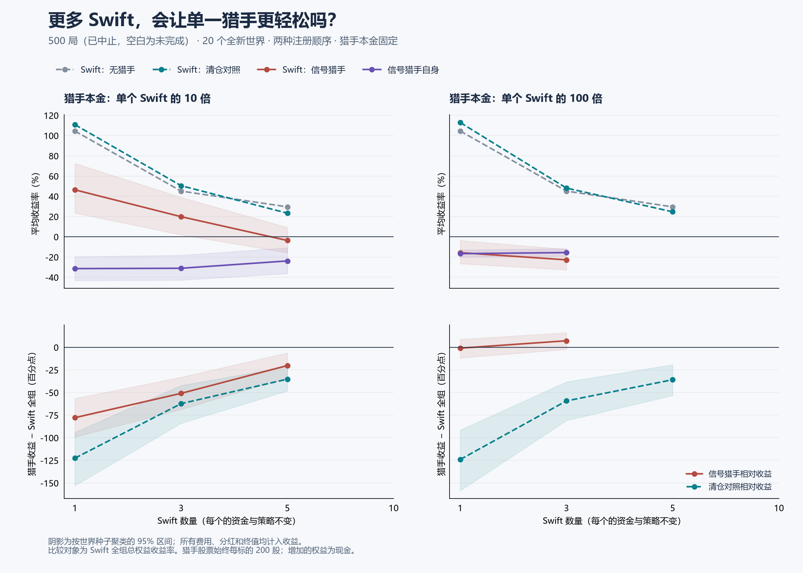

# 多 Swift 是否更容易狩猎

**按用户要求中止。** 原计划 720 局；本报告只统计成组完成的 500 局。未完成配置不纳入均值，也不续跑。中止记录见[状态文件](swift-crowding-hunt-stopped.json)。 方案见[实验协议](swift-crowding-hunt-protocol.md)。



## 直接结果

所有收益含费用、分红与终值。猎手本金始终相对于单个 Swift；增加 Swift 数量不会增加猎手本金。两种顺序合并按世界种子聚类，40 局是 20 个独立种子。

| Swift 数 | 猎手 | 本金倍数 | Swift 组收益% | 猎手收益% | 胜过组均值 | 胜过全部 | 平均胜过个体比例 | 双亏少亏 |
|---:|---|---:|---:|---:|---:|---:|---:|---:|
| 1 | 无 | — | +104.44 | — | — | — | — | — |
| 1 | cash | 10 | +110.77 | -11.83 | 0/40 | 0/40 | 0.0% | 0/2 |
| 1 | relay | 10 | +46.38 | -31.44 | 0/40 | 0/40 | 0.0% | 0/9 |
| 1 | cash | 100 | +112.87 | -11.19 | 2/40 | 2/40 | 5.0% | 2/2 |
| 1 | relay | 100 | -15.70 | -16.69 | 23/40 | 23/40 | 57.5% | 23/32 |
| 3 | 无 | — | +45.12 | — | — | — | — | — |
| 3 | cash | 10 | +50.44 | -11.86 | 3/40 | 2/40 | 11.7% | 3/5 |
| 3 | relay | 10 | +19.83 | -31.11 | 4/40 | 0/40 | 14.2% | 4/15 |
| 3 | cash | 100 | +48.10 | -11.19 | 3/40 | 3/40 | 11.7% | 3/5 |
| 3 | relay | 100 | -22.77 | -15.59 | 25/40 | 21/40 | 64.2% | 25/31 |
| 5 | 无 | — | +29.55 | — | — | — | — | — |
| 5 | cash | 10 | +23.32 | -11.91 | 5/40 | 3/40 | 17.0% | 5/7 |
| 5 | relay | 10 | -3.66 | -23.86 | 14/40 | 6/40 | 35.0% | 10/22 |
| 5 | cash | 100 | +24.67 | -11.19 | 7/40 | 2/40 | 17.0% | 7/8 |

满足预先约定的明确相对优势门槛：无。这只指本实验范围，不代表任何市场都有效。

## 收益分布和顺序

| 配置 | 猎手减 Swift 组，百分点 / 95%区间 | Swift 组收益 / 95%区间 | Swift 中位 / 最好 / 最差均值 | 首位 / 末位均值 | 所有 Swift 均亏局数 |
|---|---:|---:|---:|---:|---:|
| n1-alone | — | +104.44 [+75.79, +134.91] | +104.44 / +104.44 / +104.44 | +104.44 / +104.44 | 1/20 |
| n1-cash-10 | -122.60 [-152.94, -94.08] | +110.77 [+82.10, +141.90] | +110.77 / +110.77 / +110.77 | +110.77 / +110.77 | 2/40 |
| n1-relay-10 | -77.82 [-99.29, -56.72] | +46.38 [+23.51, +72.51] | +46.38 / +46.38 / +46.38 | +46.38 / +46.38 | 9/40 |
| n1-cash-100 | -124.06 [-158.45, -91.51] | +112.87 [+80.30, +147.36] | +112.87 / +112.87 / +112.87 | +112.87 / +112.87 | 2/40 |
| n1-relay-100 | -0.98 [-11.76, +8.82] | -15.70 [-26.54, -3.67] | -15.70 / -15.70 / -15.70 | -15.70 / -15.70 | 32/40 |
| n3-alone | — | +45.12 [+29.20, +61.22] | +37.27 / +68.39 / +29.71 | +68.39 / +32.09 | 2/20 |
| n3-cash-10 | -62.31 [-84.02, -42.26] | +50.44 [+30.03, +72.70] | +42.95 / +79.99 / +28.39 | +79.99 / +35.67 | 3/40 |
| n3-relay-10 | -50.94 [-68.61, -33.10] | +19.83 [+1.95, +38.96] | +14.97 / +36.46 / +8.06 | +35.46 / +11.13 | 11/40 |
| n3-cash-100 | -59.28 [-80.97, -38.23] | +48.10 [+27.03, +69.84] | +38.71 / +78.21 / +27.37 | +78.14 / +34.06 | 3/40 |
| n3-relay-100 | +7.18 [-2.26, +16.11] | -22.77 [-32.58, -12.28] | -24.47 / -15.79 / -28.05 | -18.10 / -25.01 | 29/40 |
| n5-alone | — | +29.55 [+12.70, +48.31] | +22.19 / +68.40 / +8.95 | +68.40 / +13.72 | 1/20 |
| n5-cash-10 | -35.23 [-48.16, -21.28] | +23.32 [+9.19, +37.05] | +14.82 / +63.70 / +2.79 | +63.70 / +9.59 | 3/40 |
| n5-relay-10 | -20.20 [-33.95, -6.23] | -3.66 [-15.74, +9.25] | -7.01 / +17.78 / -16.15 | +16.22 / -9.61 | 16/40 |
| n5-cash-100 | -35.86 [-53.26, -19.35] | +24.67 [+8.22, +42.14] | +16.82 / +65.12 / +4.66 | +64.89 / +13.30 | 6/40 |

组中位数/最好/最差先在各局内取值，再跨局平均；不是拿跨局平均收益重新排序。完整逐位置与两顺序数据见 JSON。以下不把首位和末位混成同一种执行机会。

| 配置 | 顺序 | Swift 组收益% | 猎手收益% | 胜过组均值 |
|---|---|---:|---:|---:|
| n1-relay-10 | predator_first | +47.18 | -31.18 | 0/20 |
| n1-relay-10 | target_first | +45.59 | -31.70 | 0/20 |
| n1-relay-100 | predator_first | -19.69 | -16.50 | 12/20 |
| n1-relay-100 | target_first | -11.72 | -16.87 | 11/20 |
| n3-relay-10 | predator_first | +18.69 | -31.82 | 3/20 |
| n3-relay-10 | target_first | +20.97 | -30.40 | 1/20 |
| n3-relay-100 | predator_first | -28.68 | -15.31 | 14/20 |
| n3-relay-100 | target_first | -16.86 | -15.87 | 11/20 |
| n5-relay-10 | predator_first | -10.09 | -23.18 | 10/20 |
| n5-relay-10 | target_first | +2.77 | -24.55 | 4/20 |

## relay 相对同资金清仓对照

| 配置 | 参照 | Swift 组变化 / 95%区间 | 猎手变化 / 95%区间 | 相对收益变化 / 95%区间 |
|---|---|---:|---:|---:|
| n1-relay-10 | n1-cash-10 | -64.38 [-77.22, -51.57] | -19.60 [-31.11, -7.98] | +44.78 [+22.57, +66.38] |
| n1-relay-100 | n1-cash-100 | -128.57 [-153.82, -104.14] | -5.50 [-8.90, -1.85] | +123.08 [+96.34, +150.87] |
| n3-relay-10 | n3-cash-10 | -30.61 [-39.63, -21.73] | -19.25 [-30.94, -6.82] | +11.37 [-7.48, +31.53] |
| n3-relay-100 | n3-cash-100 | -70.87 [-86.39, -55.96] | -4.41 [-7.91, -0.57] | +66.46 [+48.87, +85.17] |
| n5-relay-10 | n5-cash-10 | -26.98 [-35.78, -17.58] | -11.95 [-23.85, +0.88] | +15.02 [-2.34, +32.92] |

## 增加 Swift 相对只有一个

| 配置 | 参照 | Swift 组变化 / 95%区间 | 猎手变化 / 95%区间 | 相对收益变化 / 95%区间 |
|---|---|---:|---:|---:|
| n3-cash-10 | n1-cash-10 | -60.32 [-71.26, -50.10] | -0.03 [-0.09, +0.03] | +60.30 [+50.06, +71.27] |
| n3-relay-10 | n1-relay-10 | -26.55 [-37.01, -18.27] | +0.33 [-3.24, +3.95] | +26.88 [+16.75, +39.33] |
| n3-cash-100 | n1-cash-100 | -64.77 [-80.64, -50.53] | +0.00 [-0.00, +0.01] | +64.78 [+50.53, +80.64] |
| n3-relay-100 | n1-relay-100 | -7.07 [-11.56, -2.37] | +1.09 [+0.63, +1.65] | +8.16 [+3.27, +12.93] |
| n5-cash-10 | n1-cash-10 | -87.45 [-106.61, -70.52] | -0.08 [-0.15, -0.01] | +87.37 [+70.39, +106.53] |
| n5-relay-10 | n1-relay-10 | -50.04 [-66.31, -36.09] | +7.57 [+2.93, +12.29] | +57.62 [+42.21, +75.87] |
| n5-cash-100 | n1-cash-100 | -88.20 [-107.64, -70.07] | -0.01 [-0.01, +0.00] | +88.20 [+70.07, +107.63] |

## 数量效应扣除 cash 的数量效应

| 配置 | 参照 | Swift 组变化 / 95%区间 | 猎手变化 / 95%区间 | 相对收益变化 / 95%区间 |
|---|---|---:|---:|---:|
| n3-relay-10 | n1-relay-10 | +33.77 [+24.06, +44.15] | +0.36 [-3.23, +3.97] | -33.41 [-46.96, -20.79] |
| n3-relay-100 | n1-relay-100 | +57.71 [+45.15, +71.00] | +1.09 [+0.63, +1.64] | -56.61 [-69.74, -44.24] |
| n5-relay-10 | n1-relay-10 | +37.41 [+24.68, +53.72] | +7.65 [+2.98, +12.40] | -29.76 [-48.79, -14.67] |

变化单位都是百分点。按同种子与同注册顺序配对，但行动会改变之后的市场路径。最后一表为差分之差；正的相对收益变化表示 relay 的增量优势随人数增大。它不能消除增加小账户同时增加市场资本/股票的影响。

## 无猎手时的自身拥挤

| 数量对比 | Swift 组收益变化 / 95%区间 |
|---|---:|
| n3-alone − n1-alone | -59.31 [-76.76, -43.83] |
| n5-alone − n1-alone | -74.89 [-88.72, -61.12] |

## 金额、回撤、执行与市场质量

| 配置 | 猎手初始权益（元） | Swift 全组损益（元） | 猎手损益（元） | Swift 组 / 猎手平均回撤% | 猎手交易费% / 闲置费% | 市场质量通过 |
|---|---:|---:|---:|---:|---:|---:|
| n1-cash-10 | 369,041 | +40,858 | -43,730 | 13.8 / 12.6 | 0.02 / 10.86 | 35/40 |
| n1-relay-10 | 369,041 | +17,100 | -116,217 | 17.2 / 41.9 | 0.73 / 4.27 | 23/40 |
| n1-cash-100 | 3,690,406 | +41,617 | -412,960 | 13.4 / 11.3 | 0.00 / 11.09 | 36/40 |
| n1-relay-100 | 3,690,406 | -5,809 | -616,312 | 34.8 / 21.8 | 0.13 / 8.97 | 0/40 |
| n3-cash-10 | 369,041 | +55,752 | -43,835 | 19.3 / 12.7 | 0.02 / 10.85 | 36/40 |
| n3-relay-10 | 369,041 | +21,898 | -115,026 | 24.9 / 42.1 | 0.77 / 4.43 | 19/40 |
| n3-cash-100 | 3,690,406 | +53,203 | -412,867 | 19.8 / 11.3 | 0.00 / 11.09 | 35/40 |
| n3-relay-100 | 3,690,406 | -25,256 | -575,858 | 38.7 / 21.1 | 0.13 / 9.19 | 0/40 |
| n5-cash-10 | 369,041 | +42,929 | -44,012 | 23.8 / 12.7 | 0.02 / 10.85 | 36/40 |
| n5-relay-10 | 369,041 | -6,827 | -88,291 | 31.1 / 38.2 | 0.76 / 5.08 | 14/40 |
| n5-cash-100 | 3,690,406 | +45,523 | -413,171 | 24.3 / 11.3 | 0.00 / 11.09 | 36/40 |

账务审计 3000 次；所有账户跳过 0、错误 0、停用 0。所有 Swift 与猎手拒单 0、强平 0；猎手与全部 Swift 的直接成交金额合计 0.00 元。

市场质量门槛与账务正确性分开；所有失败世界保留。区间按种子聚类 bootstrap 3000 次，未作多重比较校正。回撤是观察到的标记权益回撤，不保证可按该价格退出。百分比少亏不等于金额少亏，也不等于猎手赚钱。

数据：[完整 JSON](swift-crowding-hunt-results.json)；[冻结计划](swift-crowding-hunt-plan.json)。原始撮合与权益曲线在 runs/swift-crowding-hunt-20261018，未提交大体积逐笔文件。

## 复现

先检出冻结实现 `645f0d5`，禁用失效的本机 RUSTC_WRAPPER 后构建 release 二进制；换一个新 stage 保存重跑，不覆盖原实验。多线程调度可能改变逐笔路径，冻结种子并不保证逐笔结果完全相同。

```sh
cargo build --release --bins
python tools/swift_crowding_hunt.py prepare --stage rerun --first-seed 18001 --seeds 20
python tools/arena_gate.py --cwd . -- python tools/swift_crowding_hunt.py run --stage rerun
python tools/swift_crowding_hunt_report.py --stage rerun --output runs/swift-crowding-hunt-20261018/rerun/results.json --markdown runs/swift-crowding-hunt-20261018/rerun/results.md
```
