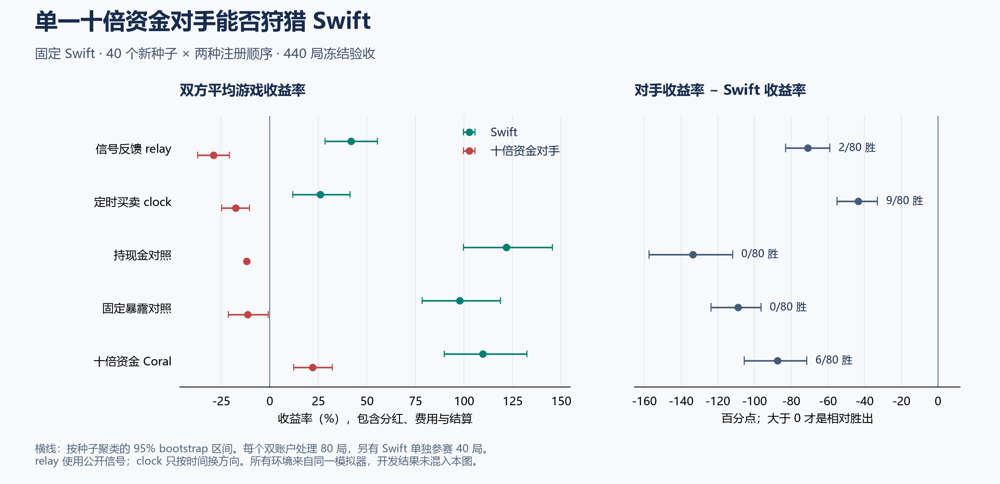

# Swift 单一狩猎者研究结果

**本轮没有找到稳定比 Swift 亏得更少或赚得更多的狩猎策略。**

完成 632 局：120 局第一轮开发、72 局反馈假设开发、440 局冻结验收。每局只有一个原版 Swift；新增对手是一个初始权益恰好十倍的账户。

## 冻结验收结果

对手胜局按收益率比较，不按绝对金额。两批共 40 个新种子；每个对手处理交换两次注册顺序，所以是 80 局而非 80 个独立世界。原版单独参赛为 40 局。

| 处理 | Swift 平均收益 | 对手平均收益 | 对手相对优势 | 对手胜局 | 双方都亏时对手少亏 |
|---|---:|---:|---:|---:|---:|
| Swift 单独参赛 | +119.12% | — | — | — | — |
| 信号反馈 relay | +41.85% | -29.08% | -70.93 个百分点 | 2/80 | 1/16 |
| 定时买卖 clock | +25.94% | -17.64% | -43.58 个百分点 | 9/80 | 8/26 |
| 持现金对照 | +121.70% | -11.93% | -133.63 个百分点 | 0/80 | 0/2 |
| 固定暴露对照 | +97.73% | -11.34% | -109.08 个百分点 | 0/80 | 0/3 |
| 十倍资金 Coral | +109.54% | +22.00% | -87.54 个百分点 | 6/80 | 0/1 |

收益包括游戏分红、费用、利息及终值结算，不是纯差价利润或年化。双方都亏是事后筛选的子集，不能把这一列单独当作总体胜率。

| 处理 | 平均收益差的95%区间 | A批收益差 / 胜局 | B批收益差 / 胜局 |
|---|---:|---:|---:|
| 信号反馈 relay | [-82.95, -58.84] | -66.11 / 0/40 | -75.75 / 2/40 |
| 定时买卖 clock | [-55.04, -32.91] | -43.01 / 4/40 | -44.16 / 5/40 |
| 持现金对照 | [-157.36, -111.84] | -132.16 / 0/40 | -135.09 / 0/40 |
| 固定暴露对照 | [-123.70, -96.35] | -105.98 / 0/40 | -112.17 / 0/40 |
| 十倍资金 Coral | [-105.53, -71.47] | -82.11 / 3/40 | -92.97 / 3/40 |

区间按种子聚类：先在一个种子内平均两个注册顺序，再对 40 个种子做 3,000 次 bootstrap。区间是描述性的，没有为所有候选做多重比较校正。

## 狩猎机制和成本

Falcon 只从匿名公共成交、盘口和中价重建 Swift 的公开信号。relay 在推测 Swift 尚未启用仓位时小批量买入，推测其已启用仓位时小批量卖出。每次上限是自己的初始持股量五分之一，本实验为 40 股。它不知道 Swift 是否实际买到、持有多少，或者是否看到相同盘口。

clock 每 20 tick 机械换方向，完全不按信号选择方向。它检验持续来回交易本身的影响；即使它优于 relay，也不能说成成功识别了 Swift。两个模式都遵守预算、可卖股票及同一撮合规则，最后 40 tick 尝试退出。

| 处理 | 角色 | 收益中位数 | 亏损局数 | 平均绝对损益（元） | 平均/最差最大回撤 |
|---|---|---:|---:|---:|---:|
| 信号反馈 relay | Swift | +42.53% | 17/80 | +15,567 | 17.5% / 54.6% |
| 信号反馈 relay | 对手 | -32.27% | 69/80 | -107,314 | 40.6% / 81.4% |
| 定时买卖 clock | Swift | +24.55% | 27/80 | +9,680 | 25.4% / 53.1% |
| 定时买卖 clock | 对手 | -17.29% | 60/80 | -64,953 | 31.4% / 64.5% |
| 持现金对照 | Swift | +109.25% | 2/80 | +45,190 | 12.7% / 26.0% |
| 持现金对照 | 对手 | -11.81% | 80/80 | -44,221 | 12.5% / 15.8% |
| 固定暴露对照 | Swift | +92.23% | 3/80 | +36,308 | 13.8% / 25.7% |
| 固定暴露对照 | 对手 | -9.32% | 53/80 | -41,402 | 36.7% / 69.5% |
| 十倍资金 Coral | Swift | +105.48% | 1/80 | +40,684 | 11.3% / 23.2% |
| 十倍资金 Coral | 对手 | +10.39% | 25/80 | +82,131 | 15.9% / 60.8% |

部分局数是否出现了用户提出的双方都亏、狩猎者少亏，可以由下列实例直接复查。按种子及顺序排列取前三例，属于事后展示，不代表整体成功：

| 路线 | 种子 | 注册顺序 | Swift 收益 | 对手收益 |
|---|---:|---|---:|---:|
| 定时买卖 clock | 11007 | predator_first | -38.96% | -30.52% |
| 定时买卖 clock | 11007 | target_first | -39.25% | -31.53% |
| 定时买卖 clock | 11013 | predator_first | -40.13% | -15.09% |

回撤按每次决策前的标记权益和最终结算计算，不是流动性枯竭时保证可实现的清仓损失。十倍资金意味着同样百分比损失的金额约为十倍，不能省略绝对损益。

对手的风险暴露与费用进一步分开；下表费用均为相对初始权益的比例，已经计入前面的总收益：

| 路线 | 平均持仓总值/权益 | 交易费 | 闲置费 | 利息 |
|---|---:|---:|---:|---:|
| 信号反馈 relay | 0.95 | 0.81% | 4.25% | 0.00% |
| 定时买卖 clock | 0.65 | 2.50% | 0.03% | 0.00% |
| 持现金对照 | 0.00 | 0.02% | 10.84% | 0.00% |
| 固定暴露对照 | 0.98 | 0.11% | 10.83% | 0.00% |
| 十倍资金 Coral | 0.61 | 1.59% | 3.32% | 2.43% |

这能区分成交成本与持仓风险，但不能把剩余亏损全部归为对 Swift 的攻击成本；行情变化、分红和对其他账户的交易也包含在内。

## 相对于同资金对照的目标变化

以下都是同种子、同注册顺序的差，再按种子聚类。负数表示 Swift 在该路线下收益更低。更换对手会改变成交和价格路径；这些差不是一段固定行情的回放。

| 路线 | 对照 | Swift 收益变化（百分点） | 95%区间 | 对手自身收益变化（百分点） |
|---|---|---:|---:|---:|
| 定时买卖 clock | 持现金对照 | -95.76 | [-108.27, -83.95] | -5.71 |
| 定时买卖 clock | 固定暴露对照 | -71.79 | [-81.27, -63.33] | -6.30 |
| 定时买卖 clock | 十倍资金 Coral | -83.60 | [-95.85, -71.77] | -39.64 |
| 信号反馈 relay | 持现金对照 | -79.85 | [-93.56, -67.77] | -17.15 |
| 信号反馈 relay | 固定暴露对照 | -55.89 | [-69.38, -44.44] | -17.74 |
| 信号反馈 relay | 十倍资金 Coral | -67.69 | [-81.36, -55.40] | -51.08 |

机械扰动相对持现金对照，让 Swift 平均少赚 95.76 个百分点，对手自身平均多亏 5.71 个百分点（自身变化95%区间 [-12.88, +1.39]）。这表明收益压制与最终相对胜负应分开：压制幅度较大，并不等于对手赢了，也不是这笔损失转入了对手账户。这里的额外损失是对照差，不是能单独结算的攻击费用。

持现金对照提供少承担市场风险的参照，固定暴露提供不依据方向信号交易的参照，Coral 代表另一种成熟策略。它们的持仓和换手也会不同，不能只归因于一个信号开关。Coral 使用其原有估值信息，信息集与 Falcon 不同，因此它是机会成本参考，不是严格同信息消融。

## 注册顺序与直接成交

| 处理 | 注册顺序 | Swift 平均收益 | 对手平均收益 | 对手胜局 |
|---|---|---:|---:|---:|
| 定时买卖 clock | 对手先加入 | +21.18% | -16.59% | 5/40 |
| 定时买卖 clock | Swift 先加入 | +30.71% | -18.69% | 4/40 |
| 信号反馈 relay | 对手先加入 | +42.29% | -30.12% | 2/40 |
| 信号反馈 relay | Swift 先加入 | +41.41% | -28.04% | 0/40 |

| 处理 | Swift 成交额中直接与对手成交的比例 | Swift 换手倍数 | 对手换手倍数 |
|---|---:|---:|---:|
| 信号反馈 relay | 0.00% | 79.6 | 16.0 |
| 定时买卖 clock | 0.00% | 98.9 | 49.4 |
| 十倍资金 Coral | 13.02% | 58.0 | 31.5 |

成交后的方向性价格变化作为补充诊断：买入后价格上升、卖出后价格下降记为正；以成交金额加权，在每局内计算后跨局等权平均。

| 处理 | Swift 成交后约20 tick 的有符号中价变化 | 可匹配覆盖率 |
|---|---:|---:|
| Swift 单独参赛 | +188.6 bp | 98.3% |
| 信号反馈 relay | +25.6 bp | 99.4% |
| 定时买卖 clock | +18.3 bp | 99.4% |

使用成交后 20–30 tick 内最早可用双边盘口中价；这是事后标记变化，包含正常派息等价格变化，不是已实现交易利润或独立因果证据。原始 JSON 中的机械阶段分组还受到本地时钟差影响，只作近似描述。

Swift、relay 和 clock 使用 IOC，不留下供彼此成交的挂单。若直接成交比例为零，收益变化来自其他参与者和价格、盘口、成交反馈，不能称为直接从 Swift 手中赚走了这些钱。身份仅用于本段事后归因，bot 接口不包含成交对手身份。

## 全部开发路线

开发集只有 8 个种子，交换顺序。下表保留失败路线，不与冻结验收混合计分。

| 阶段 | 路线 | Swift 平均收益 | 对手平均收益 | 对手收益差 | 胜局 |
|---|---|---:|---:|---:|---:|
| 第一轮 | 固定暴露对照 | +82.40% | -6.30% | -88.69 | 0/16 |
| 第一轮 | 持现金对照 | +111.69% | -12.09% | -123.77 | 1/16 |
| 第一轮 | 十倍资金 Coral | +89.00% | +35.41% | -53.59 | 2/16 |
| 第一轮 | 供给并增加买盘 | +113.23% | -9.45% | -122.68 | 0/16 |
| 第一轮 | 提前同向争抢 | +101.66% | +0.93% | -100.73 | 0/16 |
| 第一轮 | 反向承接 | +37.63% | -39.97% | -77.60 | 0/16 |
| 第一轮 | 提前持仓后供给 | +111.30% | -7.76% | -119.06 | 0/16 |
| 反馈实验 | 定时买卖 clock | +7.07% | -11.18% | -18.25 | 3/16 |
| 反馈实验 | 信号反馈 relay | +31.53% | -24.37% | -55.89 | 2/16 |
| 反馈实验 | 扩大扫单 sweep | +41.94% | -41.27% | -83.21 | 0/16 |
| 反馈实验 | 维持正向成交 trap | +77.15% | -21.66% | -98.81 | 0/16 |

## 为什么知道代码仍不等于低成本获胜

以下是结合实现与实验的解释，尚未逐项做独立因果隔离：

- 公开信号只能推测方向。Swift 是否已经成交、持有多少、此刻看到的盘口，都不是狩猎者可见的状态。
- Swift 使用最优价 IOC。对手把报价推走后，Swift 的旧限价可能直接不成交，并不会必然追着更差价格买。主动推价者先承担成交费用和库存风险。
- 反向持仓不是免费攻击。relay 的持仓和亏损显示，它在目标退出的阶段会自己承担较大的股票风险；强行扫单也可能把机会送给其他估值策略。
- 一个十倍资金账户与十个独立小账户不同。独立账户有各自的观测、决策时刻、库存与后续订单；合成一个大账户不保留这些特征，因此不能直接套用此前十个 Swift 的拥挤结果。

## 审计与边界

- 632 局共 3792 次账务审计；全体账户跳过 0 次，bot 错误 0 次，停用 0 次。
- 目标 Swift 代码、参数和市场引擎未修改。资金倍率在每局自动核对，权益轨迹必须覆盖全部 3,000 次观测。
- 41 项 Rust 测试、3 项统计检验、格式检查及严格 Clippy 通过；Falcon 的所有模式检验身份、seed、新闻和私有终值输入不改变动作。
- 原生多线程撮合存在路径不确定性，同种子重复也可能改变结果。两次开发单独 Swift 参照分别约 +96.3% 和 +117.0%，所以结果必须看批量与对照，不能据单局断言。
- 当前结果只约束这七条针对性路线和一个定时扰动对照，不能证明任何单一对手都无法攻击 Swift。没有改变市场规则、利用目标身份或在验收集继续调参。

验收中的拒单与强平单列，不能把交易拒绝混同 bot 执行错误：

| 处理 | Swift 拒单 / 强平 | 对手拒单 / 强平 |
|---|---:|---:|
| 信号反馈 relay | 0 / 0 | 0 / 0 |
| 定时买卖 clock | 0 / 0 | 0 / 0 |
| 持现金对照 | 0 / 0 | 0 / 0 |
| 固定暴露对照 | 0 / 0 | 0 / 0 |
| 十倍资金 Coral | 0 / 0 | 1036 / 0 |

## 复查和复现

实现与实验模式见 [Falcon 源码](../crates/bots/src/falcon.rs)。默认 mode=0 是第一轮 pursuit；本次冻结主要候选明确使用 mode=6，定时对照使用 mode=7。不要把默认模式的成绩与 relay 混在一起。

    cargo build --release --bin hunt-eval
    python tools/swift_hunt.py prepare-validation --stage replay --candidate relay --first-seed 13001 --seeds 20
    python tools/arena_gate.py --cwd . -- python tools/swift_hunt.py run --stage replay
    python tools/swift_hunt_report.py --stages replay --output runs/swift-hunt-replay.json

replay 目录必须是新目录；此命令会重新记录当前二进制和源码哈希。历史可执行文件保存在 runs/swift-hunt-20261018，原版 Swift 验收用的旧可执行文件也已归档。Windows 若 sccache 不可用，在构建子进程里将 RUSTC_WRAPPER 设为空。

- [Swift 总研究档案](swift-research.md)
- [预定方案与开发后冻结选择](swift-hunt-protocol.md)
- [全部冻结验收数据](swift-hunt-results.json)
- [第一轮开发数据](swift-hunt-development.json)
- [反馈开发数据](swift-hunt-feedback-development.json)
- [A批冻结清单](swift-hunt-validation-a-plan.json) / [B批冻结清单](swift-hunt-validation-b-plan.json)
