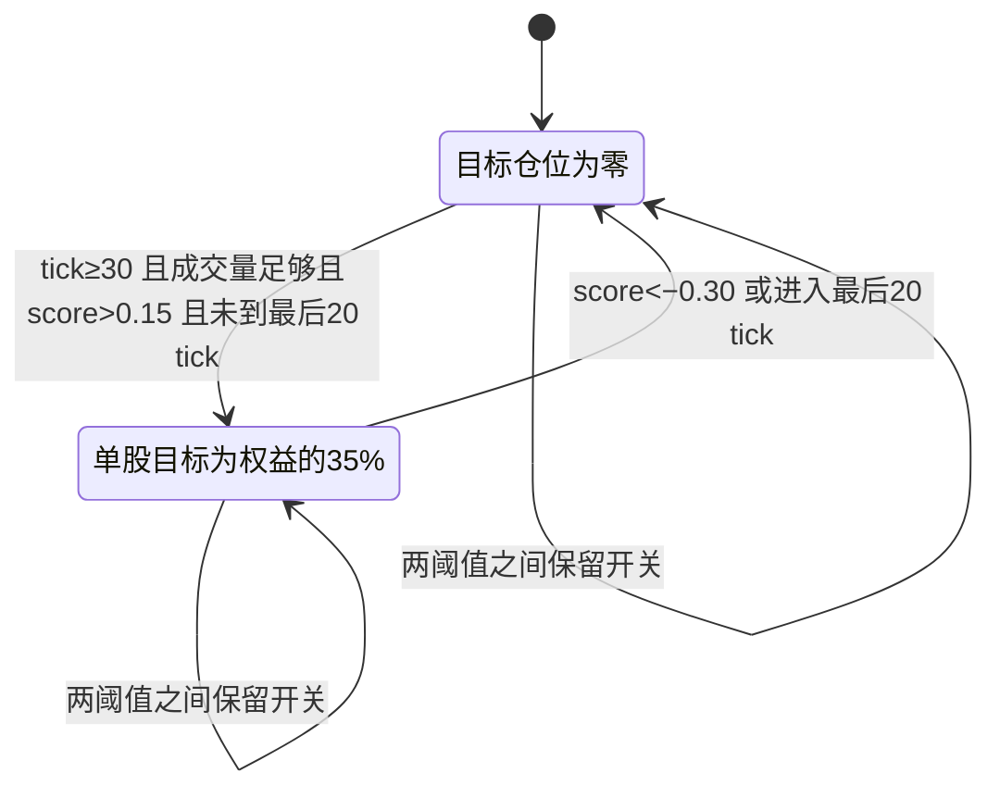

# Swift 策略特性与研究档案

Swift 是一个只依靠公共成交、盘口和价格走势的小资金交易策略。本档案集中记录它的交易规则、已验证的优势、失败条件和后续对抗研究；每项结论对应冻结版本及可复查的实验报告。

## 最新状态与 v20/v21 退化诊断（2026-10-21）

**默认基准仍为 v18；v19 支付群体、v20 分红风险、v21 背景替换都是未晋级的实验场景。** 下文 v5/v6 成绩和“当前”措辞属于对应日期的历史记录，不能作为最新市场成绩。本轮研究未修改生产 Swift、默认场景或市场规则，也没有部署参数消融中的候选。

### 分红风险与背景替换是两组不同的证据

| 独立验证，每方案 20 局 | standard 平均净收益 | early-single 平均净收益 |
|---|---:|---:|
| v20：旧 v18 世界 → 压力分红世界，保留原阵容 | +34.62% → −5.28% | +201.89% → +113.13% |
| v21：同一中等风险世界，原阵容 → Value/Coral 双替换 | +39.41% → −78.80% | +157.33% → −24.68% |

第一组说明分红风险改变确实会影响 Swift，但 early-single 在该批次平均仍有较高收益；第二组的世界、费用、初始资产和消息权限保持一致，只将匿名 Value 换成 Harbor、Coral 换成 Relay。因此不能把第二组的严重退化直接归于分红改造。两行采用不同世界种子和风险参数，不能相减后当作可叠加的归因。见 [v20 报告](dividend-v20.md)与 [v21 报告](ecology-v21.md)。

v21 原阵容的 standard 本来就不稳定：中位收益 −30.02%，仅 7/20 局盈利；双替换后中位 −92.34%，仅 1/20 盈利。early-single 则从中位 +128.11%、20/20 盈利，变为中位 −29.82%、5/20 盈利。先合并同世界的两次重复，两个账户在 10/10 世界都因双替换而收益下降；追加消融的六个新世界也重复了方向。不能只用原均值称 standard 一直稳定赚钱。

### 已支持的失败机制

- **成交对手结构改变。** 原阵容中，Coral 承接了 standard/early-single 卖出金额的 69.59%/62.76%；替换后的 Relay 在两个 Swift 全部成交金额中仅占 0.18%/0.20%。它没有接替 Coral 的实际成交服务。开发组四方案比较显示 Value 的替换也有不利影响，不能只归因于移除 Coral。成交份额不是对手从 Swift 获利的份额。
- **短线信号可兑现的优势退化。** 额外四世界逐笔记录中，新买入且随后卖出的股票，按 FIFO 买入成本加权、各局等权的价差收益：standard −0.02% → −1.21%，early-single +1.41% → −0.05%，不含初始库存、股息和费用。买入后的 30-tick 报价诊断也变差，但报价未保证足够数量，不能当作实际持有收益。
- **持续调仓放大 standard 的损失。** 双替换记录中 64.73% 的买入金额来自后续补仓，其后续报价表现比首次开仓更差；低于原持仓成本的追加买入只占全部买入金额 11.91%，所以不能将所有补仓统称为下跌摊平。Swift 使用固定分数阈值，没有估计当前环境中信号的可交易收益是否足以覆盖进出成本。
- **不是已证实的费用上涨、强平或停息套牢。** 两环境费率相同，Swift 累计费用反而下降，部分是资产缩水的结果；两个 Swift 均零强平。新记录中约 99% 买入金额发生在当前分红高于初始 25% 时，有持仓时缺买盘的观察约 0.01%–0.02%。这不排除较差退出价格、部分成交或未来削息风险。

### 已尝试但没有形成修复的方向

在六个新世界、每世界两次重复的参数消融中，仅让 standard 启用 `single_entry`，平均收益从 −76.93% 改善至 −59.12%，六个世界的配对均值均改善，但仍仅 1/12 局盈利。该参数同时改变补仓、减仓、部分退出和风险敞口，不是单独禁止摊平的实验；它是减损线索，不是合格新版本。删除深度项或动量项也没有稳定救回策略。

Horizon 作为部分买入对手时的事后报价变化较不利，提示知情卖方的选择效应值得研究；尚未单独改变其研究权限或资本，不能认定权限是 Swift 失败的原因。也不能将 Swift 亏损本身作为市场不健康的充分证据：需要分别检查真实交易能力、信息进入价格的过程、费用/分红收支及竞争者的影响。

完整过程见 [Swift v21 诊断](swift-v21-diagnosis.md)及 [事前协议](swift-v21-diagnosis-protocol.md)。复核既有 88 局，另跑 8 局只读记录与 60 局消融，共新增 68 局、1,360 次守恒审计；160,000 次决策重建与实际订单一致。记录模式影响并发时序，因此是额外比赛，不是原比赛的逐笔重放；这些世界均已使用，不得再次称为未见留出。原始运行、账目/FIFO 核对、源码与数据哈希从 [诊断汇总](swift-v21-diagnosis-results.json)进入。

## 研究策略与基准阵容的边界（2026-10-19 明确）

**按用户决定，三个 Astra 策略和 Falcon 猎手继续作为研究代码与证据保留，暂不加入默认基准，也不恢复已中止的猎手实验。** 能压低 Swift 的收益，不足以成为加入基准的理由；目前没有确认它们能为当前基准带来值得增加复杂度的覆盖。

三个 Astra 是 Swift 开发之前、三个独立代理针对 v5 编写的参赛策略；Falcon 才是后来专门研究 Swift 弱点的狩猎实现。它们不是“三个 Swift 猎手”，也不要与基准中原有的 `hunter` 策略混为一谈。

| 研究策略 | 核心方法 | 已有证据与局限 |
|---|---|---|
| `astra_a` | 沿用 Coral 历史价格分位、现金流估值与执行框架，增加本人收到的共同新闻区间池化、库存偏移、末期价值收敛 | v5 正式 20 世界平均百分位 88.10，额外 20 世界 81.66，均未达门槛 |
| `astra_b` | 同一 Coral 框架上，按整笔交易库存中点估计组合价值，使主动与被动报价的估值口径一致，并加入末期收敛 | 三方同场冠军；正式 20 世界 90.20 达标，额外 20 世界 84.65 未达标，不称为稳定打穿 |
| `astra_c` | 同一 Coral 框架上，从跨股票价格推断共同终值，增加库存偏移、价值护栏与末期收敛 | v5 正式 20 世界 89.69、额外 20 世界 82.48，均未达门槛 |
| `falcon` | 知道 Swift 代码和参数，用匿名公共成交、盘口估计其信号；不同模式分别测试抢先进出、反向交易和定时扰动等假设 | 十倍资金未形成稳定相对优势；100/300 倍资金且库存同步增加时能在多数局百分比少亏，但自身仍亏、资金损失很大且盘口质量下降 |

Astra 三条路线都从 Coral 出发，不能把独立代理开发等同于三种完全不同的交易思想，也没有证据说明在当前扩大人数、提高费用后的 v6 中加入它们会更有用。原始代码、正式/额外留出与六种顺序的同场比赛见[三方报告](astra-v5-tournament.md)，不能把旧成绩套用于当前规则。

Falcon 是一个包含多种实验模式的实现，不是八个已证实有效的独立策略。其 `relay` 用公共信号估计 Swift 开关，估计关闭时买、开启时卖；`clock` 不判断目标机会，而按时钟切换买卖制造机械扰动。其他抢先或同向路线也保留在[原始猎手报告](swift-hunt-results.md)。它不知道哪笔挂单属于 Swift，不能读取目标持仓或未来新闻。十倍资金冻结结果中 relay 仅胜 2/80、clock 胜 9/80；100/300 倍库存型两批合并各胜 64/80、62/80，但猎手平均仍亏 13.14%/10.33%。这些是旧机制的研究证据，不是当前基准成绩。

**猎手研究的重要发现是策略优势受同类竞争、库存和市场反馈影响；它没有证明一个稳定盈利、值得常驻基准的收割者。** “让 Swift 少赚”“双方都亏但猎手百分比少亏”“猎手自己赚钱”必须分别记录。大资金同时改变现金、库存、交易冲击和流动性，不能都归因于看穿代码。完整证据与停止状态见[重要发现](swift-hunter-findings.md)及下文狩猎章节。

## 挑战者角色与历史打穿结果

“挑战者”是一次 `challenge --bot 某策略` 测试中额外加入的一个账户角色，不是固定策略名，也不意味着当前总有一个 Swift 在挑战。默认现金 20,000 元、每股 20 股，可显式覆盖。基准自身包含哪些策略，由所选场景决定；测试时的额外账户不会替换基准已有账户。

| 阶段 | Swift 的身份 | 结论 |
|---|---|---|
| 原版 v5 | 额外加入的 Swift 挑战者，背景没有 Swift | 已打穿；最初旧留出 20 世界平均百分位 97.05，两批新世界合计 96.32，见[冻结验收](swift-v5.md) |
| 最初五 Swift、周期派息的 v6 | 基准已有五档 Swift，再额外加入默认 Swift 复验 | 额外账户平均百分位 60.21，4/20 进入前 25%，未通过；对应的同批 v5 复验仍通过。它是不同市场的结果，不撤销 v5 的结论 |
| 两 Swift、0.6% 费用的 v6，NewsV2 替换前 | 48 局费用/组合对照中的两个 Swift 都是基准成员，没有额外挑战者 | 已做机制与性能验证，数据不包含后续 NewsV2 背景替换 |
| 2026-10-19 的 v6：两 Swift 与 6–16 个 NewsV2 | 三类账户都属于背景阵容，NewsV2 等额替换旧 News | 用户明确暂不要求新 bot 打穿；不设正在研发或待验收的固定挑战者 |

打穿门槛仍是平均排名百分位至少 90、至少 80% 的世界进入前 25%。它衡量候选策略在指定版本中的相对表现，不能只凭总收益很高判定。CLI 默认 20 世界；各研究也有明确另定的世界数与种子。已使用的种子不能重新称为未见留出。

基准升级不要求 Swift 再打穿一次，也不自动启动新的挑战者研发。把 Swift 纳入背景，是让后续待测策略面对订单流竞争；再额外加入 Swift 只是可选的复验。所有“已打穿/未打穿”都须注明场景版本、策略参数和实验批次，不能笼统写“Swift 现在未打穿”。

## 后续版本与录制更新

**2026-10-19 NewsV2 纳入基准：** 原 6–16 个旧 News 账户已替换为 `news_v2`，人数和每账户资金/库存不变，普通 Swift 与小资金 single 保留。NewsV2 是 Swift 的成交、盘口、动量、仓位和最优价执行，加已投递的新闻方向与可信度；它与 Swift 会争抢相近机会。默认参数未调优，Astra/Falcon 不加入，版本继续称 v6，用户明确暂不要求新 bot 打穿。历史结果必须继续绑定原场景；旧 News 阵容保存在 `baseline-v6-legacy-news.toml`，具体见[当前基准](baseline-v6-current.md)。

**2026-10-19 复盘功能更新：** 当前 v6 的较早进退版启用可选 `single_entry=1`，账户名为 `swift-early-single`：同一股票一次买入成交后不补仓，退出触发后持续清仓，完全空仓才可再入场。标准版及 `single_entry` 默认值 0 保留原加减仓行为。此后源码哈希已改变；下文冻结版本的收益结论不外推到新模式。调试器增加整轮操作与 FIFO 连线，详见[交易调查台](swift-debugger.md)。

**单次入场的执行与成本发现：** 新录制中 `swift-early-single` 的 −3.63% 是最终账户收益；买卖价差扣交易费后合计仍赚 866.79 元，普通及组合分红合计 808.19 元，但闲置费为 3,047.39 元。第一单只成交几股就停止建仓，使平均持仓市值仅约为权益的 2.89%。因此“单次入场”同时改变了仓位规模、交易额抵扣与分红收入，不能仅看入场信号或胜率解释结果；详见[逐项拆账](swift-debugger.md#单次入场版为何亏损对已录制路径的拆账)。这是一条既有路径的解释，尚非只改变加仓规则的多世界因果对照。

**现金流机制更新：** 当前扩容 v6 的闲置费为每 50 ticks 平均权益的 0.6%，普通股息与组合收益都逐 tick 整仓舍入派发。新闻仍按原定生效时刻改变未来费率，终值尺度保留。当时没有修改 Swift 算法或参数；NewsV2 替换前的 12 世界四组对照中，标准版平均收益 +196.21% → +171.26%，小资金单次入场版 +118.03% → +90.95%，见[组合与费用改造报告](per-tick-combos.md)。这是机制对照，没有做挑战者打穿验收，也不能将其收益当作现在 NewsV2 阵容的成绩。用户明确接受个人时钟引起的少量权益偏差，因此没有新增同步登记。下述旧收益与审计保留为历史证据，普通股息那一轮改造见[逐 tick 派息报告](per-tick-dividends.md)。

此前普通股息改造的新旧规则各 20 世界对照中，Swift 在 v5 人群的平均收益为 +111.30% → +109.02%，当时五 Swift 的 v6 为 +10.43% → +7.07%；逐 tick v5 仍达打穿门槛，当时的 v6 仍未达。这不是当前扩容、两 Swift、0.6% 费用配置的结果。配对收益变化区间均跨过零，不能声称稳定削弱。当时逐 tick v6 的平均交易及库存估值剩余项仍约 −7248 元，普通分红约 +12393 元，费用扣除后净赚约 2588 元。**分红平滑后贡献仍大，这次改造没有证明原利润仅来自集中派息，也没有消除所有机制性收益。**

**2026-10-19 追加派息审计（改造前）：** 在 160 局已有轨迹中，15 局的全市场普通分红超过全部初始股票全程领息的统一登记上限。这些历史收益尚未排除派息权归属偏差的影响；分红占比高也不能单独证明“领完息原价卖出”。[机制报告](swift-mechanism.md)补充了挂单没有统一除息、价格逐步调整、派息总额边界与异步结算限制；[逐局审计](swift-dividend-audit.json)可复核。

**重要发现与当前状态：** 猎手研究显示，目标收益受损、猎手百分比少亏、猎手盈利是三个不同结论；资金、初始库存和同类拥挤都会改变结果。2026-10-18 已按用户要求停止继续实验。专题总结见[Swift 猎手研究：重要发现](swift-hunter-findings.md)。2026-10-19 曾完成[五个不同参数 Swift 的正式 v6 验收](baseline-v6.md)，并切换默认基准；在那一批冻结引擎与场景下，默认 Swift 挑战 v5/v6 的平均百分位为 96.51/60.21，后者未打穿。当前规则已再改变，不能沿用这一结论；原有猎手实验没有恢复。

## 策略身份和信息边界

正式策略为 [swift.rs](../crates/bots/src/swift.rs)，原始标准版交易规则冻结于提交 `5289b76`，后来另加可选 `single_entry` 模式。历史狩猎研究保持当批代码、默认参数、原有基准对手和撮合规则不变；后续研究的代码、模式、引擎及场景以各批冻结证据为准。v21 诊断保持生产实现不变，仅在实验场景中改变已有参数。

它读取公共成交的方向、数量和价格，聚合盘口、交易时钟以及自己的资金与持仓。它不读取新闻、分红预测、终值提示、世界种子或其他账户。账户权益用于仓位控制；按游戏规则收到分红不等于使用分红预测交易。

## 信号和状态

每只股票保存 10 和 30 tick 的指数衰减成交量与主动成交净量，以及 30 tick 的盘口中价均线。每次更新的衰减系数为 `exp(-经过tick数/周期)`。

`flow = (主动买入量 - 主动卖出量) / 总成交量`

`depth = (中价下方2%内买盘量 - 中价上方2%内卖盘量) / 两侧总量`

`momentum = clamp(中价/30tick中价均线 - 1, -0.1, 0.1)`

`score = 0.7×flow10 + 0.3×flow30 + 0.3×depth + 5×momentum`

公共成交没有身份标签，包含自己的成交。因此，成交信号可能受到自己的交易和其他同类策略的反馈影响。

| 规则 | 默认行为 |
|---|---|
| 启用股票仓位 | tick 至少 30、短期衰减成交量大于 10、score 大于 0.15 |
| 信号退出 | score 小于 −0.30，将该股目标清零 |
| 两阈值之间 | 保留上次的持仓开关状态，减少反复买卖 |
| 单股目标 | 当前权益的 35%，由目标金额换算股数 |
| 总目标杠杆 | 不超过 1.5，多个股票共享购买预算 |
| 买入 | 在观测到的最优卖价提交 IOC；价差超过中价的 1.2% 时不买 |
| 卖出 | 在观测到的最优买价提交 IOC |
| 未成交部分 | 等下一次观测，不扫更差价格 |
| 结束前 | 最后 20 tick 将目标清零，但空买盘可能妨碍完全平仓 |

图中是目标开关，不代表实际仓位；预算不足、未成交和流动性消失都会使实际持仓偏离目标。临近结束时退出优先于入场。

退出不是固定价格止损。仓位随权益、信号和可成交深度变化，也会因目标数量下降而减仓。IOC 成交价受限，并不保证立刻成交。

## 已完成的验证

| 研究 | 主要结果 | 证据 |
|---|---|---|
| 原版 v5 冻结验收 | 官方旧留出 20 局平均排名 97.05；两批新世界各 40 局合计 96.32 | [v5 验收](swift-v5.md) |
| 固定策略跨环境测试 | 27 类条件共 700 局，原版 v5 新 40 局平均排名 94.07、平均收益 +114.8% | [压力测试](swift-stress.md) |
| 拥挤追加诊断 | 新 20 种子下，加十个 Swift 后挑战者平均 −4.3%；加十个 Coral 后 +88.9% | [逐局结果](swift-crowding-results.json) |
| 新闻、方向、活跃度与大阳线 | 23 组 × 40 局；随机化成交方向使 v5 仅订单流策略由 +116.62% 降到 −22.67%；提高无新闻市场成交量未恢复高收益 | [机制研究](swift-mechanism.md) |
| v21 背景替换退化 | 复核 88 局，新增 8 局记录及 60 局消融；对手盘与信号收益改变，持续调仓放大 standard 损失；未部署修复 | [逐笔与消融诊断](swift-v21-diagnosis.md) |

收益均为一局游戏的总收益，包含分红、费用、利息和最终结算，不是年化或纯买卖价差。各条件重复使用种子做配对，700 局不是 700 个独立世界；新机制研究的 920 局同样只使用 40 个世界种子。

## 重要补充：盈利机制与分红（2026-10-19）

固定代码与参数，在当前引擎完成 920 局研究。最符合证据的解释是：新闻造成价值变化与账户反应，公共成交方向反映其中可利用的压力；小仓位、最优价执行和退出把部分机会转为收益。**仅仅交易热闹并不足够，也不必等大阳线已经出现才入场。** [完整机制报告](swift-mechanism.md)保留全部对照、逐世界结果、统计口径和限制。

- **成交方向的内容有用。** v5 只用真实方向平均 +116.62%，保持每次观察中的成交价、量、时间不变而随机化方向后为 −22.67%，反转方向为 −66.39%。这些干预会通过交易影响后续市场，不是固定价格回放。
- **高活跃不能替代新闻环境。** 完整 Swift 在正常 v5 平均 +136.91%，无新新闻为 +6.48%；提高随机 Noise 后，市场成交额达到正常 v5 的 1.95 倍，收益仍只有 +6.74%。成交量增加不足以解释原有优势。
- **已经出现的大阳线不是必要的买入前提。** 将过去 30 tick 中价上涨至少 1% 定为代理，禁止此时买入仍平均 +80.89%；原版 59.7% 的买入金额发生在未达到该阈值时。这不排除先买入、后经历大涨，也没有验证所有 K 线形态。
- **分红是重要收益来源。** 每局平均 v5 交易/持股估值贡献约 +28,517 元、普通及组合分红 +26,821 元，扣费后净赚 +50,828 元；v6 交易/持股估值约 −7,004 元，靠 +13,969 元分红覆盖费用后净赚 +4,133 元。前一项包含开局与期末库存估值，不能等同于已平仓价差。

同期新增 [News 修复与增强版](news-v2.md)。补全事件生命周期的 `news_fixed` 没有提高平均收益；结合收到的新闻与 Swift 执行的 `news_v2`，当时 v5/v6 平均收益为 +151.24%/+21.24%，分别超过同批 Swift 14.33/10.22 个百分点，但仍未打穿当时的 v6。那批研究保持了正式 Swift 与背景旧 News；当前 v6 已另行采用 NewsV2，见本页开头。

## 已观察到的特性

2026-10-19 针对单次入场版另做了 [60 局资金与背景扩容对照](v6-population.md)。12 个新世界中，仅将现金和初始股票缩为十分之一，平均每局总收益由 +6.48% 升至 +102.76%，亏损由 4/12 变为 0/12；平均绝对利润约 2,390 元升至 3,810 元。采用更多背景挂单账户后平均 +99.65%、绝对利润约 3,693 元，价差和典型跳价更小。该模式任何正成交后不能补仓，本金过大时实际仓位很小、费用相对沉重；缩小本金改善资金与首单容量的匹配，但并不保证满额成交。此处是新的单次入场参数档，不能与下列旧版 Swift 数据混合，也不是打穿验收。

- **容量有限。** 本金 0.1 倍的 20 局平均收益 +303.7%；10 倍为 +7.8%；100 倍的 40 局为 −9.8%，37 局亏损。小资金提高收益率不等于提高绝对利润。
- **退出很重要。** 关闭负向信号退出的 20 局中位收益 −14.8%，平均最大回撤 47.1%，最差回撤 80.9%。此对照仍保留仓位调整与临近结束退出。
- **依赖及时决策。** 每 20 tick 决策一次，平均排名降至 55.95，20 局中 10 局亏损。这是降频实验，不是网络延迟实验。
- **消息冲击和流动性影响收益。** 持续高波动下表现强；无新消息时平均收益仅 +3.4%；移除大资金网格对手后为 +18.9%。这些配置同时改变市场反应，不能据此把利润全部归给某类对手。
- **拥挤与注册顺序有关。** 十个同类竞争者会削弱最后加入者；整组 11 个 Swift 平均仍为 +2.51%，最早加入者明显占优，不能表述成每个 Swift 都亏损。
- **不依赖所有辅助项。** 只保留主动成交方向仍通过 v5 门槛；取消杠杆、等权益纯现金开局也通过。尚未据此修改正式策略。

## 解释和待验证问题

2026-10-19 的[机制研究](swift-mechanism.md)已进一步支持成交方向的信息价值，并排除“只要成交更活跃就能恢复高收益”和“必须在大阳线之后买入”这两种简单解释。收益中分红与交易/持股估值已单独拆账，但并没有把全部因果机制逐一隔离。

仍需区分真实价值变化、其他账户的反应滞后、同类抢先消耗机会、公共成交反馈与注册/调度顺序各自贡献多少。猎手研究已经证明某些对手能降低 Swift 收益，但无法据此把损失归为对手赚走的利润。当前对照没有在完全一致的成交量、价差和价格路径上只改变新闻。

模拟股票按有限剩余分红定价，本轮跨市场实验没有覆盖完整净上涨、下跌和横盘周期。不能将游戏成绩直接解释为真实品种的炒单盈利能力。

## 单一狩猎者研究

研究目标：一个知道 Swift 默认代码和参数、初始现金及持股均为其十倍的对手，能否在收益率上胜过 Swift，并相对于同资金对照降低 Swift 的收益。

这项原始实验始终只保留一个正式 Swift。狩猎者只能使用公共匿名行情和自己的账户；不能读取 Swift 的仓位、订单身份、内部状态或世界未来。事后分析可以读取成交双方身份，不能把分析结果回传为当局交易输入。

收益率相对胜出、双方都亏时谁亏得少、狩猎者绝对损益，以及相对无针对性对照的目标收益变化，分别报告。增加账户或少交易本身造成的差异不算已证明的狩猎能力。交换注册顺序，并将开发世界与冻结验收世界分开。

已完成 [单一狩猎者研究](swift-hunt-results.md)：192 局开发、440 局冻结验收，共 632 局。七条针对性路线与一个定时扰动对照均未形成稳定相对胜出；所有失败路线保留。

| 冻结处理 | Swift 平均收益 | 十倍资金对手平均收益 | 对手胜局 |
|---|---:|---:|---:|
| 公开信号反馈 relay | +41.85% | −29.08% | 2/80 |
| 每 20 tick 换方向 clock | +25.94% | −17.64% | 9/80 |
| 同资金持现金对照 | +121.70% | −11.93% | 0/80 |
| 同资金默认 Coral | +109.54% | +22.00% | 6/80 |

clock 的 80 局中有 26 局双方都亏，其中 8 局对手亏得更少。第一批种子 11013、对手先加入的例子中，Swift 亏约 40.13%，对手亏约 15.09%；这是可复查的成功个例，不是稳定总体优势。

相对持现金对照，clock 自身平均额外少赚 5.71 个百分点，Swift 少赚 95.76 个百分点。新证据支持 Swift 的收益对周期性成交扰动敏感；同时，降低目标收益与狩猎者最终相对胜出是不同的指标。两种注册顺序按种子聚类统计，开发集不并入验收。

relay 和 clock 不留下可与 Swift 直接成交的挂单，双方直接成交额为零；压制通过市场中其他交易者、价格和成交反馈发生。不能把目标收益损失描述为狩猎者直接赚走的钱。

## 增加猎手资金：现金、库存与交易量必须分开

本轮追加 1,420 局完整矩阵、380 局独立确认、340 局现金/库存机制核验，共 2,140 局，全部维持一个原版 Swift。代码与配置按批次冻结；[资金报告](swift-capital-results.md)、[现金机制核验](swift-capital-cash-results.md)保留全部失败候选。

仅增加备用现金、把仓位额度固定在 10 倍 Swift 初始权益，并没有形成稳定相对优势。将本金、初始股票与交易规模同时放大，relay 100/300 倍组在矩阵内胜出；第一批独立确认各胜 31/40 局，但平均收益差的 95% 区间跨零。随后预先写定的机制核验中，同两组各胜 33/40、31/40 局，平均收益差区间均在零以上。

两批选择后世界的[补充合并](swift-capital-postselection.md)不含选参矩阵，各档为 40 个新种子、80 局。这是报告阶段的描述性合并，不冒充新的预注册检验：

| 开局结构 | 猎手倍率 | Swift 平均收益 | 猎手平均收益 | 猎手胜局 | 平均收益差 95% 区间 |
|---|---:|---:|---:|---:|---:|
| 股票与资金同步放大 | 100 | −26.20% | −13.14% | 64/80 | [+4.67, +20.35] 个百分点 |
| 股票与资金同步放大 | 300 | −23.42% | −10.33% | 62/80 | [+4.53, +20.66] 个百分点 |
| 只新增现金、放大交易 | 100 | −13.85% | −16.32% | 23/40 | [−14.89, +7.31] 个百分点 |
| 只新增现金、放大交易 | 300 | −14.17% | −12.82% | 22/40 | [−12.90, +12.37] 个百分点 |

最后两行仅来自 17000 段机制核验，每档 20 个新种子、40 局，不与上两行混为同一组样本。新增现金组初始仍每标的 200 股，余下资本全部为现金；与库存组的总权益、仓位额度和普通信号脉冲股数相同。其相对收益尚未获得明确支持，说明先有库存对这类反馈卖出策略有实际帮助。

relay 按 Swift 的公共信号估计持仓开关，估计开启时卖、关闭时买；不是知道 Swift 的真实持仓，也不是拦截其订单。普通交易使用最优价 IOC，双方直接成交额为零。成效只能经其他交易者、价格与公共成交信号传播。

**有钱确实能破坏小策略的优势，但代价很高，且不是单纯靠看穿参数获利。** 100/300 倍库存组的猎手总权益约为整个原背景的 1.30/3.90 倍，拥有全市场约 51%/76% 的初始股票。两批合并中猎手平均亏约 48.8 万/115.0 万元，Swift 亏约 0.97 万/0.87 万元。百分比少亏并不等于金额少亏。

这些大额 relay 世界没有一个通过全部市场质量阈值，双边盘口覆盖率明显下降。现金主动组也出现流动性恶化，而不是保持正常盘口条件下精确捕捉目标。这限制了“狩猎成功”的解释：目标平均受损得到支持，稳定盈利没有得到支持。闲置费也一直计入全部本金，增加现金不使损失率自动趋于零。

## 多 Swift 研究已中止

原计划 720 局，已完成 500 局成组数据；另有未完成配置的 8 个原始世界摘要，保留但排除统计。1、3 个 Swift 的完整处理已完成，5 个的 100 倍 relay 未完成，10 个尚未开始。没有补跑或根据当前结果继续优化。

无猎手时，1/3/5 个 Swift 的全组平均收益分别为 +104.44%/+45.12%/+29.55%。100 倍现金 relay 对三个 Swift 平均 −15.59%，Swift 全组 −22.77%，胜过组均值 25/40、胜过全部个体 21/40；但平均相对收益区间仍跨零。拥挤效应明显，稳定狩猎优势尚不能据此确立。

[中止报告](swift-crowding-hunt-results.md)同时保留全部完成的对照、按位置和注册顺序的结果；[中止记录](swift-crowding-hunt-stopped.json)列明未完成部分。原有实验 stage 已加中止标记，运行器会拒绝误续跑。

## 复查入口

- [v21 退化诊断：成交对手、逐笔账目与参数消融](swift-v21-diagnosis.md)
- [v21 诊断协议与样本边界](swift-v21-diagnosis-protocol.md)
- [v21 诊断数据与冻结哈希入口](swift-v21-diagnosis-results.json)
- [原始验收数据](swift-v5-results.json)
- [跨环境预定方案](swift-stress-plan.json)
- [跨环境逐局数据与置信区间](swift-stress-results.json)
- [完整压力测试图](swift-stress-overview.png)
- [策略信息边界和执行测试](../crates/bots/src/swift_tests.rs)
- [资金矩阵、独立确认及冻结协议](swift-capital-results.md)
- [现金与初始库存机制核验](swift-capital-cash-results.md)
- [多 Swift 狩猎冻结方案](swift-crowding-hunt-protocol.md)
- [猎手重要发现与后续基准决策](swift-hunter-findings.md)
- [正式 v6 的五个 Swift 参数档与验收](baseline-v6.md)
- [新闻、成交方向、活跃度与大阳线的机制研究](swift-mechanism.md)
- [News 修复、增强版与同批 Swift 比较](news-v2.md)
- [920 局机制实验完整结果](news-swift-results.json)

后续若修改 Swift，必须另建候选版本，保留本档案中的冻结对象；已使用的验收世界不能重新标为未见留出集。
