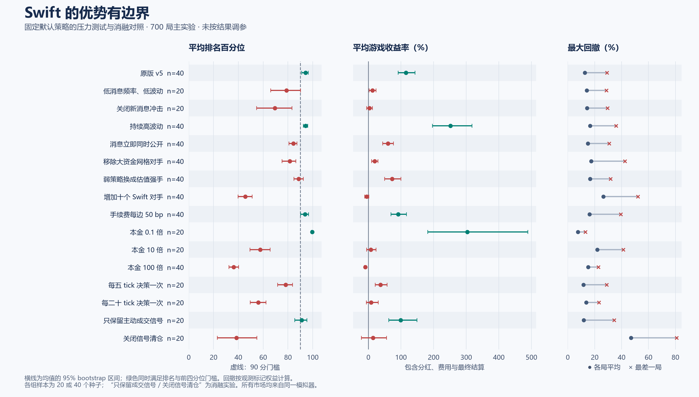

# Swift 跨模拟市场压力测试

完成 **780 局运行**：27 类主实验、35 个批次共 700 局，另做 80 局拥挤效应诊断。Swift 默认代码与参数没有按结果调整。

**Swift 有明确的适用边界，不能在所有模拟市场里维持优势。** 原版 v5 的成绩得到新种子复核；同策略拥挤、本金放大、降低决策频率、减少消息冲击和移除主要流动性提供者，均会明显改变表现。

## 实验方法

- 原策略冻结于提交 5289b76，本轮没有修改 crates/bots 或 crates/market。测试程序只记录每次决策前的权益；降频实验才合并成交数据并减少策略调用。
- 7001–7020 运行所有 27 类；预先指定的 8 类重点环境再用 8001–8020 复核。各条件样本量为 20 或 40，不能把全部运行当作 700 个独立样本。
- 相同种子用于配对，但更改规则或对手后价格内生变化，不能当作同一路径回放。
- 资金对照同时同比缩放现金和股票；纯现金开局对照使用对应 v5 世界的相同初始权益。
- 去盘口、去动量、关闭信号退出、取消杠杆和持现金均标为消融/对照，没有据此替换正式 Swift。手续费变化适用于所有账户。
- 决策每 5/20 tick 一次是降频测试，不是网络延迟测试，tick 不能换算为现实秒数。
- 生成器没有独立的牛熊漂移开关。低波动和无消息场景不直接称为横盘市，另按实际价格净变化做事后分组。

## 全部条件

过线门槛沿用 v5：平均百分位至少 90，且至少 80% 的局数进入前四分位。更换对手后名次含义也变化，需同时看绝对收益与亏损局数。

| 条件 | 局数 | 平均排名 | 前25% | 平均收益 | 中位收益 | 亏损局数 | 平均/最差最大回撤 | 过线 |
|---|---:|---:|---:|---:|---:|---:|---:|---|
| 原版 v5 | 40 | 94.07 | 97.5% | +114.8% | +101.3% | 1/40 | 12.7% / 29.2% | 是 |
| 低消息频率、低波动 | 20 | 78.73 | 75.0% | +12.5% | +8.0% | 6/20 | 14.0% / 28.7% | 否 |
| 持续高波动 | 40 | 94.26 | 100.0% | +251.8% | +225.1% | 0/40 | 16.6% / 36.0% | 是 |
| 关闭新消息冲击 | 20 | 69.46 | 65.0% | +3.4% | +2.0% | 9/20 | 14.2% / 29.5% | 否 |
| 消息立即同时公开 | 40 | 84.25 | 87.5% | +59.8% | +51.0% | 5/40 | 14.8% / 30.7% | 否 |
| 消息传播慢四倍 | 20 | 93.99 | 100.0% | +67.6% | +61.9% | 2/20 | 10.6% / 21.0% | 是 |
| 移除大资金网格对手 | 40 | 81.45 | 80.0% | +18.9% | +12.1% | 10/40 | 17.3% / 42.4% | 否 |
| 弱策略换成估值强手 | 40 | 88.67 | 90.0% | +72.6% | +68.2% | 1/40 | 16.6% / 31.8% | 否 |
| 增加十个 Swift 对手 | 40 | 45.57 | 2.5% | -5.1% | -3.7% | 22/40 | 26.3% / 52.1% | 否 |
| 手续费每边 20 bp | 20 | 92.27 | 95.0% | +103.7% | +67.0% | 1/20 | 13.8% / 39.6% | 是 |
| 手续费每边 50 bp | 40 | 93.81 | 95.0% | +91.3% | +76.9% | 2/40 | 16.1% / 39.5% | 是 |
| 取消闲置费及交易抵扣 | 20 | 94.37 | 95.0% | +135.8% | +98.2% | 1/20 | 10.2% / 22.5% | 是 |
| 最小报价单位十倍 | 20 | 89.89 | 90.0% | +104.4% | +62.4% | 1/20 | 14.2% / 30.6% | 否 |
| 所有人只看一档盘口 | 20 | 95.44 | 100.0% | +118.1% | +88.2% | 1/20 | 10.0% / 19.2% | 是 |
| 本金 0.1 倍 | 20 | 99.46 | 100.0% | +303.7% | +193.4% | 0/20 | 7.6% / 13.1% | 是 |
| 本金 10 倍 | 20 | 57.65 | 15.0% | +7.8% | +3.2% | 8/20 | 21.9% / 41.3% | 否 |
| 本金 100 倍 | 40 | 36.15 | 2.5% | -9.8% | -11.6% | 37/40 | 15.0% / 22.7% | 否 |
| 等初始权益、纯现金开局 | 20 | 94.70 | 95.0% | +125.3% | +83.7% | 1/20 | 12.8% / 32.0% | 是 |
| 每五 tick 决策一次 | 20 | 78.07 | 70.0% | +37.3% | +28.2% | 2/20 | 11.7% / 28.9% | 否 |
| 每二十 tick 决策一次 | 20 | 55.95 | 5.0% | +8.2% | -0.2% | 10/20 | 13.6% / 23.1% | 否 |
| 只保留主动成交信号 | 20 | 90.95 | 95.0% | +99.2% | +62.5% | 1/20 | 11.9% / 34.5% | 是 |
| 去掉盘口信号 | 20 | 95.05 | 100.0% | +109.5% | +63.1% | 1/20 | 11.9% / 20.7% | 是 |
| 去掉动量信号 | 20 | 93.02 | 95.0% | +99.5% | +74.0% | 1/20 | 12.0% / 24.4% | 是 |
| 关闭信号清仓 | 20 | 38.52 | 25.0% | +14.0% | -14.8% | 12/20 | 47.1% / 80.9% | 否 |
| 不使用杠杆 | 20 | 94.64 | 100.0% | +100.9% | +68.3% | 1/20 | 9.4% / 17.0% | 是 |
| 卖出初始股票后不再买入 | 20 | 35.84 | 0.0% | -12.8% | -12.7% | 20/20 | 13.1% / 16.0% | 否 |
| 原版 v5 同种子重复 | 20 | 94.02 | 95.0% | +115.0% | +71.2% | 1/20 | 13.7% / 28.9% | 是 |

收益是本局游戏收益，不是年化。正常分红、费用、利息和最终结算均包含在内。回撤从初始权益、每次决策前的标记权益和最终结算计算，不等于流动性枯竭时能实现的清仓价值。

## 第二批复核

| 条件 | 第一批排名 / 收益 | 第二批排名 / 收益 |
|---|---:|---:|
| 原版 v5 | 93.96 / +120.6% | 94.18 / +108.9% |
| 持续高波动 | 95.24 / +275.8% | 93.29 / +227.8% |
| 消息立即同时公开 | 85.46 / +64.5% | 83.05 / +55.1% |
| 移除大资金网格对手 | 80.31 / +15.7% | 82.59 / +22.1% |
| 弱策略换成估值强手 | 84.77 / +70.1% | 92.58 / +75.1% |
| 增加十个 Swift 对手 | 43.46 / -9.1% | 47.69 / -1.1% |
| 手续费每边 50 bp | 92.52 / +90.5% | 95.11 / +92.0% |
| 本金 100 倍 | 35.75 / -10.8% | 36.55 / -8.8% |

## 哪部分规则更关键

仅比较 7001–7020。区间按配对种子差异做 3,000 次 bootstrap，包含市场因策略改变产生的反馈。

| 对照 | 平均排名 | 平均收益 | 相对默认策略的收益差（百分点） | 差异95%区间 |
|---|---:|---:|---:|---:|
| 默认策略 | 93.96 | +120.6% | — | — |
| 只保留主动成交信号 | 90.95 | +99.2% | -21.4 | [-35.5, -7.3] |
| 去掉盘口信号 | 95.05 | +109.5% | -11.1 | [-27.5, +6.8] |
| 去掉动量信号 | 93.02 | +99.5% | -21.0 | [-45.7, +1.6] |
| 关闭信号清仓 | 38.52 | +14.0% | -106.6 | [-128.4, -85.6] |
| 不使用杠杆 | 94.64 | +100.9% | -19.7 | [-30.1, -9.3] |
| 卖出初始股票后不再买入 | 35.84 | -12.8% | -133.4 | [-182.8, -90.9] |

主动成交方向单独仍能过线；关闭负向信号清仓会大幅恶化表现。盘口与动量是辅助项，当前证据不支持把每一项都描述为不可缺少。关闭信号退出时，仓位数量调整和最后 20 tick 清仓仍保留，并非禁止所有卖出。

## 容量

同样只比较第一批配对世界。放大现金和股票会改变市场供需，属于有市场影响的容量测试。

| 资金规模 | 平均初始权益（元） | 平均净利润（元） | 平均收益率 |
|---|---:|---:|---:|
| 本金 0.1 倍 | 3,691 | +11,158 | +303.7% |
| 原版 v5 | 36,914 | +44,448 | +120.6% |
| 本金 10 倍 | 369,138 | +28,417 | +7.8% |
| 本金 100 倍 | 3,691,376 | -400,054 | -10.8% |

小资金提高的是收益率与进出灵活性，不等于绝对利润更高：本组十分之一本金的平均利润仍低于标准本金。

## 拥挤与顺序

11 个 Swift 的等权平均收益为 **+2.51%**。以下同时列出其他副本，避免只看最后加入的挑战者。

| Swift 顺序 | 平均收益率 | 亏损局数 |
|---|---:|---:|
| swift#0 | +54.27% | 3/40 |
| swift#1 | +19.07% | 17/40 |
| swift#2 | +5.42% | 19/40 |
| swift#3 | -1.08% | 22/40 |
| swift#4 | -4.29% | 22/40 |
| swift#5 | -7.64% | 22/40 |
| swift#6 | -8.45% | 25/40 |
| swift#7 | -8.67% | 25/40 |
| swift#8 | -8.39% | 24/40 |
| swift#9 | -7.53% | 25/40 |
| challenger | -5.09% | 22/40 |

同一策略在不同位置的表现有明显差异，不能忽略先后获取短期机会的影响。尚未分离线程调度、排队顺序、共同追单和自身交易反馈的各自贡献。

发现首批拥挤失败后，追加以下诊断实验，用新种子 9001–9020；这部分不冒充最初预注册实验。三种新增对手处理的账户数和初始资金相同，使用冻结 Swift 和原 llm-market 可执行文件。

| 追加对照 | 平均排名 | 平均收益 | 中位收益 | 亏损局数 |
|---|---:|---:|---:|---:|
| 不增加账户 | 95.64 | +106.0% | +79.1% | 0/20 |
| 增加10个默认Swift | 43.85 | -4.3% | -11.6% | 15/20 |
| 增加10个默认Coral | 96.36 | +88.9% | +73.0% | 0/20 |
| 增加10个卖出初始股票后持现金的账户 | 95.85 | +114.5% | +107.1% | 0/20 |

增加同款 Swift 的损害在新种子下再次出现，增加等量 Coral 或持现金账户则没有出现同样的崩塌。这支持同策略竞争是关键条件；但没有把执行顺序、信号共同反应和自身成交反馈分别控制，不能指定其中一个为唯一原因。

## 市场状态

不满足原 v5 全部质量检查的场景也保留。无消息场景自然减少估值穿越，不能仅凭这一项认定市场失效。

| 条件 | 双边盘口覆盖 | 成交覆盖 | 中位价差的跨局均值 | 薄侧深度/典型成交 |
|---|---:|---:|---:|---:|
| 原版 v5 | 99.5% | 98.6% | 0.356% | 10.4 |
| 低消息频率、低波动 | 99.6% | 97.9% | 0.211% | 19.5 |
| 持续高波动 | 95.9% | 99.4% | 0.698% | 3.3 |
| 关闭新消息冲击 | 99.6% | 97.7% | 0.195% | 21.9 |
| 消息立即同时公开 | 99.6% | 98.2% | 0.324% | 12.4 |
| 消息传播慢四倍 | 99.5% | 98.9% | 0.364% | 10.0 |
| 移除大资金网格对手 | 94.1% | 95.6% | 2.531% | 1.2 |
| 弱策略换成估值强手 | 99.5% | 96.9% | 0.435% | 10.5 |
| 增加十个 Swift 对手 | 99.0% | 98.4% | 0.469% | 7.7 |
| 手续费每边 20 bp | 99.4% | 98.7% | 0.347% | 10.8 |
| 手续费每边 50 bp | 99.6% | 98.7% | 0.331% | 11.7 |
| 取消闲置费及交易抵扣 | 99.6% | 98.2% | 0.320% | 10.8 |
| 最小报价单位十倍 | 96.5% | 98.2% | 0.614% | 8.6 |
| 所有人只看一档盘口 | 99.4% | 98.6% | 0.392% | 10.7 |

价格净变化的事后分组，仅计市场环境组；重复种子不作独立样本显著性推断：

- 价格净降 5%–30%：30 次运行，平均排名 87.89，中位收益 +191.3%，亏损 1 次。
- 价格净降超过 30%：390 次运行，平均排名 84.44，中位收益 +48.1%，亏损 61 次。

这些分组使用各股票首末双边盘口中价涨跌幅的中位数。本次没有净上涨或净变化 ±5% 内的市场组样本，不能声称已覆盖完整牛熊横盘周期。游戏股票按有限剩余分红定价，随着分红派发，剩余现金流期限缩短；净价格下降不能直接等同现实熊市。

## 收益构成

原版 v5 的平均总收益 +114.8%，其中已到账普通及组合分红相当于初始权益的 68.2%；将这些分红从总损益中扣除，剩余 +46.6%。平均累计成交额为初始权益的 60.8 倍，交易费、闲置费和利息合计相当于初始权益的 11.0%。
这只是同一场运行的账务分解。分红也会影响价格、再投资和对手行为，不能据此预测取消分红后的收益。收益并不全是短线买卖价差。

## 验证与限制

- 共 **4680 次账务审计**；全体账户跳过 **0** 次、bot 错误 **0** 次、停用 **0** 次。
- cargo fmt --check、严格 Clippy 和全部 36 项 Rust 测试通过。逐局权益记录必须完整覆盖 3,000 次观测；源码、场景及两个实验可执行文件的冻结哈希在实验后重新核对一致。
- 同种子重复的默认 v5，平均排名差 +0.06，平均收益差 -5.60 个百分点，反映多线程路径不确定性。
- 95%区间为描述性 bootstrap 区间，未做多重比较校正。平均盈利不代表每局盈利，排名过线也不是实盘盈利证据。
- 所有环境仍来自同一分红驱动、不能做空的模拟器；没有真实交易所延迟、完整撤单事件流或实盘逐笔回放，不能据此断言适用于所有牛熊市或现实品种。
- 减去分红后的损益仅是账务分解。取消分红也会改变价格和其他策略，因此不能把这一列当作无分红世界的收益。

## 复现与产物

    cargo build --release --bin swift-eval
    python tools/swift_stress.py prepare --out runs/swift-stress-replay
    python tools/arena_gate.py --cwd . -- python tools/swift_stress.py run --out runs/swift-stress-replay
    python tools/swift_stress_report.py --out runs/swift-stress-replay
    python tools/swift_stress_plot.py

使用新的输出目录，避免覆盖历史结果。脚本冻结配置、源码和二进制哈希；run 可跳过已完成批次，遇到未完成批次则保留现场并停止。统计和作图脚本不参与交易。作图另需 matplotlib；可用 python -m pip install --target runs/swift-analysis-deps matplotlib 安装到独立目录。Windows 若全局 sccache 不可用，构建时将子进程环境 RUSTC_WRAPPER 设为空。

- [主实验预定方案](swift-stress-plan.json)
- [全部逐局结果与区间](swift-stress-results.json)
- [追加拥挤诊断](swift-crowding-results.json)
- [可导出统计图](swift-stress-overview.svg)
- 原始输出：runs/swift-stress-20261018 与 runs/swift-crowding-20261018。
